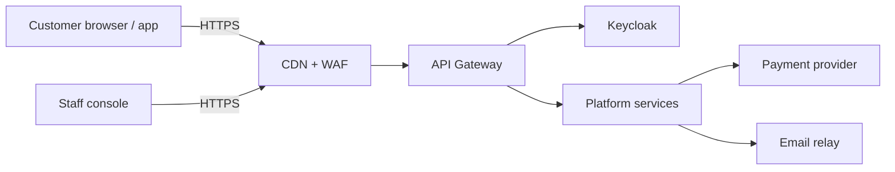
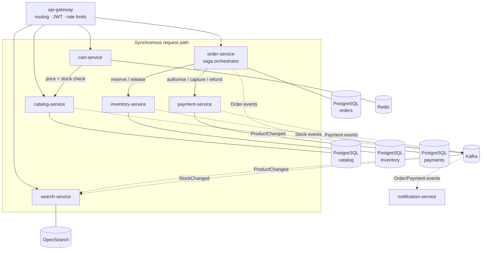
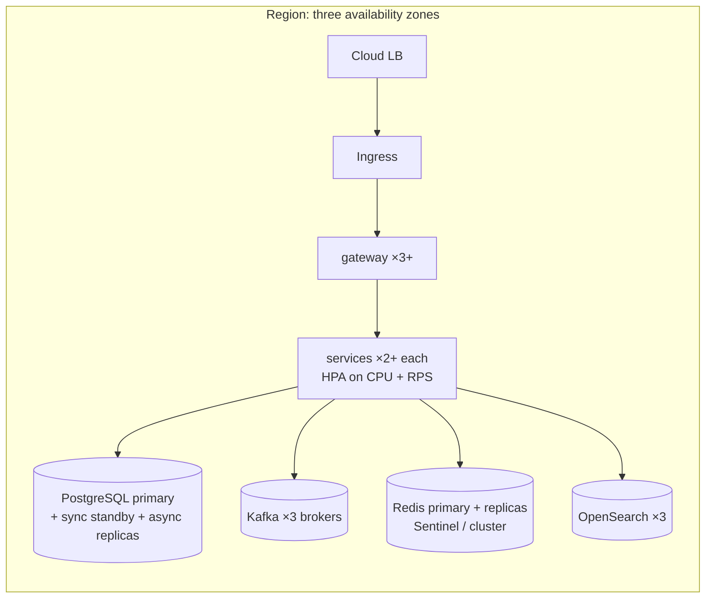

# E-commerce platform: system design specification

| | |
|---|---|
| Status | Draft 1 |
| Scope | Online store: catalogue, search, cart, checkout, inventory, payments, notifications |
| Stack | Java 25, Gradle, Spring Boot 4, PostgreSQL, Cassandra, Redis, OpenSearch, Kafka, MinIO, Keycloak, Kubernetes |

## Contents

1. [Problem statement](#1-problem-statement)
2. [Requirements](#2-requirements)
3. [Capacity estimates](#3-capacity-estimates)
4. [Architecture](#4-architecture)
5. [Services](#5-services)
6. [Key flows](#6-key-flows)
7. [Data design](#7-data-design)
8. [Cross-cutting concerns](#8-cross-cutting-concerns)
9. [Technology choices](#9-technology-choices)
10. [Deployment](#10-deployment)
11. [Failure modes](#11-failure-modes)
12. [Extensions](#12-extensions)
13. [Scalability, modularity and performance](#13-scalability-modularity-and-performance)
14. [Polyglot persistence](#14-polyglot-persistence)
15. [Design patterns applied](#15-design-patterns-applied)

---

## 1. Problem statement

Build the backend of an online store that lets customers:

* browse and search a large catalogue;
* keep a cart;
* check out and pay;
* follow their orders.

The system must:

* stay responsive at peak traffic, such as a sales event;
* never sell stock it does not have;
* never charge a customer twice for one order;
* keep working in a degraded mode when a dependency fails.

## 2. Requirements

### 2.1 Functional

| ID | Requirement |
|---|---|
| F1 | Customers can browse categories and view product details (price, images, attributes, availability). |
| F2 | Customers can run full-text search with filters (category, price range, brand, attributes), sorting and pagination. |
| F3 | Guests and signed-in customers keep a cart. A guest cart merges into the account cart on sign-in. |
| F4 | Checkout turns a cart into an order. It reserves stock, takes payment and confirms the order, or fails cleanly with nothing charged and nothing held. |
| F5 | Customers see their order history and status (`PENDING`, `CONFIRMED`, `CANCELLED`, `SHIPPED`, `DELIVERED`). |
| F6 | Customers can cancel an order before it ships. Stock is released and the payment is refunded. |
| F7 | Staff manage products, categories, prices and stock levels. |
| F8 | Customers receive email for order confirmation, cancellation and shipping. |
| F9 | Registration and sign-in use OpenID Connect, with roles `customer` and `staff`. |
| F10 | Customers can rate and review products they bought; product pages show the rating summary and the newest reviews. |
| F11 | Staff upload product images directly to object storage; the platform never proxies the image bytes. |

### 2.2 Non-functional

| ID | Quality | Target |
|---|---|---|
| N1 | Availability | 99.95% monthly for browse, search and cart; 99.9% for checkout |
| N2 | Latency (p99, server side) | Product page ≤ 150 ms, search ≤ 300 ms, add to cart ≤ 100 ms, place order ≤ 1.5 s |
| N3 | Throughput | Steady 2,000 read rps, peak 25,000 read rps; peak 500 orders/s during flash sales |
| N4 | Consistency | Stock and payments are strongly consistent within their service; data across services is eventually consistent, typically < 1 s |
| N5 | Durability | No acknowledged order or payment is lost (synchronous replication, RPO ≈ 0); RTO ≤ 15 min |
| N6 | Correctness | No overselling; at most one successful charge per order; every event is processed effectively once |
| N7 | Security | OWASP ASVS L2; TLS everywhere; no card data stored (the provider tokenises it); least-privilege service accounts |
| N8 | Scalability | Each service scales horizontally and is stateless apart from its own datastore |
| N9 | Operability | Traces, metrics and logs for every request; SLO burn-rate alerts; zero-downtime deploys |
| N10 | Evolvability | Services deploy independently; contracts are versioned and backward compatible |

## 3. Capacity estimates

The assumptions are deliberately round numbers. The design must hold at 10× these figures without changing its architecture.

| Input | Value |
|---|---|
| Monthly active users | 10 M |
| Daily active users | 1 M |
| Page or API reads per DAU | 25 |
| Orders per day | 100 k (peak day 1 M) |
| Products (SKUs) | 5 M |
| Average product document | 5 KB (search) / 2 KB (relational) |
| Average order | 2 KB including lines |

**Traffic**

* **Reads:** 25 M per day is about 290 rps on average. With a ×8 daily peak and ×10 for an event, that is up to 25 k rps. Most of it is served from the CDN, Redis and OpenSearch, not from PostgreSQL.
* **Writes:**
  * **Orders:** 100 k per day is about 1.2 orders/s on average. A flash sale is designed for 500 orders/s.
  * **Each order** causes about 10 internal events, so peak Kafka load is about 5 k msg/s. That is far below a single broker's limit; three brokers are for durability.
  * **Cart writes:** about 10 per order, roughly 5 k/s at peak, handled by Redis.

**Storage (per year)**

| Data | Size |
|---|---|
| Catalogue (PostgreSQL) | 5 M × 2 KB ≈ 10 GB |
| Search index | 5 M × 5 KB ≈ 25 GB, × 2 replicas = 50 GB |
| Orders | 100 k/day × 2 KB × 365 ≈ 73 GB/year (partitioned by month) |
| Payments | about 30 GB/year |
| Kafka | 7-day retention × 5 k msg/s peak × 1 KB; under 100 GB per broker in practice |
| Carts (Redis) | 2 M active carts × 2 KB ≈ 4 GB, 30-day expiry |

**Connections**

At 500 orders/s with about 5 queries each, the order database runs about 2.5 k queries/s. That is comfortable for one PostgreSQL primary using PgBouncer and about 50 pooled connections. Read replicas serve order history.

## 4. Architecture

### 4.1 Context



### 4.2 Containers



### 4.3 Architectural principles

1. **Database per service.** No service reads another service's tables. Data is shared through APIs and events only.
2. **Synchronous calls for decisions, events for propagation.**
   * Checkout calls inventory and payment directly, because it needs an answer now.
   * Everything else (search indexing, notifications, analytics) reacts to events.
3. **No dual writes.** A service changes its state and records the outgoing event in the same database transaction (**transactional outbox**). A relay publishes the outbox rows to Kafka.
4. **Idempotency everywhere.**
   * Commands carry idempotency keys.
   * Consumers deduplicate by event id.
   * Calls to the payment provider carry the provider's idempotency key.
5. **Fail fast and degrade gracefully.**
   * Every remote call has a timeout.
   * Circuit breakers protect callers.
   * Browse and search keep working when checkout dependencies are down.
6. **Stateless compute.** Pods keep no session state, so any replica can serve any request and autoscaling is safe.
7. **Hexagonal services.** The domain is free of framework code; adapters are replaceable; ArchUnit enforces the rule.

## 5. Services

| Service | Responsibility | Store | Publishes | Consumes |
|---|---|---|---|---|
| **api-gateway** | TLS end, routing, JWT validation, rate limiting, request ids, CORS | Redis (rate-limit buckets) | | |
| **catalog-service** | Products, categories, prices, attributes, media; source of truth for product data | PostgreSQL (+ MinIO for images) | `ProductChanged`, `PriceChanged` | |
| **search-service** | Full-text and faceted search; read model of catalogue plus availability | OpenSearch | | `ProductChanged`, `StockChanged` |
| **cart-service** | Carts for guests and customers; validates price and availability on read | Redis | `CartCheckedOut` | `PriceChanged` |
| **inventory-service** | Stock per SKU and warehouse; reservations with expiry; atomic decrement | PostgreSQL | `StockReserved`, `StockReservationFailed`, `StockReleased`, `StockChanged` | `OrderCancelled` |
| **order-service** | Order lifecycle; checkout **saga orchestrator**; idempotent order placement | PostgreSQL | `OrderPlaced`, `OrderConfirmed`, `OrderCancelled` | `PaymentCaptured`, `PaymentFailed` |
| **payment-service** | Payment intents; authorise, capture, refund through a provider port | PostgreSQL | `PaymentAuthorized`, `PaymentCaptured`, `PaymentFailed`, `PaymentRefunded` | |
| **review-service** | Ratings and reviews per product; rating summaries | Cassandra | `ReviewPosted` | `OrderConfirmed` (verified-purchase check) |
| **notification-service** | Emails for order events; templates; retries with backoff | Redis (dedupe keys with expiry) | | `OrderConfirmed`, `OrderCancelled`, `OrderShipped` |
| **Keycloak** (external) | Users, roles, OIDC tokens | PostgreSQL | | |

### 5.1 Public API (through the gateway)

| Method | Path | Auth | Purpose |
|---|---|---|---|
| GET | `/api/v1/products/{id}` | public | Product detail |
| GET | `/api/v1/categories` | public | Category tree |
| GET / POST | `/api/v1/products/{id}/reviews` | public / customer | Newest reviews (cursor) / post a review |
| POST | `/api/v1/admin/products/{id}/images` | staff | Returns a presigned upload URL (Valet Key) |
| GET | `/api/v1/search?q=&category=&brand=&minPrice=&maxPrice=&sort=&page=` | public | Faceted search |
| GET | `/api/v1/cart` | guest token or customer | Current cart with live prices |
| PUT | `/api/v1/cart/items/{sku}` | guest token or customer | Set quantity (0 removes) |
| POST | `/api/v1/orders` | customer + `Idempotency-Key` header | Place order from cart |
| GET | `/api/v1/orders` / `/api/v1/orders/{id}` | customer | Order history / detail |
| POST | `/api/v1/orders/{id}/cancel` | customer | Cancel before shipping |
| POST/PUT | `/api/v1/admin/products…`, `/api/v1/admin/stock…` | staff | Catalogue and stock management |

Internal service-to-service APIs (`/internal/…`) are reachable only inside the cluster through mTLS and network policy. They are not routed by the gateway.

Errors use **RFC 9457 problem details** (`application/problem+json`). Lists use cursor pagination.

### 5.2 Events

All events share one envelope:

```json
{
  "eventId": "01J9Z3…",            // UUIDv7; consumers dedupe on it
  "type": "order.OrderPlaced",
  "version": 1,
  "occurredAt": "2026-11-01T10:15:30Z",
  "aggregateId": "ord_…",           // Kafka partition key: ordering per aggregate
  "traceparent": "00-…",            // W3C trace context
  "payload": { … }
}
```

**Topics**

* There is one topic per producing context: `catalog.events`, `inventory.events`, `order.events`, `payment.events`.
* Each topic has 12 partitions and replication factor 3, with `min.insync.replicas=2`.
* Producers use `acks=all` and idempotent mode.

**Consumers**

* Consumers commit offsets after processing and record each `eventId` in a dedupe table inside the same transaction as their state change. Together with the producer settings, this gives effectively-once processing.
* After 5 failed attempts (exponential backoff), an event goes to `<topic>.dlq` and raises an alert.

**Schema evolution**

* Only additive changes are allowed within a version.
* A breaking change publishes `version: 2` alongside version 1 until all consumers have migrated.

## 6. Key flows

### 6.1 Browse and search

1. The browser asks the CDN for static assets and cached product pages, which have a short TTL and are purged on `ProductChanged`.
2. API reads pass through the gateway.
   * **Product reads:** catalog-service reads Redis first (cache-aside, 10 min TTL, evicted on change), then PostgreSQL read replicas.
   * **Searches:** they go to OpenSearch through search-service, which adds availability from its own read model.
3. Search freshness: each catalogue change produces `ProductChanged` (outbox → Kafka → indexer). The index is typically updated within a second.

### 6.2 Add to cart

1. `PUT /cart/items/{sku}` writes to the cart hash in Redis (`cart:{customerId|guestId}`, 30-day expiry).
2. Reading the cart re-prices every line from catalog-service, with a short cache, and flags lines whose price changed or that went out of stock. The cart never holds stock; stock is reserved only at checkout.

### 6.3 Checkout saga (orchestrated by order-service)

```mermaid
sequenceDiagram
    autonumber
    participant C as Customer
    participant O as order-service
    participant I as inventory-service
    participant P as payment-service
    participant K as Kafka
    C->>O: POST /orders (Idempotency-Key)
    O->>O: idempotency check; create order PENDING (+ outbox OrderPlaced)
    O->>I: reserve(orderId, lines) [timeout 800 ms]
    I->>I: conditional decrement per SKU, reservation expires in 15 min
    I-->>O: reserved
    O->>P: authorise(orderId, amount, providerKey=orderId) [timeout 2 s]
    P-->>O: authorised
    O->>I: commit reservation
    O->>P: capture
    O->>O: order CONFIRMED (+ outbox OrderConfirmed)
    O-->>C: 201 Created {orderId, status: CONFIRMED}
    O--)K: OrderConfirmed (relay)
```

**Compensation**

| Failure at step | Compensation | Final state |
|---|---|---|
| Reservation fails (out of stock) | none needed | `CANCELLED` (reason `OUT_OF_STOCK`), 409 to client |
| Authorisation declined | release reservation | `CANCELLED` (reason `PAYMENT_DECLINED`), 402 to client |
| Authorisation times out or is unknown | release reservation; void the authorisation if it later succeeds (payment-service reconciles with the provider by `providerKey`) | `CANCELLED` |
| Capture fails after commit | refund / void; return stock | `CANCELLED`, customer notified |
| order-service crashes mid-saga | on restart, a recovery job resumes `PENDING` orders older than 30 s from their last recorded step | Saga completes or compensates |

**Recovery state.** Each saga step is recorded on the order row (`saga_step`, `saga_updated_at`), so the orchestrator can always resume.

**Reservation safety net.** Reservations expire even if every compensation path fails, so stock is never stuck.

### 6.4 Flash sale (hot SKU)

* A few SKUs receive tens of thousands of checkout attempts. The design caps contention:
  * **Atomic conditional update:** `UPDATE stock SET available = available - :q WHERE sku = :s AND available >= :q`. This needs no read-modify-write and no distributed lock, and it cannot oversell.
  * **Admission control:** the gateway rate-limits per user and per SKU. Requests above the limit get `429` with `Retry-After`, which protects the database.
  * **Early rejection:** once a SKU sells out, inventory-service publishes `StockChanged(available=0)`. The cart and search mark it sold out, so most attempts never reach checkout.
* Optional for extreme cases: split hot SKU stock into N sub-buckets (rows) and decrement a random one.

### 6.5 Cancellation and refund

`POST /orders/{id}/cancel` → order `CANCELLING` → payment refund → stock release → `CANCELLED`. Each step is idempotent and resumable like checkout.

## 7. Data design

### 7.1 Order service (PostgreSQL)

```sql
orders(
  id uuid primary key,              -- UUIDv7, time ordered
  customer_id uuid not null,
  status text not null,             -- PENDING|CONFIRMED|CANCELLING|CANCELLED|SHIPPED|DELIVERED
  saga_step text not null,
  cancel_reason text,
  total_amount numeric(19,2) not null,
  currency char(3) not null,
  idempotency_key text not null,
  version bigint not null,          -- optimistic locking
  created_at timestamptz not null,
  updated_at timestamptz not null,
  unique (customer_id, idempotency_key)
) partition by range (created_at);  -- monthly partitions

order_lines(order_id uuid, line_no int, sku text, quantity int, unit_price numeric(19,2), primary key(order_id, line_no))
outbox(id uuid primary key, aggregate_id text, type text, payload jsonb, created_at timestamptz, published_at timestamptz)
processed_events(event_id uuid primary key, processed_at timestamptz)
```

### 7.2 Inventory service

```sql
stock(sku text, warehouse text, available int not null check (available >= 0), reserved int not null,
      version bigint, primary key (sku, warehouse))
reservations(order_id uuid, sku text, quantity int, status text, expires_at timestamptz, primary key(order_id, sku))
```

The `check (available >= 0)` constraint is a second line of defence against overselling.

### 7.3 Other stores

| Service | Model |
|---|---|
| catalog | `products`, `categories`, `product_attributes` (JSONB), `prices`; GIN index on attributes |
| payment | `payments(order_id unique, status, amount, provider_ref, provider_key)`, `payment_attempts` (audit) |
| cart | Redis hash `cart:{owner}` → `{sku: qty}`, with expiry |
| search | OpenSearch index `products-v{n}` behind alias `products`; keyword fields for facets; reindex by building a new index and swapping the alias |

### 7.4 Money and identifiers

* **Money** is `BigDecimal` with an ISO-4217 currency in a `Money` value type. Floating point is never used for money.
* **Identifiers** are UUIDv7: time ordered, so index locality stays good.

## 8. Cross-cutting concerns

### 8.1 Security

* **Authentication:** OIDC through Keycloak; access tokens are short-lived JWTs (5 min) with refresh tokens. The gateway validates the signature, issuer and audience. Services also validate scopes (defence in depth).
* **Authorisation:** roles `customer` and `staff`. Ownership checks (`order.customerId == token.sub`) live in the application layer.
* **Transport:** TLS at the edge; mTLS between services through the service mesh, or mutual certificates in the plain Kubernetes profile.
* **Secrets:** Kubernetes secrets from an external secret store (for example OpenBao or Vault). Nothing secret is in the repository.
* **Payments:** card data never reaches the platform; the client tokenises it with the provider (PCI DSS SAQ A scope).
* **Abuse:**
  * WAF at the CDN;
  * per-IP and per-user rate limits;
  * bot detection hooks at the gateway;
  * input validation with Bean Validation;
  * parameterised SQL only.

### 8.2 Observability

* **Tracing:** OpenTelemetry Java agent for all services. Trace context flows through HTTP headers and Kafka event headers. Traces go to Tempo.
* **Metrics:**
  * Micrometer exports to Prometheus.
  * RED metrics per endpoint.
  * Business metrics: orders/min, payment decline rate, stock-outs, saga compensations.
  * Kafka consumer lag.
* **Logs:** structured JSON with `traceId` and `spanId`, sent to Loki.
* **SLOs and alerts:** multi-window burn-rate alerts on availability and latency SLOs; DLQ depth > 0; outbox backlog age > 30 s.

### 8.3 Resilience

| Mechanism | Setting (default) |
|---|---|
| Timeouts | Every client call: connect 200 ms, read 800 ms (payment 2 s) |
| Retries | Only idempotent calls; 2 retries, exponential backoff with jitter |
| Circuit breaker | 50% failure rate over 20 calls → open for 10 s |
| Bulkhead | Separate thread pools / semaphores for inventory and payment clients |
| Load shedding | Gateway returns 503 when downstream breakers are open; browse stays up |
| Graceful shutdown | Readiness turns false, in-flight requests drain for 20 s, then stop |

### 8.4 Caching

| Data | Where | Invalidation |
|---|---|---|
| Product pages / images | CDN | TTL 60 s + purge on `ProductChanged` |
| Product detail | Redis cache-aside | TTL 10 min + evict on change |
| Cart prices | in-process (Caffeine) 30 s | TTL |
| Search results | none (OpenSearch is the read model) | n/a |

## 9. Technology choices

| Need | Choice | Why | Alternatives considered |
|---|---|---|---|
| Language | Java 25 | Virtual threads simplify blocking I/O at high concurrency; records and sealed types model the domain; LTS | Kotlin, Go |
| Framework | Spring Boot 4 | Mature ecosystem (data, security, Kafka, observability), first-class virtual threads | Quarkus, Micronaut |
| Build | Gradle 9 (Kotlin DSL) | Fast incremental builds, version catalog, convention plugins for consistent service setup | Maven |
| Relational | PostgreSQL 17 | ACID, partitioning, JSONB, strong tooling | MySQL |
| Messaging | Kafka 4 (KRaft) | Durable, ordered per key, replayable; scales to far beyond the estimates | RabbitMQ, Pulsar |
| Cache / cart | Redis 8 | Sub-millisecond reads and writes; data structures with expiry | Memcached, Hazelcast |
| Wide-column | Apache Cassandra 5 | Linear write scaling for reviews; partition per product, newest first | ScyllaDB, HBase |
| Object storage | MinIO (S3 API) | Images served from the CDN; presigned uploads; any S3 store in production | Ceph RGW |
| Pooling / scale-out SQL | PgBouncer; Citus (when orders outgrow one primary) | Thousands of client connections onto few server connections; transparent sharding by `customer_id` | Vitess (MySQL) |
| Scheduled jobs | ShedLock | Exactly one replica runs each job (outbox relay sweep, reservation expiry, saga recovery) | Quartz cluster |
| Load testing | Gatling (Java DSL) | Performance budgets checked in CI against the SLOs in §2.2 | k6, JMeter |
| Search | OpenSearch 3 | Open-source full text with aggregations for facets | Solr, Meilisearch |
| Identity | Keycloak | Standards-based OIDC, user federation, admin UI | Authentik, Ory |
| Gateway | Spring Cloud Gateway | Same stack as services; filters for JWT and rate limits | Envoy, Kong |
| Resilience | Resilience4j | Lightweight, works with virtual threads | Hystrix (retired) |
| Observability | OpenTelemetry + Prometheus + Grafana + Tempo + Loki | Vendor-neutral open standard | Elastic APM |
| Orchestration | Kubernetes + Kustomize | Standard scheduling, autoscaling, self-healing | Nomad |
| Testing | JUnit 6, AssertJ, ArchUnit, Testcontainers | Real dependencies in tests; architecture rules as code | Mocks only |

Detailed reasoning for each choice is recorded in `docs/adr/`.

## 10. Deployment



* **Replicas:** at least 2 per service, spread across zones (topology spread constraints), with PodDisruptionBudgets.
* **Autoscaling:** HPA on CPU and request rate. Kafka consumers scale up to the partition count (12).
* **Zero-downtime deploys:**
  * Rolling updates with readiness probes.
  * Database migrations are backward compatible (expand → migrate → contract) and run as a pre-deploy job.
* **Disaster recovery:**
  * PostgreSQL point-in-time recovery with continuous WAL archiving.
  * Kafka topics replicated across zones.
  * The search index can always be rebuilt from the catalogue.
* **Environments:**
  * `local` (Docker Compose);
  * `dev`, `staging`, `prod` (Kustomize overlays).

## 11. Failure modes

| Failure | Effect | Handling |
|---|---|---|
| inventory-service down | Checkout cannot reserve | Breaker opens; checkout returns 503 with `Retry-After`; browse, search and cart unaffected |
| Payment provider slow | Checkout latency rises | 2 s timeout, then compensate; payment reconciler settles unknown outcomes |
| Kafka unavailable | Events delayed | Outbox rows accumulate durably; relay resumes; no data loss |
| OpenSearch down | Search unavailable | Gateway serves a "search unavailable" problem response; product pages still work from the catalogue |
| Redis down | Carts and rate limits unavailable | Cart returns 503; gateway rate limiter fails open with a conservative local limit |
| Duplicate client request | Possible double order | `Idempotency-Key` returns the original response |
| Duplicate event delivery | Possible double effect | `processed_events` dedupe in the same transaction |
| Poison message | Consumer stuck | Retry with backoff, then DLQ, then alert |
| Order DB primary loss | Writes fail briefly | Synchronous standby promoted automatically (Patroni); RPO 0 |
| Region loss | Outage | Out of scope for draft 1; see extensions (warm standby region) |

## 12. Extensions

* Multi-region active/passive with Kafka MirrorMaker 2 and PostgreSQL logical replication.
* Recommendations service fed by order and click events.
* Fulfilment and shipping integration; returns.
* Promotions and coupon engine (rules evaluated at cart pricing).
* Marketplace: seller onboarding and split payments.
* Storefront web app (server-rendered, CDN cached).

## 13. Scalability, modularity and performance

### 13.1 Scaling up and out

Every tier has a planned way to grow. None of them needs a redesign at 10× the estimates in §3.

| Tier | First step (vertical) | Next step (horizontal) | Limit it removes |
|---|---|---|---|
| Gateway and services | More CPU per pod; virtual threads use it without more threads | HPA adds stateless pods behind the load balancer | Request throughput |
| Kafka consumers | Larger fetch batches | One consumer per partition (12 → raise partitions ahead of need) | Event throughput |
| PostgreSQL (orders, inventory, payments) | Bigger primary; PgBouncer transaction pooling | Read replicas for history and admin; then Citus hash-sharding orders by `customer_id` | Write throughput per primary |
| Cassandra (reviews) | | Add nodes; data rebalances by token range | Write volume |
| OpenSearch | | More shards (set at index creation) and replicas for query load; reindex behind the alias to change shard count | Query and index throughput |
| Redis | | Redis Cluster: 16,384 hash slots spread across primaries | Memory and ops per node |
| Object storage / CDN | | Effectively unlimited; the CDN absorbs image traffic | Bandwidth |

**Hot partition rules**

* Kafka keys are aggregate ids, so load spreads evenly while order per aggregate is kept.
* Cassandra review partitions are bucketed by month (`(product_id, month)`), so a best-selling product never grows one partition without limit.
* Hot SKUs in inventory can be split into sub-bucket rows (§6.4).

### 13.2 Modularity

* **Bounded contexts → services.**
  * Each service owns one context: catalogue, search, cart, inventory, ordering, payment, reviews, notification.
  * It has its own store, its own release cadence and its own scaling profile.
* **Inside a service: hexagonal layers.**
  * `domain` (pure Java), `application` (use cases and ports) and `adapter` (web, persistence, messaging, clients).
  * ArchUnit fails the build if `domain` imports Spring or an adapter.
* **Shared code is platform only.**
  * `shared-kernel`, `event-contracts` and `outbox` hold no business rules.
  * Services never share domain classes; they share versioned event contracts.
* **Replaceable adapters.**
  * A payment provider, search engine or mail relay is one adapter behind a port.
  * Swapping one does not touch the domain. The payment adapter is the anti-corruption layer for the provider's model.
* **Convention plugins.** Gradle `build-logic` defines how every service is built, tested and packaged, so a new service is a short build file.

### 13.3 Performance

| Technique | Where | Effect |
|---|---|---|
| Virtual threads (Java 25) | All servlet services | Blocking JDBC and HTTP calls without thread-pool exhaustion; high concurrency with simple code |
| Multi-tier caching | CDN → Redis → Caffeine | Most reads never reach a database (§8.4) |
| Read models (CQRS) | search-service, order history replicas | Queries served from stores shaped for them |
| Keyset (cursor) pagination | All list endpoints | Constant cost per page, unlike `OFFSET` |
| Covering and partial indexes | Orders by customer, pending sagas, unpublished outbox rows | Index-only scans on hot queries |
| Batching | Outbox relay (batches of 500), Kafka producer (`linger.ms=5`, zstd compression), JDBC batch inserts | Fewer round trips; smaller payloads |
| Conditional single-statement updates | Stock decrement | No read-modify-write races, no locks held across calls |
| Connection pooling | HikariCP in services + PgBouncer | Bounded database connections at any pod count |
| HTTP/2 and response compression | Gateway | Less latency and bandwidth for clients |
| Async side effects | Notifications, indexing, reviews' verified-purchase check | Not on the request path |
| Startup and footprint | Class Data Sharing (AppCDS) + Spring AOT; layered container images | Fast scale-out and smaller images |

**Performance budgets** are the latency targets in §2.2. Gatling simulations for browse, search, add-to-cart and checkout run in CI against a production-like stack. A regression of more than 10% in p99 fails the pipeline.

## 14. Polyglot persistence

Each service uses the store whose data model and access pattern fit its data. They are open-source products, and no two services share a database.

| Service | Store | Why this store |
|---|---|---|
| catalog | PostgreSQL + JSONB | Relational core (categories, prices) with flexible per-category attributes; GIN indexes; strong consistency for staff edits |
| catalog media | MinIO (S3 API) | Large binary objects belong in object storage behind a CDN, not in a database |
| search | OpenSearch | Inverted index, relevance scoring, aggregations for facets; a rebuildable read model |
| cart | Redis | Key-value access by owner, sub-millisecond, expiring data that is cheap to lose |
| inventory | PostgreSQL | Contended counters need ACID transactions, check constraints and row-level atomic updates |
| order | PostgreSQL (partitioned; Citus later) | Transactions, constraints and joins for order + lines + outbox in one commit |
| payment | PostgreSQL | Financial records: ACID, append-only attempt log, auditability |
| review | Apache Cassandra | Write-heavy, append-only, read by product newest-first; scales linearly across nodes |
| notification | Redis | Short-lived dedupe keys (`SET NX` with expiry); no long-term state |
| gateway | Redis | Shared token buckets for rate limiting across gateway replicas |
| identity | PostgreSQL (Keycloak's own) | Managed by Keycloak |

**Consistency across stores.** No transaction spans two stores. Changes flow between services through events (transactional outbox + idempotent consumers) and through sagas for multi-step business transactions (§6.3).

## 15. Design patterns applied

Pattern names follow the course in [jk-boot-up/java-design-patterns](https://github.com/jk-boot-up/java-design-patterns). Each link leads to the plain-Java project that explains the pattern.

| Pattern | Where it is used | Why |
|---|---|---|
| [Hexagonal Architecture](https://github.com/jk-boot-up/java-design-patterns/tree/main/gradle-java/architectural-design-patterns/hexagonal-architecture-pattern) | Every service | Domain independent of frameworks and infrastructure |
| [Event-Driven Architecture](https://github.com/jk-boot-up/java-design-patterns/tree/main/gradle-java/architectural-design-patterns/event-driven-architecture-pattern) | Kafka between contexts | Loose coupling and independent scaling |
| [Bounded Context](https://github.com/jk-boot-up/java-design-patterns/tree/main/gradle-java/domain-driven-design-patterns/bounded-context-pattern) / [Context Map](https://github.com/jk-boot-up/java-design-patterns/tree/main/gradle-java/domain-driven-design-patterns/context-map-pattern) | One service per context | Clear ownership of models and data |
| [Aggregate](https://github.com/jk-boot-up/java-design-patterns/tree/main/gradle-java/domain-driven-design-patterns/aggregate-pattern) | `Order`, `Cart`, `StockItem`, `Payment` | Invariants enforced in one consistency boundary |
| [Value Object](https://github.com/jk-boot-up/java-design-patterns/tree/main/gradle-java/domain-driven-design-patterns/value-object-pattern) / [Money](https://github.com/jk-boot-up/java-design-patterns/tree/main/gradle-java/enterprise-design-patterns/money-pattern) | `Money`, `Sku`, `Quantity`, identifiers | Immutable, validated domain primitives; no floating-point money |
| [Domain Event](https://github.com/jk-boot-up/java-design-patterns/tree/main/gradle-java/domain-driven-design-patterns/domain-event-pattern) | `OrderPlaced`, `StockReserved`, … | Facts other contexts react to |
| [Specification](https://github.com/jk-boot-up/java-design-patterns/tree/main/gradle-java/domain-driven-design-patterns/specification-pattern) | Search filters; cancellation eligibility | Composable business rules |
| [Anti-Corruption Layer](https://github.com/jk-boot-up/java-design-patterns/tree/main/gradle-java/domain-driven-design-patterns/anti-corruption-layer-pattern) | Payment provider adapter | Provider's model never leaks into ours |
| [State](https://github.com/jk-boot-up/java-design-patterns/tree/main/gradle-java/behavioural/state-pattern) | Order and payment lifecycles | Only legal transitions compile and run |
| [Strategy](https://github.com/jk-boot-up/java-design-patterns/tree/main/gradle-java/behavioural/strategy-pattern) | Payment providers; pricing rules | Swap behaviour without changing callers |
| [Chain of Responsibility](https://github.com/jk-boot-up/java-design-patterns/tree/main/gradle-java/behavioural/chain-of-responsibility-pattern) | Gateway filters; validation pipeline | Ordered, independent request checks |
| [Adapter](https://github.com/jk-boot-up/java-design-patterns/tree/main/gradle-java/structural/adapter-pattern) / [Facade](https://github.com/jk-boot-up/java-design-patterns/tree/main/gradle-java/structural/facade-pattern) | Persistence and client adapters; application services | Ports implemented by infrastructure; simple entry points |
| [Builder](https://github.com/jk-boot-up/java-design-patterns/tree/main/gradle-java/creational/builder-pattern) | Search queries; test data | Readable construction of complex objects |
| [Repository](https://github.com/jk-boot-up/java-design-patterns/tree/main/gradle-java/enterprise-design-patterns/repository-pattern) / [Data Mapper](https://github.com/jk-boot-up/java-design-patterns/tree/main/gradle-java/enterprise-design-patterns/data-mapper-pattern) | Persistence adapters | Domain objects stay free of persistence concerns |
| [Service Layer](https://github.com/jk-boot-up/java-design-patterns/tree/main/gradle-java/enterprise-design-patterns/service-layer-pattern) / [Unit of Work](https://github.com/jk-boot-up/java-design-patterns/tree/main/gradle-java/enterprise-design-patterns/unit-of-work-pattern) | Application use cases with one transaction each | Clear transaction boundaries |
| [Optimistic Offline Lock](https://github.com/jk-boot-up/java-design-patterns/tree/main/gradle-java/enterprise-design-patterns/optimistic-offline-lock-pattern) | `version` columns on orders, stock, payments | Lost-update protection without long locks |
| [Gateway](https://github.com/jk-boot-up/java-design-patterns/tree/main/gradle-java/enterprise-design-patterns/gateway-pattern) | Clients for inventory, payment, provider | One place for remote-call concerns |
| [Saga](https://github.com/jk-boot-up/java-design-patterns/tree/main/gradle-java/micro-services-design-patterns/saga-pattern) / [Process Manager](https://github.com/jk-boot-up/java-design-patterns/tree/main/gradle-java/messaging-integration-patterns/process-manager-pattern) | Checkout and cancellation in order-service | Multi-service transaction with compensations |
| [Transactional Outbox](https://github.com/jk-boot-up/java-design-patterns/tree/main/gradle-java/micro-services-design-patterns/transactional-outbox-pattern) | Every event producer | No dual writes; guaranteed publication |
| [Idempotent Consumer](https://github.com/jk-boot-up/java-design-patterns/tree/main/gradle-java/micro-services-design-patterns/idempotent-consumer-pattern) | Every event consumer; `Idempotency-Key` on orders | Effectively-once effects |
| [Database per Service](https://github.com/jk-boot-up/java-design-patterns/tree/main/gradle-java/micro-services-design-patterns/database-per-service-pattern) | All services (§14) | Independent schemas, scaling and technology |
| [CQRS](https://github.com/jk-boot-up/java-design-patterns/tree/main/gradle-java/micro-services-design-patterns/cqrs-pattern) / [Materialized View](https://github.com/jk-boot-up/java-design-patterns/tree/main/gradle-java/micro-services-design-patterns/materialized-view-pattern) | Search index; rating summaries | Reads served from query-shaped models |
| [Event-Carried State Transfer](https://github.com/jk-boot-up/java-design-patterns/tree/main/gradle-java/micro-services-design-patterns/event-carried-state-transfer-pattern) | `ProductChanged` carries the product | Consumers need no call back to catalog |
| [API Gateway](https://github.com/jk-boot-up/java-design-patterns/tree/main/gradle-java/micro-services-design-patterns/api-gateway-pattern) / [Gateway Offloading](https://github.com/jk-boot-up/java-design-patterns/tree/main/gradle-java/micro-services-design-patterns/gateway-offloading-pattern) | api-gateway | One entry point; TLS, auth and rate limits off the services |
| [Circuit Breaker](https://github.com/jk-boot-up/java-design-patterns/tree/main/gradle-java/micro-services-design-patterns/circuit-breaker-pattern), [Retry](https://github.com/jk-boot-up/java-design-patterns/tree/main/gradle-java/micro-services-design-patterns/retry-pattern), [Timeout](https://github.com/jk-boot-up/java-design-patterns/tree/main/gradle-java/micro-services-design-patterns/timeout-pattern), [Bulkhead](https://github.com/jk-boot-up/java-design-patterns/tree/main/gradle-java/micro-services-design-patterns/bulkhead-pattern) | All synchronous clients (§8.3) | Contain failures; protect callers |
| [Rate Limiter](https://github.com/jk-boot-up/java-design-patterns/tree/main/gradle-java/micro-services-design-patterns/rate-limiter-pattern) | Gateway, per user and per hot SKU | Admission control during flash sales |
| [Cache-Aside](https://github.com/jk-boot-up/java-design-patterns/tree/main/gradle-java/micro-services-design-patterns/cache-aside-pattern) | Product detail in Redis | Fast reads with simple invalidation |
| [Valet Key](https://github.com/jk-boot-up/java-design-patterns/tree/main/gradle-java/micro-services-design-patterns/valet-key-pattern) | Presigned image uploads | Clients write to storage directly, with scoped short-lived rights |
| [Sharding](https://github.com/jk-boot-up/java-design-patterns/tree/main/gradle-java/micro-services-design-patterns/sharding-pattern) | Kafka partitions; Cassandra partitions; Citus for orders | Spread load across nodes |
| [Competing Consumers](https://github.com/jk-boot-up/java-design-patterns/tree/main/gradle-java/micro-services-design-patterns/competing-consumers-pattern) | Kafka consumer groups | Parallel event processing |
| [Health Endpoint Monitoring](https://github.com/jk-boot-up/java-design-patterns/tree/main/gradle-java/micro-services-design-patterns/health-endpoint-monitoring-pattern) | Actuator liveness and readiness | Safe rollouts and self-healing |
| [Dead Letter Channel](https://github.com/jk-boot-up/java-design-patterns/tree/main/gradle-java/messaging-integration-patterns/dead-letter-channel-pattern) / [Guaranteed Delivery](https://github.com/jk-boot-up/java-design-patterns/tree/main/gradle-java/messaging-integration-patterns/guaranteed-delivery-pattern) | Kafka DLQs; `acks=all` | Poison messages isolated; nothing lost |
| [Scheduler](https://github.com/jk-boot-up/java-design-patterns/tree/main/gradle-java/concurrency-design-patterns/scheduler-pattern) / [Producer–Consumer](https://github.com/jk-boot-up/java-design-patterns/tree/main/gradle-java/concurrency-design-patterns/producer-consumer-pattern) | Reservation expiry, saga recovery, outbox relay | Background work outside the request path |
| [Distributed Tracing](https://github.com/jk-boot-up/java-design-patterns/tree/main/gradle-java/platform-design-patterns/distributed-tracing-pattern) / [Externalised Configuration](https://github.com/jk-boot-up/java-design-patterns/tree/main/gradle-java/platform-design-patterns/externalised-configuration-pattern) | OpenTelemetry; Spring config + Kubernetes ConfigMaps | Observable, environment-independent builds |
| [Token Authentication](https://github.com/jk-boot-up/java-design-patterns/tree/main/gradle-java/security-design-patterns/token-authentication-pattern) / [Authorization Policy](https://github.com/jk-boot-up/java-design-patterns/tree/main/gradle-java/security-design-patterns/authorization-policy-pattern) / [Input Validation](https://github.com/jk-boot-up/java-design-patterns/tree/main/gradle-java/security-design-patterns/input-validation-pattern) | Keycloak JWTs; ownership checks; Bean Validation | Defence in depth |
| [Test Double](https://github.com/jk-boot-up/java-design-patterns/tree/main/gradle-java/testing-design-patterns/test-double-pattern) / [Object Mother](https://github.com/jk-boot-up/java-design-patterns/tree/main/gradle-java/testing-design-patterns/object-mother-pattern) | In-memory adapters; test fixtures | Fast, deterministic tests |

---

*Implementation plan and milestones: [PLAN.md](PLAN.md).*
