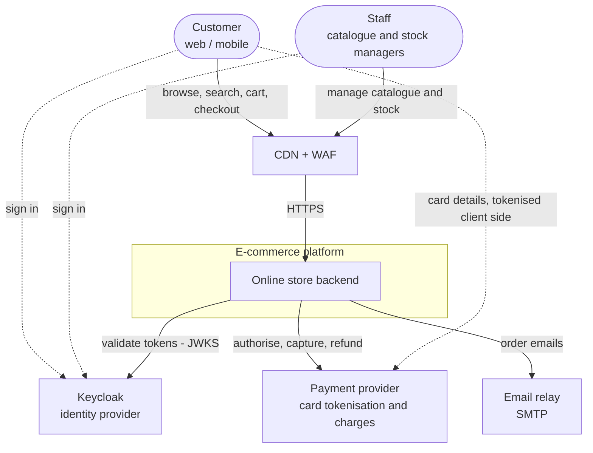
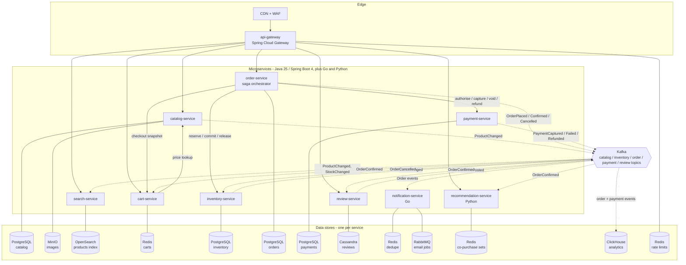
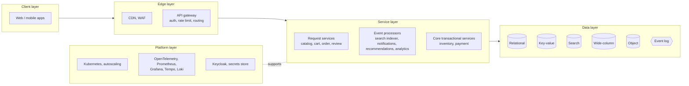
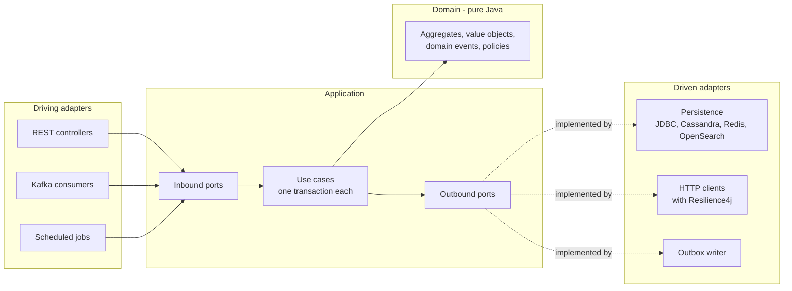

# 1. High-level design

## 1.1 System context (C4 level 1)

The platform never sees card numbers; the browser tokenises them directly with the payment provider. That keeps the platform in
PCI DSS SAQ A scope.

## 1.2 Containers (C4 level 2)

**Solid arrows are synchronous HTTP calls** (inside the cluster, with mTLS). **Dotted arrows are events** published through the
transactional outbox and consumed by idempotent consumers.

## 1.3 Layers

## 1.4 Inside every service: hexagonal architecture

Dependencies point inwards. The `domain` package imports nothing from Spring or any adapter. ArchUnit tests in every service enforce
this.

## 1.5 Request path and event path

| Path | Example | Mechanism | Consistency |
|---|---|---|---|
| Read | Product page, search | Gateway → service → cache or read model | Eventually consistent read models (< 1 s typical) |
| Command | Add to cart | Gateway → cart-service → Redis | Immediate within the service |
| Business transaction | Checkout | Gateway → order-service → orchestrated calls to cart, inventory, payment | Saga with compensations; final state is always consistent |
| Propagation | Search indexing, emails, cart clearing | Outbox → Kafka → idempotent consumer | Eventually consistent, at-least-once delivery, effectively-once effect |

## 1.6 Technology map

| Concern | Technology |
|---|---|
| Runtime | Java 25 (virtual threads), Spring Boot 4.0, Spring Cloud 2025.1; Go 1.24 for notification-service; Python 3.12 + FastAPI for recommendation-service (ADR 0007) |
| Build | Gradle 9 multi-project, version catalog, convention plugins |
| Edge | CDN + WAF (provider choice), Spring Cloud Gateway |
| Identity | Keycloak, OAuth 2.1 / OIDC, JWT access tokens |
| Relational | PostgreSQL 17 + PgBouncer, Flyway |
| Key-value | Redis 8 |
| Wide-column | Apache Cassandra 5 |
| Search | OpenSearch 3 |
| Object storage | MinIO (S3 API) |
| Messaging | Apache Kafka 4 (KRaft) for events; RabbitMQ 4 for email jobs |
| Analytics | ClickHouse (Kafka table engine), Grafana |
| Resilience | Resilience4j through Spring Cloud CircuitBreaker |
| Observability | OpenTelemetry, Micrometer, Prometheus, Grafana, Tempo, Loki |
| Deployment | Docker images (layered, AppCDS), Kubernetes + Kustomize |
| Tests | JUnit 6, AssertJ, ArchUnit, Testcontainers, Gatling |

## 1.7 Quality attributes and how the design meets them

| Quality | Design response |
|---|---|
| Scalability | Stateless services behind HPA; partitioned Kafka; read replicas; Cassandra and OpenSearch scale out; Redis Cluster |
| Availability | Two or more replicas per service across three zones; PodDisruptionBudgets; graceful degradation (browse and search survive checkout outages) |
| Performance | Virtual threads; layered caching; read models; keyset pagination; batching; conditional single-statement updates |
| Correctness | Saga with compensations; idempotency keys; outbox; idempotent consumers; database constraints as a final guard |
| Modularity | One bounded context per service; hexagonal layers; platform libraries with no business logic |
| Security | OIDC + JWT; ownership checks; mTLS; secrets from a secret store; no card data |
| Operability | Traces, metrics and logs correlated by trace id; SLO burn-rate alerts; runbooks |
