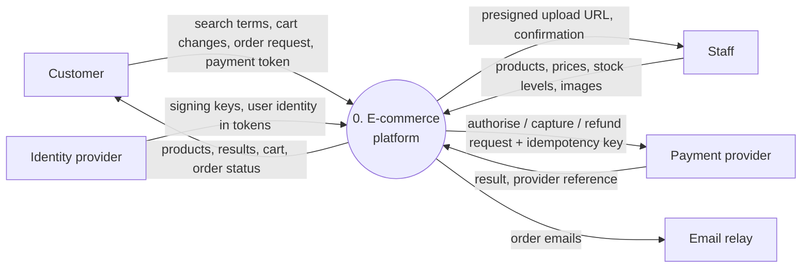
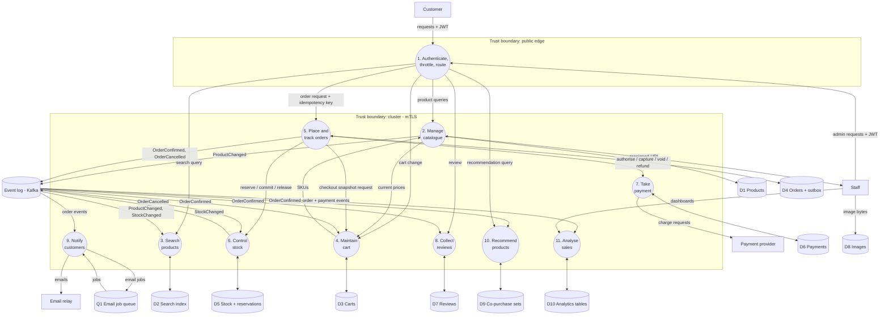
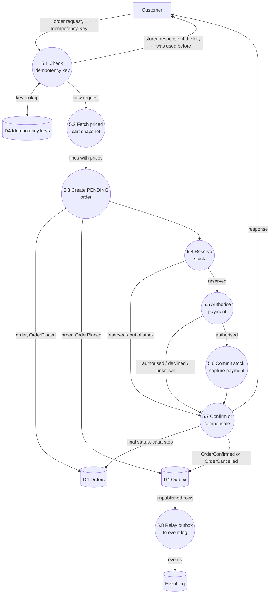

# 2. Data-flow diagrams

Notation:
* **Rectangles** are external entities.
* **Circles** (rounded nodes) are processes.
* **Cylinders** are data stores.
* **Labelled arrows** are data flows.
* **Dashed boxes** are trust boundaries.

## 2.1 Level 0: context

## 2.2 Level 1: main processes

## 2.3 Level 2: process 5 (place order)

## 2.4 Data stores

| Id | Store | Owner | Contents | Sensitivity |
|---|---|---|---|---|
| D1 | PostgreSQL `catalog` | catalog-service | Products, categories, prices, attributes, image keys | Public |
| D2 | OpenSearch `products` | search-service | Denormalised product documents + availability | Public |
| D3 | Redis `cart:*` | cart-service | Cart lines per owner | Personal (customer id) |
| D4 | PostgreSQL `orders` | order-service | Orders, lines, saga progress, idempotency keys, outbox | Personal (customer id, email) |
| D5 | PostgreSQL `inventory` | inventory-service | Stock per SKU and warehouse, reservations | Internal |
| D6 | PostgreSQL `payments` | payment-service | Payments, attempts, provider references (no card data) | Financial |
| D7 | Cassandra `reviews` | review-service | Reviews, rating summaries, verified purchases | Personal (customer id) |
| D8 | MinIO `product-images` | catalog-service | Image objects | Public |
| D9 | Redis `reco:*` | recommendation-service | Co-purchase counts per SKU | Aggregate, no personal data |
| D10 | ClickHouse `analytics` | analytics | Order and payment facts | Personal ids hashed |
| Q1 | RabbitMQ `email.*` | notification-service | Email jobs (recipient, template, data) | Personal (email) |
| EV | Kafka topics | producers | Domain events, 7-day retention | Mixed: order events carry email |

## 2.5 Trust boundaries and controls

| Boundary | Crossing | Controls |
|---|---|---|
| Internet → edge | All client traffic | TLS 1.3, WAF, bot rules, JWT validation, per-IP and per-user rate limits, request size limits |
| Edge → cluster | Gateway → services | mTLS, network policies (gateway may only reach public-facing services), forwarded identity headers stripped and re-derived from the token |
| Service → service | Internal APIs | mTLS identity per service account; internal endpoints not routed by the gateway |
| Cluster → payment provider | Charges | Outbound allow-list, provider API key from the secret store, provider idempotency keys |
| Staff → object storage | Image upload | Presigned URL limited to one key, `PUT` only, 5-minute expiry, size and content-type conditions |
| Services → event log | Events | Kafka ACLs per service principal: produce only to its own topic, consume only from subscribed topics |
