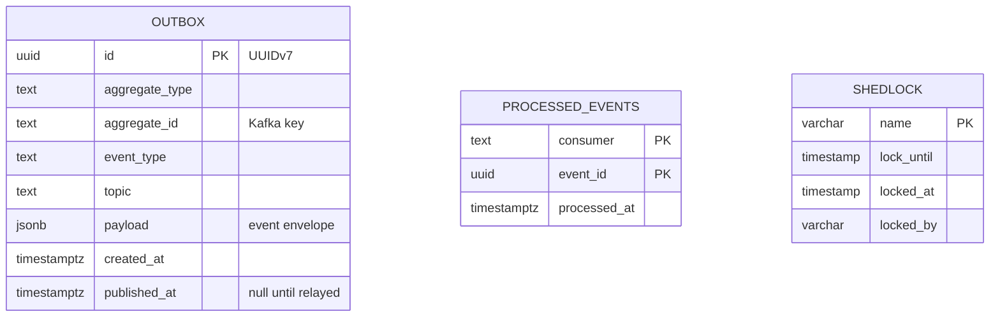
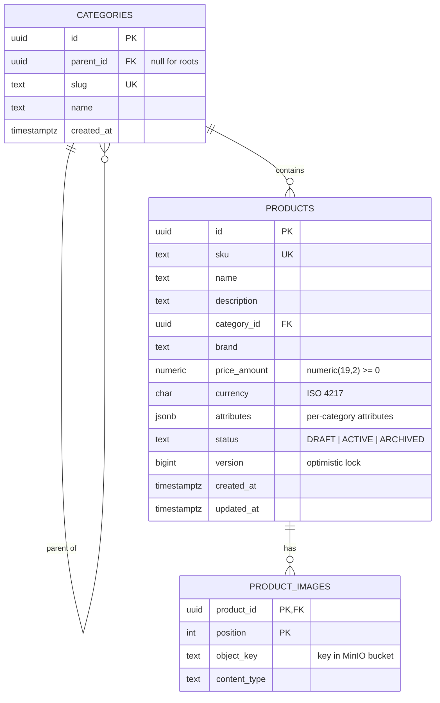
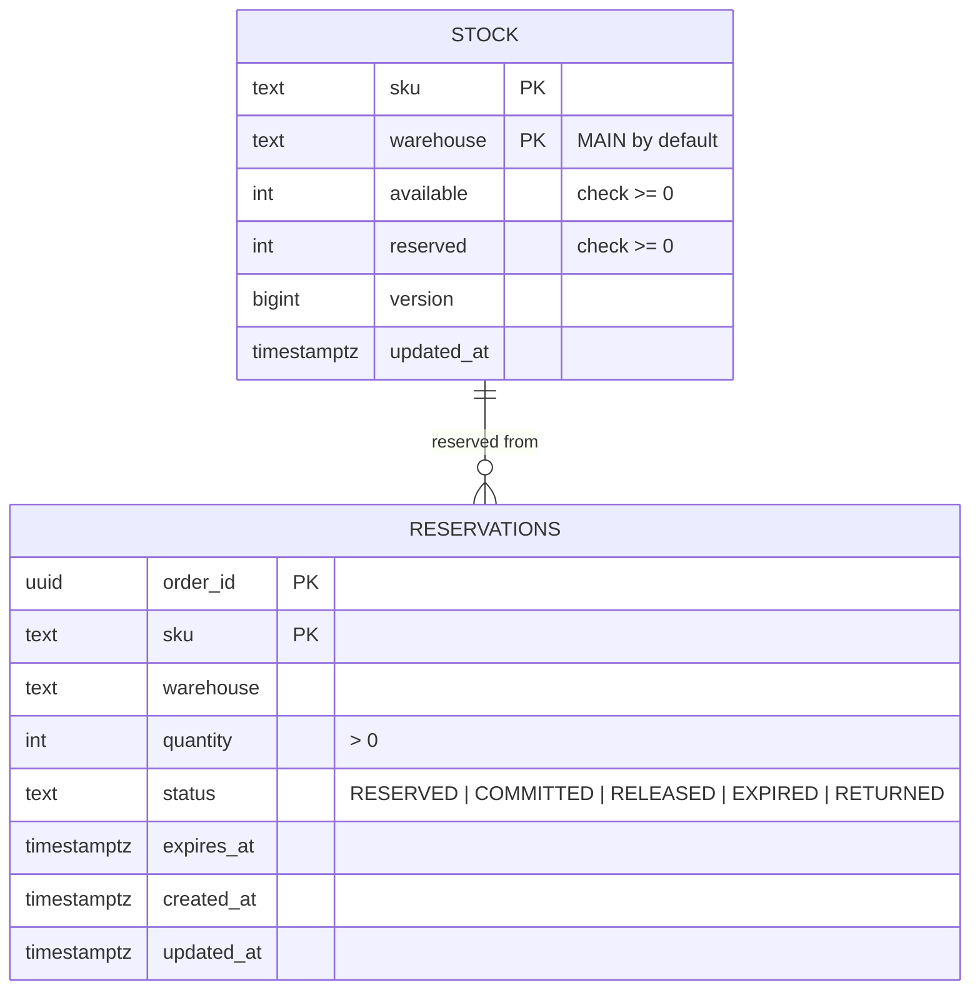
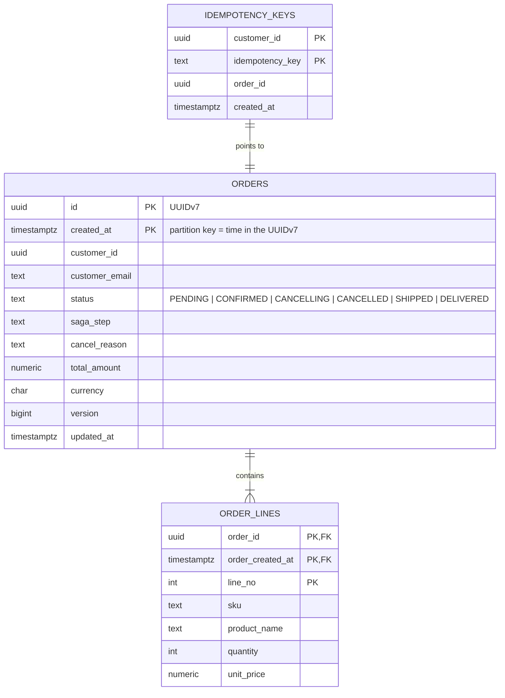
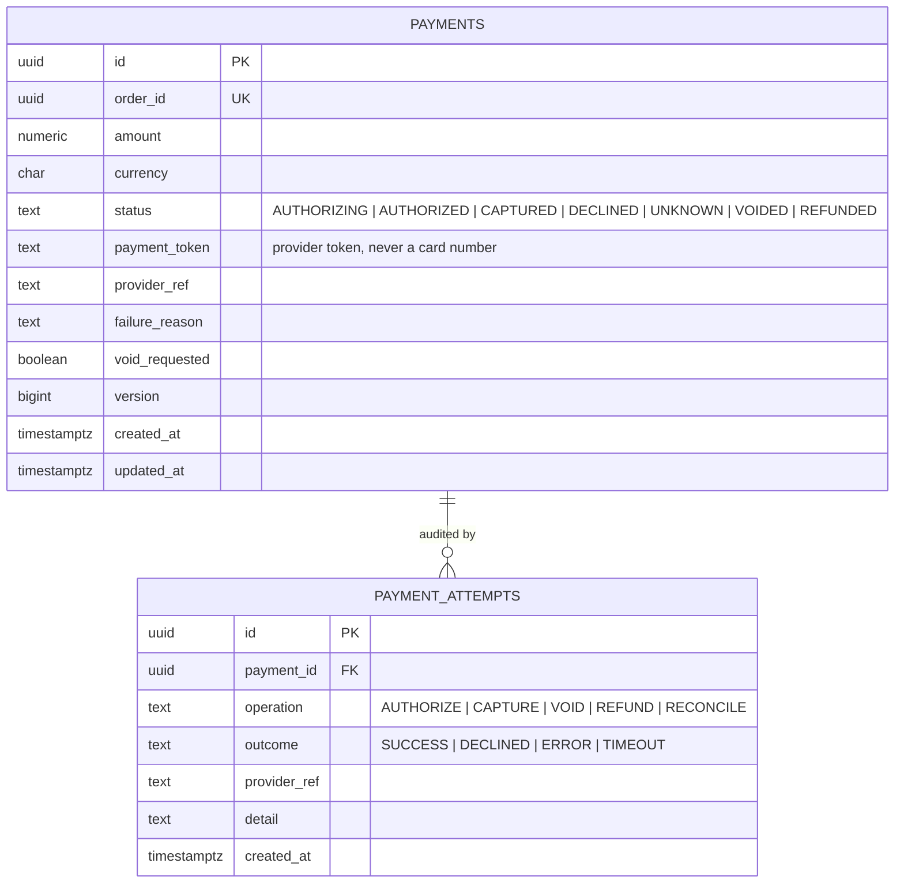
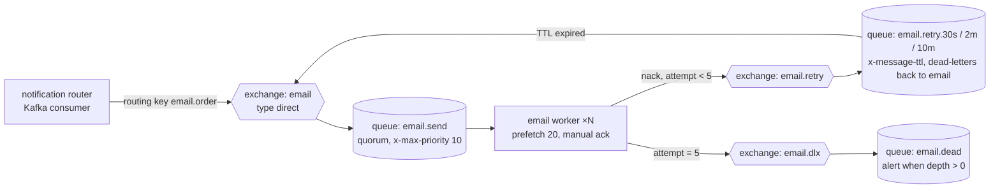

# 4. Database design

The platform uses **polyglot persistence**, as described in [SPEC §14](../SPEC.md#14-polyglot-persistence).
* Every service owns its store; no other service connects to it.
* PostgreSQL schemas are managed by Flyway migrations in each service (`src/main/resources/db/migration`).
* Cassandra tables are created by versioned CQL scripts.
* OpenSearch indexes are created by the search service from a mapping file.

## 4.1 Common tables (every PostgreSQL service)

These come from the `platform/outbox` library and are created by each service's first migration.



```sql
create table outbox (
  id             uuid primary key,
  aggregate_type text        not null,
  aggregate_id   text        not null,
  event_type     text        not null,
  topic          text        not null,
  payload        jsonb       not null,
  created_at     timestamptz not null default now(),
  published_at   timestamptz
);
-- the relay only ever reads unpublished rows, oldest first
create index outbox_unpublished on outbox (created_at) where published_at is null;

create table processed_events (
  consumer     text        not null,
  event_id     uuid        not null,
  processed_at timestamptz not null default now(),
  primary key (consumer, event_id)
);
```

| Table | Writes | Reads | Retention |
|---|---|---|---|
| `outbox` | One row per event, in the business transaction | Relay: `SELECT … WHERE published_at IS NULL ORDER BY created_at LIMIT 500 FOR UPDATE SKIP LOCKED` | Published rows deleted after 7 days |
| `processed_events` | One row per consumed event, in the consumer's transaction | Primary-key insert; a conflict means "already processed" | 14 days (longer than Kafka retention) |
| `shedlock` | Lock acquisition by scheduled jobs | Same | Permanent, one row per job |

`FOR UPDATE SKIP LOCKED` lets several relay replicas work in parallel without publishing the same row twice.

## 4.2 catalog (PostgreSQL)



```sql
create table categories (
  id         uuid primary key,
  parent_id  uuid references categories (id),
  slug       text not null unique,
  name       text not null,
  created_at timestamptz not null default now()
);

create table products (
  id           uuid primary key,
  sku          text not null unique,
  name         text not null,
  description  text not null default '',
  category_id  uuid not null references categories (id),
  brand        text not null,
  price_amount numeric(19, 2) not null check (price_amount >= 0),
  currency     char(3) not null,
  attributes   jsonb not null default '{}'::jsonb,
  status       text not null check (status in ('DRAFT', 'ACTIVE', 'ARCHIVED')),
  version      bigint not null,
  created_at   timestamptz not null,
  updated_at   timestamptz not null
);
create index products_category_active on products (category_id) where status = 'ACTIVE';
create index products_attributes on products using gin (attributes jsonb_path_ops);

create table product_images (
  product_id   uuid not null references products (id) on delete cascade,
  position     int  not null,
  object_key   text not null,
  content_type text not null,
  primary key (product_id, position)
);
```

## 4.3 inventory (PostgreSQL)



```sql
create table stock (
  sku        text not null,
  warehouse  text not null default 'MAIN',
  available  int  not null check (available >= 0),
  reserved   int  not null default 0 check (reserved >= 0),
  version    bigint not null default 0,
  updated_at timestamptz not null default now(),
  primary key (sku, warehouse)
);

create table reservations (
  order_id   uuid not null,
  sku        text not null,
  warehouse  text not null default 'MAIN',
  quantity   int  not null check (quantity > 0),
  status     text not null check (status in ('RESERVED', 'COMMITTED', 'RELEASED', 'EXPIRED', 'RETURNED')),
  expires_at timestamptz not null,
  created_at timestamptz not null default now(),
  updated_at timestamptz not null default now(),
  primary key (order_id, sku)
);
-- the expiry job only scans live reservations
create index reservations_live_expiry on reservations (expires_at) where status = 'RESERVED';
```

**The reservation statement.** This single atomic statement cannot oversell:

```sql
update stock
   set available = available - :qty, reserved = reserved + :qty, version = version + 1, updated_at = now()
 where sku = :sku and warehouse = :wh and available >= :qty;
-- 1 row updated  → reserved
-- 0 rows updated → not enough stock (or unknown SKU)
```

* **Ordering:** lines are reserved in SKU order inside one transaction. Two orders for the same SKUs therefore lock rows in the same order and cannot deadlock.
* **Commit** turns `reserved` into a sale: `reserved = reserved - q`.
* **Release** returns the quantity: `available = available + q, reserved = reserved - q`.

## 4.4 orders (PostgreSQL)



```sql
create table orders (
  id             uuid        not null,
  created_at     timestamptz not null,
  customer_id    uuid        not null,
  customer_email text        not null,
  status         text        not null,
  saga_step      text        not null,
  cancel_reason  text,
  total_amount   numeric(19, 2) not null,
  currency       char(3)     not null,
  version        bigint      not null,
  updated_at     timestamptz not null,
  primary key (id, created_at)
) partition by range (created_at);

create table order_lines (
  order_id         uuid        not null,
  order_created_at timestamptz not null,
  line_no          int         not null,
  sku              text        not null,
  product_name     text        not null,
  quantity         int         not null check (quantity > 0),
  unit_price       numeric(19, 2) not null check (unit_price >= 0),
  primary key (order_id, order_created_at, line_no),
  foreign key (order_id, order_created_at) references orders (id, created_at)
) partition by range (order_created_at);

create index orders_by_customer on orders (customer_id, created_at desc);
create index orders_in_flight   on orders (updated_at) where status in ('PENDING', 'CANCELLING');

create table idempotency_keys (
  customer_id     uuid not null,
  idempotency_key text not null,
  order_id        uuid not null,
  created_at      timestamptz not null default now(),
  primary key (customer_id, idempotency_key)
);
```

**Partitioning**
* **Scheme:** `orders` and `order_lines` are range-partitioned by month. A function `ensure_order_partitions(months_ahead)` creates the missing monthly partitions; a daily job calls it to stay 3 months ahead, and a default partition catches anything unexpected.
* **Pruning without an extra column:** the order id is a UUIDv7, whose first 48 bits are the creation time in milliseconds. `created_at` is set from the id, so a lookup by id computes `created_at` from the id and prunes to one partition.
* **Archiving:** old partitions are detached and archived, with no expensive `DELETE`.

**Scaling beyond one primary.** The tables can be distributed with Citus on `customer_id` (SPEC §13.1). All queries already filter by `customer_id` or by order id; adding `customer_id` to the order lookup path makes them single-shard.

## 4.5 payments (PostgreSQL)



```sql
create table payments (
  id             uuid primary key,
  order_id       uuid not null unique,
  amount         numeric(19, 2) not null check (amount > 0),
  currency       char(3) not null,
  status         text not null,
  payment_token  text not null,
  provider_ref   text,
  failure_reason text,
  void_requested boolean not null default false,
  version        bigint not null,
  created_at     timestamptz not null,
  updated_at     timestamptz not null
);
create index payments_unsettled on payments (updated_at) where status in ('AUTHORIZING', 'UNKNOWN');

create table payment_attempts (
  id           uuid primary key,
  payment_id   uuid not null references payments (id),
  operation    text not null,
  outcome      text not null,
  provider_ref text,
  detail       text,
  created_at   timestamptz not null default now()
);
```

* **One payment per order:** `order_id unique` guarantees it. A repeated authorise call returns the existing payment.
* **Provider idempotency key:** the provider is always called with `order_id`, so a retried charge can never be taken twice.
* **Audit trail:** `payment_attempts` is append-only. Rows are never updated.

## 4.6 reviews (Cassandra)

Each table is designed around one query; data is duplicated on purpose.

```sql
CREATE KEYSPACE reviews WITH replication = {'class': 'NetworkTopologyStrategy', 'dc1': 3};

-- Q1: newest reviews of a product, paged
CREATE TABLE reviews.reviews_by_product (
  sku         text,
  bucket      text,        -- 'yyyy-MM' of created_at: bounds partition size
  created_at  timestamp,
  review_id   uuid,
  customer_id uuid,
  rating      int,
  title       text,
  body        text,
  verified    boolean,
  PRIMARY KEY ((sku, bucket), created_at, review_id)
) WITH CLUSTERING ORDER BY (created_at DESC, review_id ASC);

-- Q2: rating summary of a product
CREATE TABLE reviews.rating_summary_by_product (
  sku          text PRIMARY KEY,
  review_count counter,
  rating_total counter
);

-- Q3: has this customer bought this product? (filled from OrderConfirmed)
CREATE TABLE reviews.purchases_by_customer (
  customer_id  uuid,
  sku          text,
  purchased_at timestamp,
  PRIMARY KEY ((customer_id), sku)
);

-- Q4: one review per customer per product (lightweight transaction guard)
CREATE TABLE reviews.review_guard (
  sku         text,
  customer_id uuid,
  review_id   uuid,
  PRIMARY KEY ((sku, customer_id))
);
```

| Query | Table | Access |
|---|---|---|
| Show newest reviews | `reviews_by_product` | Read the current month's bucket; continue to earlier buckets until the page is full |
| Show rating | `rating_summary_by_product` | Single-partition read; average = total ÷ count |
| Verified-purchase badge | `purchases_by_customer` | Single-partition read |
| Post review | `review_guard` `INSERT … IF NOT EXISTS`, then insert the review and increment counters | The LWT happens once per review, which is rare compared with reads |

Consistency levels: writes and reads use `LOCAL_QUORUM`; counters use `LOCAL_QUORUM`.

## 4.7 Redis key design

| Key | Type | Owner | TTL | Notes |
|---|---|---|---|---|
| `cart:c:{customerId}` / `cart:g:{guestId}` | Hash `sku → quantity` | cart-service | 30 days, refreshed on write | `HSET`, `HDEL`, `HGETALL`; merge on sign-in |
| `product:{id}` | String (JSON) | catalog-service | 10 min | Cache-aside; deleted on change |
| `request_rate_limiter.{key}.tokens` / `.timestamp` | String | api-gateway | Seconds | Token bucket via a Lua script, atomic |
| `notif:sent:{eventId}` | String | notification-service | 7 days | `SET NX EX`; the first writer sends the email |
| `reco:also:{sku}` | Sorted set `otherSku → count` | recommendation-service | none (trimmed to top 200) | `ZINCRBY` for every pair in a confirmed order; `ZREVRANGE 0 9` to read |
| `reco:seen:{eventId}` | String | recommendation-service | 14 days | `SET NX EX` dedupe |

## 4.8 OpenSearch mapping (`products-v1`, alias `products`)

```json
{
  "settings": { "number_of_shards": 3, "number_of_replicas": 1, "refresh_interval": "1s" },
  "mappings": {
    "dynamic": "strict",
    "properties": {
      "id":          { "type": "keyword" },
      "sku":         { "type": "keyword" },
      "name":        { "type": "text", "analyzer": "english", "fields": { "raw": { "type": "keyword" } } },
      "description": { "type": "text", "analyzer": "english" },
      "category":    { "type": "keyword" },
      "brand":       { "type": "keyword" },
      "price":       { "type": "scaled_float", "scaling_factor": 100 },
      "currency":    { "type": "keyword" },
      "attributes":  { "type": "flat_object" },
      "inStock":     { "type": "boolean" },
      "available":   { "type": "integer" },
      "status":      { "type": "keyword" },
      "updatedAt":   { "type": "date" },
      "catalogVersion": { "type": "long" }
    }
  }
}
```

* **Writes are versioned:** the indexer writes with `version_type=external` using the catalogue version. An older event arriving late can never overwrite newer data.
* **Mapping changes:** create `products-v2`, reindex, then switch the alias atomically.

## 4.9 RabbitMQ topology (notification-service)



| Element | Settings | Why |
|---|---|---|
| `email.send` | Quorum queue (Raft-replicated), priority 0–10 | Order confirmations (priority 8) overtake bulk mail |
| Retry queues | `x-message-ttl` 30 s, 2 min, 10 min, then dead-letter back to `email` | Delayed retries without a scheduler |
| `email.dead` | Holds failed jobs; alerting on depth | Poison jobs never block the queue |
| Worker prefetch | 20 | Bounded in-flight work per worker; fair dispatch |
| Message properties | `message_id` = event id, persistent delivery | Dedupe and durability |

## 4.10 ClickHouse (analytics)

```sql
-- 1. Kafka engine tables read the topics (one consumer group per table)
CREATE TABLE analytics.order_events_queue (raw String)
ENGINE = Kafka SETTINGS kafka_broker_list = 'kafka:9092', kafka_topic_list = 'order.events',
  kafka_group_name = 'analytics-orders', kafka_format = 'JSONAsString';

-- 2. Storage table: one row per order event
CREATE TABLE analytics.order_facts (
  event_id     UUID,
  event_type   LowCardinality(String),
  occurred_at  DateTime64(3, 'UTC'),
  order_id     UUID,
  customer_key UInt64,                 -- cityHash64(customer_id): no raw personal id
  total        Decimal(19, 2),
  currency     LowCardinality(String),
  reason       LowCardinality(String),
  line_count   UInt16
) ENGINE = ReplacingMergeTree
PARTITION BY toYYYYMM(occurred_at)
ORDER BY (event_type, occurred_at, event_id);    -- ReplacingMergeTree drops duplicate deliveries

-- 3. Materialised view parses JSON into the storage table as messages arrive
CREATE MATERIALIZED VIEW analytics.order_facts_mv TO analytics.order_facts AS
SELECT toUUID(JSONExtractString(raw, 'eventId'))                              AS event_id,
       JSONExtractString(raw, 'type')                                         AS event_type,
       parseDateTime64BestEffort(JSONExtractString(raw, 'occurredAt'), 3)      AS occurred_at,
       toUUID(JSONExtractString(raw, 'payload', 'orderId'))                   AS order_id,
       cityHash64(JSONExtractString(raw, 'payload', 'customerId'))            AS customer_key,
       toDecimal64(JSONExtractString(raw, 'payload', 'total', 'amount'), 2)    AS total,
       JSONExtractString(raw, 'payload', 'total', 'currency')                 AS currency,
       JSONExtractString(raw, 'payload', 'reason')                            AS reason,
       toUInt16(JSONLength(raw, 'payload', 'lines'))                          AS line_count
FROM analytics.order_events_queue;

-- 4. Pre-aggregated rollup for dashboards
CREATE MATERIALIZED VIEW analytics.revenue_per_minute
ENGINE = SummingMergeTree ORDER BY (minute, currency) AS
SELECT toStartOfMinute(occurred_at) AS minute, currency, count() AS orders, sum(total) AS revenue
FROM analytics.order_facts WHERE event_type = 'order.OrderConfirmed' GROUP BY minute, currency;
```

## 4.11 Retention and data lifecycle

| Data | Hot | Archive | Deletion |
|---|---|---|---|
| Orders | 24 monthly partitions online | Detached partitions to object storage (Parquet) | Per legal retention (e.g. 10 years for invoices) |
| Payments | Online | Same as orders | Per legal retention |
| Outbox / processed events | 7 / 14 days | none | Scheduled delete |
| Reviews | Online | none | On customer deletion request (GDPR): delete by `customer_id` using `purchases_by_customer` + guard table |
| Carts | 30 days | none | TTL |
| Kafka | 7 days | none | Retention policy |
| Analytics | 25 monthly partitions | Older partitions moved to object storage (S3 disk) | TTL by partition |
