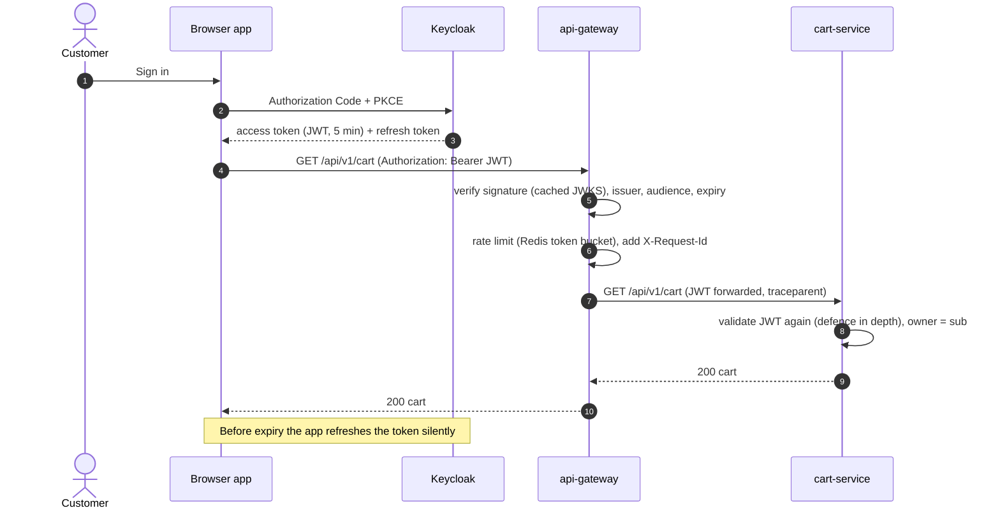
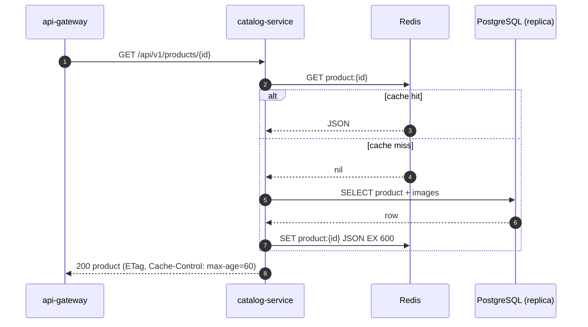
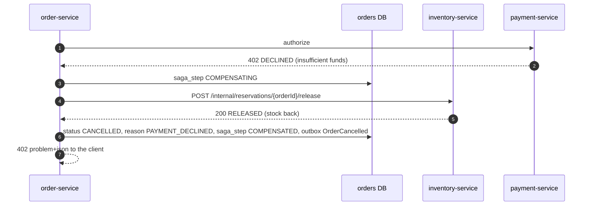
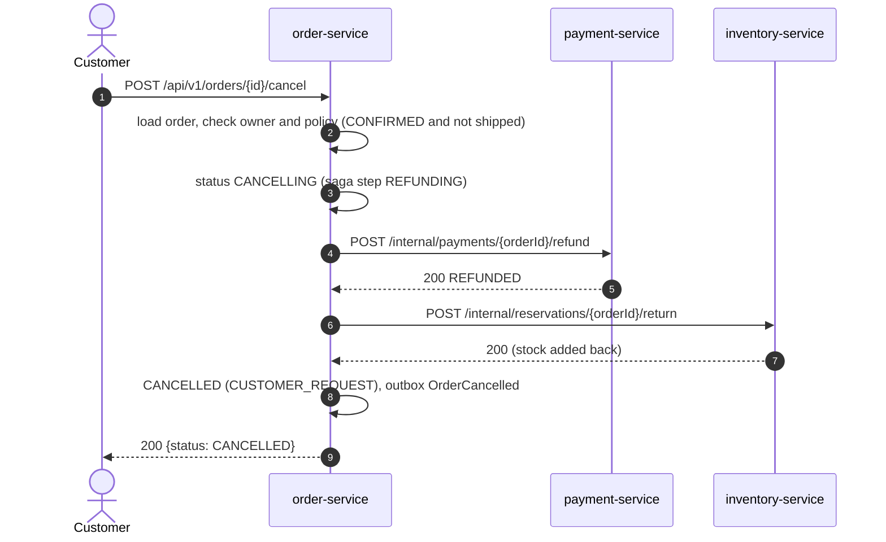
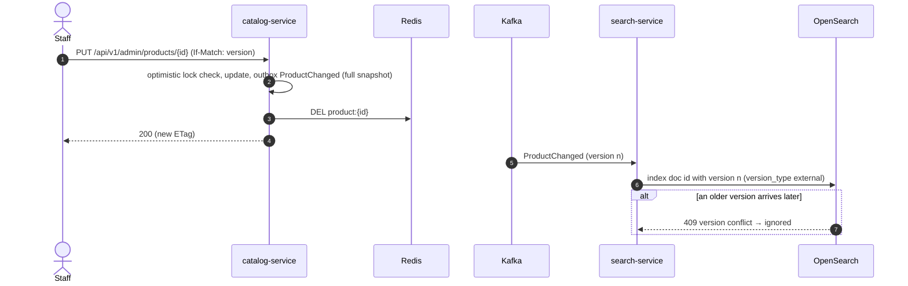
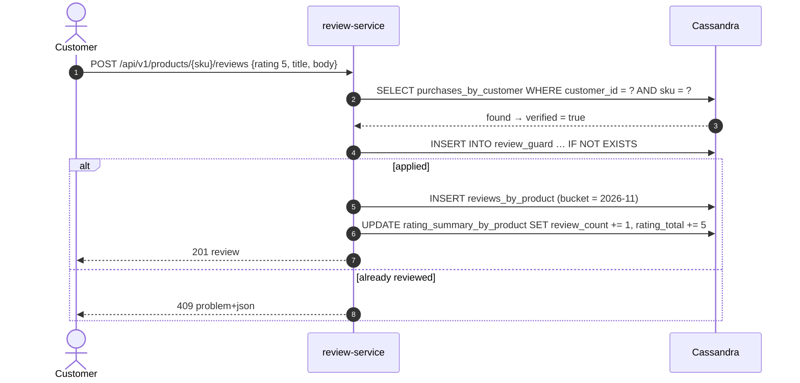
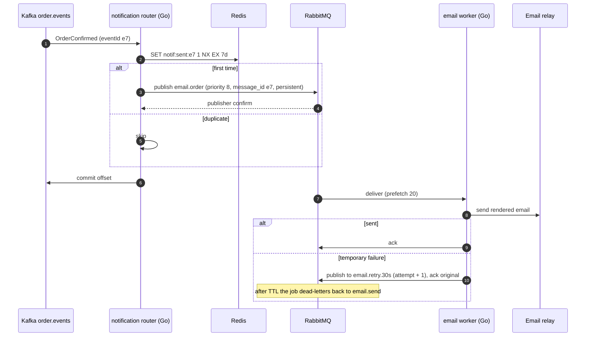

# 5. Sequence diagrams

Timeouts on every arrow follow [SPEC §8.3](../SPEC.md#83-resilience). "GW" is the API gateway.

## 5.1 Sign-in and an authenticated request



## 5.2 Browse a product (cache-aside)



## 5.3 Search

```mermaid
sequenceDiagram
    autonumber
    participant GW as api-gateway
    participant SR as search-service
    participant OS as OpenSearch
    GW->>SR: GET /api/v1/search?q=running shoes&brand=Acme&maxPrice=120&sort=price_asc
    SR->>SR: build query (Builder + Specification): must match q, filter brand, range price, term status=ACTIVE
    SR->>OS: _search (bool query + terms aggs on brand, category; search_after cursor)
    OS-->>SR: hits + aggregations
    SR-->>GW: 200 {items, facets, nextCursor}
```

## 5.4 Add to cart

```mermaid
sequenceDiagram
    autonumber
    participant GW as api-gateway
    participant CART as cart-service
    participant R as Redis
    participant CAT as catalog-service
    GW->>CART: PUT /api/v1/cart/items/SKU-1 {quantity: 2}
    CART->>CART: validate (1..99), owner from JWT or guest token
    CART->>R: HSET cart:c:{id} SKU-1 2 ; EXPIRE 30d
    CART->>CAT: POST /internal/products/prices {skus} [timeout 300 ms, breaker]
    alt catalog available
        CAT-->>CART: prices, names, status
        CART-->>GW: 200 priced cart
    else breaker open / timeout
        CART-->>GW: 200 cart with lines marked "price pending" (degraded)
    end
```

## 5.5 Checkout: happy path

```mermaid
sequenceDiagram
    autonumber
    actor C as Customer
    participant GW as api-gateway
    participant O as order-service
    participant DB as orders DB
    participant CART as cart-service
    participant I as inventory-service
    participant P as payment-service
    participant PSP as Payment provider
    participant K as Kafka
    C->>GW: POST /api/v1/orders {paymentToken} Idempotency-Key: k1
    GW->>O: forward (JWT)
    O->>DB: SELECT idempotency_keys (customer, k1)
    DB-->>O: none
    O->>CART: GET /internal/carts/{customer}/checkout-snapshot
    CART-->>O: lines with current prices
    O->>DB: BEGIN; INSERT orders PENDING, order_lines, idempotency_keys, outbox OrderPlaced; COMMIT
    O->>I: POST /internal/reservations {orderId, lines} [800 ms]
    I-->>O: 200 RESERVED (expires in 15 min)
    O->>DB: saga_step = STOCK_RESERVED
    O->>P: POST /internal/payments/authorize {orderId, amount, token} [2 s]
    P->>PSP: authorise (idempotency key = orderId)
    PSP-->>P: authorised, ref
    P-->>O: 200 AUTHORIZED
    O->>DB: saga_step = PAYMENT_AUTHORIZED
    O->>I: POST /internal/reservations/{orderId}/commit
    I-->>O: 200 COMMITTED
    O->>P: POST /internal/payments/{orderId}/capture
    P->>PSP: capture
    P-->>O: 200 CAPTURED
    O->>DB: BEGIN; status CONFIRMED, saga_step COMPLETED, outbox OrderConfirmed; COMMIT
    O-->>GW: 201 {orderId, status: CONFIRMED}
    GW-->>C: 201
    Note over DB,K: Outbox relay publishes OrderPlaced, OrderConfirmed to order.events
    K-->>CART: OrderConfirmed → clear cart
```

## 5.6 Checkout: out of stock

```mermaid
sequenceDiagram
    autonumber
    participant O as order-service
    participant DB as orders DB
    participant I as inventory-service
    O->>I: POST /internal/reservations {orderId, lines}
    I->>I: BEGIN; conditional UPDATE per SKU (sorted); one returns 0 rows → ROLLBACK
    I-->>O: 409 OUT_OF_STOCK {sku: SKU-2}
    O->>DB: status CANCELLED, reason OUT_OF_STOCK, outbox OrderCancelled
    O-->>O: 409 problem+json to the client
```

Nothing was reserved, because the whole reservation is one transaction, so no compensation is needed.

## 5.7 Checkout: payment declined



## 5.8 Checkout: payment outcome unknown (timeout)

```mermaid
sequenceDiagram
    autonumber
    participant O as order-service
    participant I as inventory-service
    participant P as payment-service
    participant PSP as Payment provider
    participant J as payment reconciler (scheduled)
    O->>P: authorize [2 s]
    P->>PSP: authorise (key = orderId)
    Note over P,PSP: Provider is slow; no answer within the timeout
    P-->>O: 504 UNKNOWN (payment row status UNKNOWN)
    O->>P: POST /internal/payments/{orderId}/void
    P->>P: void_requested = true
    O->>I: release reservation
    O->>O: CANCELLED (PAYMENT_UNKNOWN), outbox OrderCancelled
    J->>PSP: look up by key = orderId
    alt provider did authorise late
        PSP-->>J: authorised
        J->>PSP: void (key = orderId)
        J->>J: status VOIDED, attempt logged
    else provider never authorised
        PSP-->>J: not found
        J->>J: status DECLINED
    end
```

The customer is never charged for a cancelled order, even if the provider answered after the timeout.

## 5.9 Cancellation and refund



If order-service stops between steps, the saga recovery job resumes the order from its recorded step (§6.2 in the flow diagrams).

## 5.10 Transactional outbox relay

```mermaid
sequenceDiagram
    autonumber
    participant UC as Use case
    participant DB as Service DB
    participant RL as Outbox relay (every replica, every 100 ms, SKIP LOCKED)
    participant K as Kafka
    UC->>DB: BEGIN; UPDATE aggregate; INSERT outbox row; COMMIT
    loop poll
        RL->>DB: BEGIN; SELECT … WHERE published_at IS NULL ORDER BY created_at LIMIT 500 FOR UPDATE SKIP LOCKED
        DB-->>RL: batch
        RL->>K: send all (key = aggregate_id, acks=all, idempotent producer)
        K-->>RL: acks
        RL->>DB: UPDATE outbox SET published_at = now() WHERE id IN (…); COMMIT
    end
    Note over RL,K: A crash after send and before commit re-sends the batch: consumers dedupe by eventId
```

## 5.11 Idempotent consumer

```mermaid
sequenceDiagram
    autonumber
    participant K as Kafka
    participant C as Consumer (e.g. inventory: OrderCancelled)
    participant DB as Service DB
    K->>C: record (eventId e1)
    C->>DB: BEGIN; INSERT processed_events (consumer, e1) ON CONFLICT DO NOTHING
    alt inserted (first time)
        C->>DB: apply effect (release reservation)
        C->>DB: COMMIT
    else conflict (duplicate delivery)
        C->>DB: ROLLBACK (nothing to do)
    end
    C->>K: commit offset
    Note over C,K: On error: retry with backoff (1 s, 2 s, 4 s, 8 s, 16 s), then publish to topic.dlq and commit
```

## 5.12 Catalogue change to search index



## 5.13 Presigned image upload (Valet Key)

```mermaid
sequenceDiagram
    autonumber
    actor S as Staff
    participant CAT as catalog-service
    participant M as MinIO
    S->>CAT: POST /api/v1/admin/products/{id}/images {contentType: image/webp, size}
    CAT->>CAT: validate type and size; key = products/{id}/{uuid}.webp
    CAT->>M: presign PUT (5 min, content-type fixed)
    CAT-->>S: 201 {uploadUrl, objectKey}
    S->>M: PUT image bytes to uploadUrl
    S->>CAT: POST /api/v1/admin/products/{id}/images/{objectKey}/confirm
    CAT->>M: HEAD object (exists, size, type)
    CAT->>CAT: add product_images row, outbox ProductChanged
```

## 5.14 Posting a review



## 5.15 Order email (Kafka → RabbitMQ → SMTP)



## 5.16 Recommendations

```mermaid
sequenceDiagram
    autonumber
    participant K as Kafka order.events
    participant RC as recommendation-service (Python)
    participant RD as Redis
    participant GW as api-gateway
    K->>RC: OrderConfirmed {lines: A, B, C}
    RC->>RD: SET reco:seen:{eventId} NX EX 14d
    RC->>RD: pipeline: ZINCRBY reco:also:A 1 B, A→C, B→A, B→C, C→A, C→B; ZREMRANGEBYRANK to keep top 200
    GW->>RC: GET /api/v1/products/A/recommendations
    RC->>RD: ZREVRANGE reco:also:A 0 9 WITHSCORES
    RC-->>GW: 200 [B, C, …]
```
