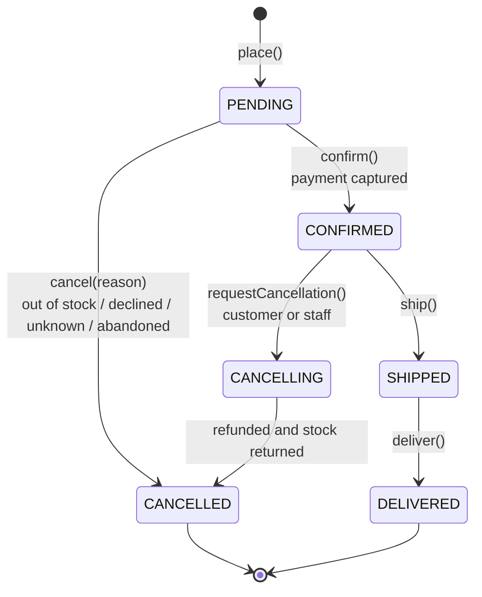
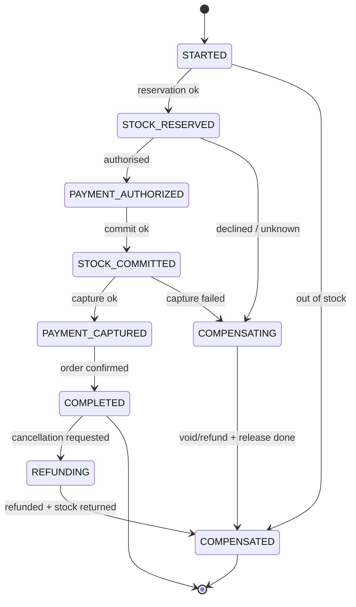
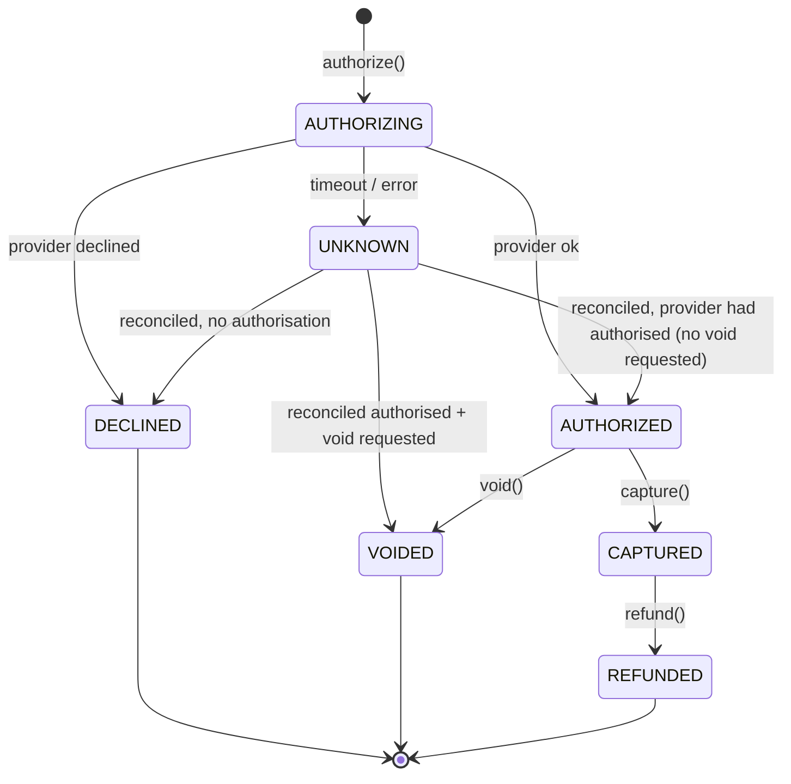
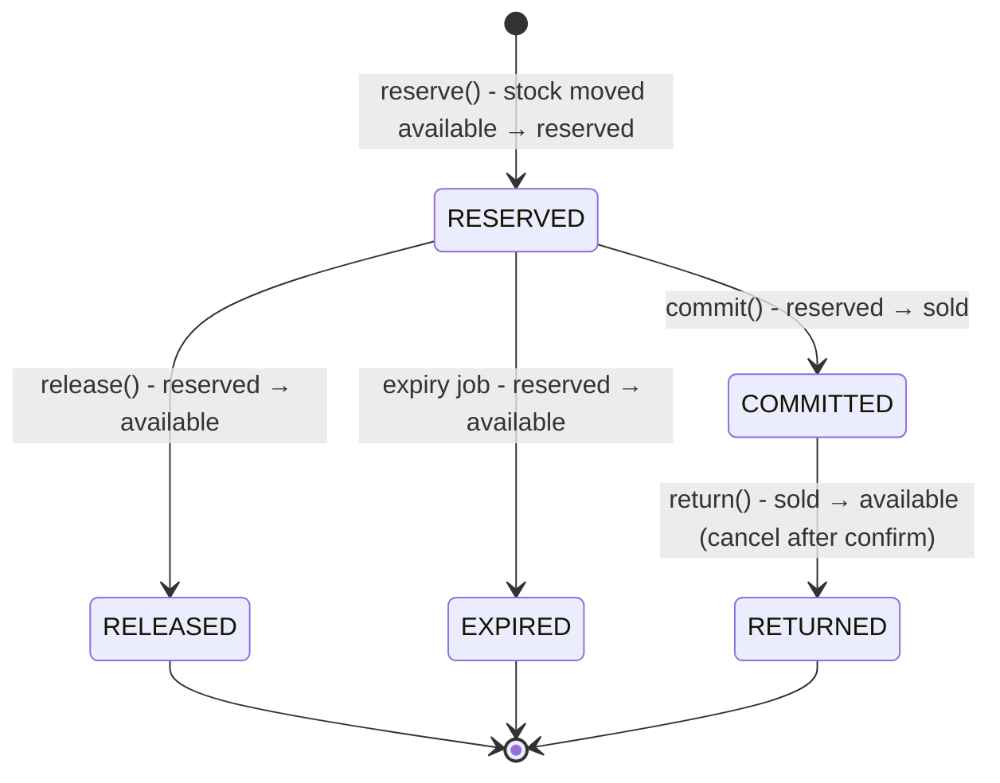
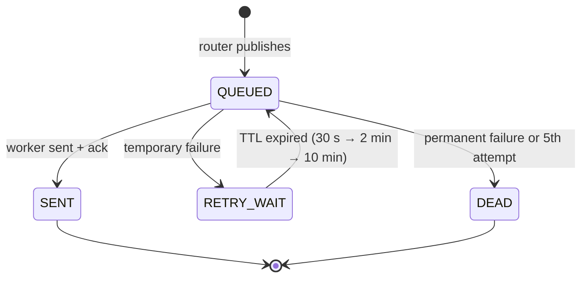

# 7. State diagrams

The domain enforces these state machines in code (State pattern on the aggregates). An illegal transition throws an
`IllegalStateTransition` domain error, which maps to HTTP 409.

## 7.1 Order status

| From | Allowed to |
|---|---|
| `PENDING` | `CONFIRMED`, `CANCELLED` |
| `CONFIRMED` | `CANCELLING`, `SHIPPED` |
| `CANCELLING` | `CANCELLED` |
| `SHIPPED` | `DELIVERED` |
| `CANCELLED`, `DELIVERED` | none (final) |

## 7.2 Checkout saga step

## 7.3 Payment status

## 7.4 Stock reservation status

Every transition is idempotent: repeating `release()` on a `RELEASED` reservation is a no-op that still answers success. A retried
compensation therefore never fails.

## 7.5 Email job (notification-service)

