# 8. Class and UML diagrams

This document shows the system-level UML. Each service's own `design/README.md` repeats its part with more detail: fields,
adapters and tests.

## 8.1 Component diagram

<picture>
  <source media="(prefers-color-scheme: dark)" srcset="diagrams/class-diagrams--component-diagram.dark.svg">
  
</picture>

`[[Name]]` marks an outbound port (interface); `[(Name)]` marks a repository port.

## 8.2 Domain primitives (copied into each service that needs them)

<picture>
  <source media="(prefers-color-scheme: dark)" srcset="diagrams/class-diagrams--domain-primitives-copied-into-each-service-that-.dark.svg">
  
</picture>

## 8.3 Order context (order-service)

<picture>
  <source media="(prefers-color-scheme: dark)" srcset="diagrams/class-diagrams--order-context-order-service.dark.svg">
  
</picture>

### Application layer and ports

<picture>
  <source media="(prefers-color-scheme: dark)" srcset="diagrams/class-diagrams--application-layer-and-ports.dark.svg">
  
</picture>

`ReservationResult` and `PaymentResult` are **sealed** interfaces. The saga handles each outcome in an exhaustive `switch`, so a new
outcome cannot be forgotten: the compiler rejects the code.

## 8.4 Inventory context (inventory-service)

<picture>
  <source media="(prefers-color-scheme: dark)" srcset="diagrams/class-diagrams--inventory-context-inventory-service.dark.svg">
  
</picture>

## 8.5 Payment context (payment-service)

<picture>
  <source media="(prefers-color-scheme: dark)" srcset="diagrams/class-diagrams--payment-context-payment-service.dark.svg">
  
</picture>

## 8.6 Catalogue, cart, search and review contexts

<picture>
  <source media="(prefers-color-scheme: dark)" srcset="diagrams/class-diagrams--catalogue-cart-search-and-review-contexts.dark.svg">
  
</picture>

## 8.7 Outbox and idempotent consumer (each service's own copy)

<picture>
  <source media="(prefers-color-scheme: dark)" srcset="diagrams/class-diagrams--outbox-and-idempotent-consumer-each-service-s-ow.dark.svg">
  
</picture>

## 8.8 Package diagram (every Java service)

<picture>
  <source media="(prefers-color-scheme: dark)" srcset="diagrams/class-diagrams--package-diagram-every-java-service.dark.svg">
  
</picture>

ArchUnit rules enforced in every Java service:

1. `domain` depends on nothing outside `java.*` and itself.
2. `application` depends only on `domain` (and `java.*`).
3. Adapters do not depend on each other.
4. Only `config` may reference Spring configuration annotations.

## 8.9 Deployment (UML deployment view)

<picture>
  <source media="(prefers-color-scheme: dark)" srcset="diagrams/class-diagrams--deployment-uml-deployment-view.dark.svg">
  
</picture>
