# 10. Event catalogue

## Envelope

Every event, in every topic and every language, uses the same envelope:

```json
{
  "eventId": "0193a1b2-…",          // UUIDv7, unique; consumers dedupe on it
  "type": "order.OrderConfirmed",    // <context>.<EventName>
  "version": 1,                      // schema version of the payload
  "occurredAt": "2026-11-01T10:15:31.204Z",
  "aggregateId": "0193a1b0-…",       // also the Kafka record key
  "traceparent": "00-4bf92f…-00f067…-01",
  "payload": { }
}
```

* **Kafka headers** repeat `eventId`, `type` and `traceparent`, so tools can filter without parsing the JSON.
* **Schemas:** each producer owns its JSON Schemas in `services/<producer>/contracts/events/<type>.v<version>.json`.
* **Consumers** keep their own copy of the schemas they read in `services/<consumer>/contracts/consumed/` and test against it.

## Topics

| Topic | Producer | Partitions / RF | Key | Retention | Consumers |
|---|---|---|---|---|---|
| `catalog.events` | catalog-service | 12 / 3 | product id | 7 days (+ compacted mirror `catalog.products`) | search-service |
| `inventory.events` | inventory-service | 12 / 3 | SKU | 7 days | search-service |
| `order.events` | order-service | 12 / 3 | order id | 7 days | cart, review, recommendation, notification, inventory (cancellations), analytics |
| `payment.events` | payment-service | 12 / 3 | order id | 7 days | analytics |
| `review.events` | review-service | 6 / 3 | SKU | 7 days | (future: catalog rating cache) |
| `<topic>.dlq` | any consumer | 3 / 3 | original key | 30 days | operators (replay tool) |

## Events

### catalog.ProductChanged (v1)

Published on every create, update, activation, archive or image change. It carries the full product (event-carried state transfer),
so consumers never call catalog-service back.

```json
{ "productId": "0193…", "sku": "SKU-1001", "name": "Trail Runner 2", "description": "…",
  "categorySlug": "running-shoes", "brand": "Acme", "price": {"amount": "89.90", "currency": "EUR"},
  "attributes": {"size": "42"}, "status": "ACTIVE", "imageKeys": ["products/0193…/a.webp"], "catalogVersion": 3 }
```

### inventory.StockChanged (v1)

Published when available stock for a SKU changes: reserve, release, expire, return or restock. It is coalesced: at most one per SKU per
transaction.

```json
{ "sku": "SKU-1001", "available": 17, "inStock": true }
```

### order.OrderPlaced (v1)

```json
{ "orderId": "0193…", "customerId": "0193…", "total": {"amount": "179.80", "currency": "EUR"},
  "lines": [{"sku": "SKU-1001", "quantity": 2, "unitPrice": {"amount": "89.90", "currency": "EUR"}}] }
```

### order.OrderConfirmed (v1)

```json
{ "orderId": "0193…", "customerId": "0193…", "customerEmail": "ada@example.com",
  "total": {"amount": "179.80", "currency": "EUR"},
  "lines": [{"sku": "SKU-1001", "productName": "Trail Runner 2", "quantity": 2, "unitPrice": {"amount": "89.90", "currency": "EUR"}}] }
```

### order.OrderCancelled (v1)

```json
{ "orderId": "0193…", "customerId": "0193…", "customerEmail": "ada@example.com",
  "reason": "PAYMENT_DECLINED", "total": {"amount": "179.80", "currency": "EUR"} }
```

### payment.PaymentCaptured / PaymentFailed / PaymentRefunded (v1)

```json
{ "paymentId": "0193…", "orderId": "0193…", "amount": {"amount": "179.80", "currency": "EUR"},
  "status": "CAPTURED", "reason": null }
```

### review.ReviewPosted (v1)

```json
{ "sku": "SKU-1001", "reviewId": "0193…", "rating": 5, "verified": true }
```

## Who consumes what

<picture>
  <source media="(prefers-color-scheme: dark)" srcset="diagrams/event-catalogue--who-consumes-what.dark.svg">
  
</picture>

## Evolution rules

1. **Additive within a version:** new optional fields only. Consumers must ignore unknown fields (tolerant reader).
2. **Breaking change:** publish `version: 2` beside version 1 until every consumer has moved, then retire version 1.
3. **Order:** ordering is guaranteed per key (aggregate) only. Consumers never assume order across aggregates.
4. **Duplicates:** delivery is at-least-once. Every consumer is idempotent on `eventId`.
5. **Freshness of state:** for state-carrying events, consumers keep the highest `catalogVersion` (or aggregate version) they have seen and drop older ones.
