# 11. System, module and service diagrams

The system as built: what runs, how the services depend on each other, what every service is made of inside, and how they
cooperate in the key flows. Names are the names in the code (`services/*`, `deploy/compose/compose.yaml`). The C4 views in
[01 High-level design](01-high-level-design.md) show the intent; this document shows the wiring.

## 11.1 System diagram

<picture>
  <source media="(prefers-color-scheme: dark)" srcset="diagrams/system-module-service-diagrams--system-diagram.dark.svg">
  
</picture>

| Tier | Runs | Talks to |
|---|---|---|
| Edge | NGINX: TLS, HSTS, per-address rate limits, caching of public assets | storefront, api-gateway, Keycloak |
| Web | storefront (server-rendered pages, the session holds the tokens), Keycloak | api-gateway, `redis-session` |
| API | api-gateway: validates JWTs, rate limits per user and address, admission control for hot SKUs, routes | every public service |
| Services | eleven services, each with its own store ([ADR 0002](adr/0002-microservices-with-a-database-per-service.md)) | each other only as shown in 11.2 |
| Messaging | Kafka for domain events, RabbitMQ for email work queues ([ADR 0006](adr/0006-kafka-for-events-rabbitmq-for-work-queues.md)) | producers through the outbox |

## 11.2 Service-interaction map

Solid arrows are synchronous HTTP (inside the cluster); dotted arrows are Kafka topics, labelled with the topic.

<picture>
  <source media="(prefers-color-scheme: dark)" srcset="diagrams/system-module-service-diagrams--service-interaction-map.dark.svg">
  
</picture>

| Service | Calls (HTTP) | Publishes | Consumes |
|---|---|---|---|
| api-gateway | the public services | — | — |
| catalog-service | — | `catalog.events` | — |
| search-service | — | — | `catalog.events`, `inventory.events` |
| cart-service | catalog-service (prices, cached 30 s) | — | `order.events` (clears the cart on confirmation) |
| inventory-service | — | `inventory.events` | `order.events` (releases stock still held for a cancelled order: a safety net) |
| order-service | cart (snapshot), inventory (reserve, commit, release, return), payment (authorize, capture, void, refund) | `order.events` | — |
| payment-service | the payment provider | `payment.events` | — |
| review-service | — | `review.events` | `order.events` (who may review what) |
| recommendation-service | — | — | `order.events` (bought-together pairs) |
| notification-service | Mailpit / SMTP | — (RabbitMQ `email.send`, `email.retry.*`) | `order.events` |
| analytics | — | — | `order.events` (ClickHouse Kafka engine) |

`payment.events` and `review.events` have no consumer in the code yet. The [event catalogue](10-event-catalogue.md) lists
analytics and a future catalogue rating cache as their readers.

No service calls a service that calls it back, and every synchronous chain is at most two hops deep (gateway → order →
inventory). Everything else that one service must learn from another arrives as an event, so a slow consumer never slows
a request.

## 11.3 Module diagram: inside a Java service

Every Java service has the same packages under `com.jkbootup.ecommerce.<service>`, and ArchUnit tests enforce the arrows:
the domain depends on nothing, the application depends only on the domain and its own ports, and an adapter depends on
the application but never on another adapter ([ADR 0003](adr/0003-no-shared-code-between-services.md)).

<picture>
  <source media="(prefers-color-scheme: dark)" srcset="diagrams/system-module-service-diagrams--module-diagram-inside-a-java-service.dark.svg">
  
</picture>

| Service | Adapters | Store |
|---|---|---|
| api-gateway | `admission`, `filter`, `web` (no application layer: it routes) | Redis (rate limits) |
| catalog-service | `web`, `persistence`, `messaging`, `redis`, `storage` | PostgreSQL `catalog`, object storage |
| search-service | `web`, `opensearch`, `messaging` | OpenSearch `products` |
| cart-service | `web`, `redis`, `client`, `messaging` | Redis |
| inventory-service | `web`, `persistence`, `messaging`, `scheduling` (reservation expiry) | PostgreSQL `inventory` |
| order-service | `web`, `persistence`, `client`, `messaging`, `scheduling` (saga recovery) | PostgreSQL `orders` |
| payment-service | `web`, `persistence`, `provider`, `messaging`, `scheduling` (reconciliation) | PostgreSQL `payments` |
| review-service | `web`, `cassandra`, `messaging` | Cassandra |

The outbox services (catalog, inventory, order, payment) carry an `observability` package with `TraceContext`: the
persistence adapter stores the current `traceparent` with each outbox row and the messaging adapter restores it when it
sends, which is why it sits outside both adapters.

The Go and Python services follow the same shape in their own idiom:

| Service | Layout |
|---|---|
| notification-service (Go) | `internal/domain`, `internal/app`, `internal/adapter/{kafka,rabbit,smtp,dedupe,httpapi}`, `cmd/notification-service` |
| recommendation-service (Python) | `recommendation/domain.py`, `recommendation/app.py`, `recommendation/adapters/{kafka_consumer,redis_store,http}.py` |

## 11.4 Communication diagrams of the key flows

UML communication diagrams: the objects and the numbered messages between them. The sequence diagrams in
[05](05-sequence-diagrams.md) show the same flows over time, including every failure branch.

### Checkout

<picture>
  <source media="(prefers-color-scheme: dark)" srcset="diagrams/system-module-service-diagrams--checkout.dark.svg">
  
</picture>

### A product change reaches search

<picture>
  <source media="(prefers-color-scheme: dark)" srcset="diagrams/system-module-service-diagrams--a-product-change-reaches-search.dark.svg">
  
</picture>

### Cancellation

<picture>
  <source media="(prefers-color-scheme: dark)" srcset="diagrams/system-module-service-diagrams--cancellation.dark.svg">
  
</picture>

The order stays `CANCELLING` until both the refund and the stock return succeed; saga recovery retries them. Inventory's
listener on `OrderCancelled` is a safety net: release is idempotent, so a stock hold that survived is freed.

When a checkout fails before capture (out of stock, declined, payment timeout), order-service compensates instead: void
the authorisation, release the reservation, cancel the order.

## 11.5 Where to look next

* Per service, in more detail: `services/<service>/design/README.md` and its walkthrough.
* Deployment of these boxes: [03 Deployment](03-deployment.md); data inside them: [04 Database design](04-database-design.md).
* What every arrow is protected by: [12 Security design](12-security-design.md); how every arrow is observed:
  [13 Observability and SLOs](13-observability-and-slos.md).
