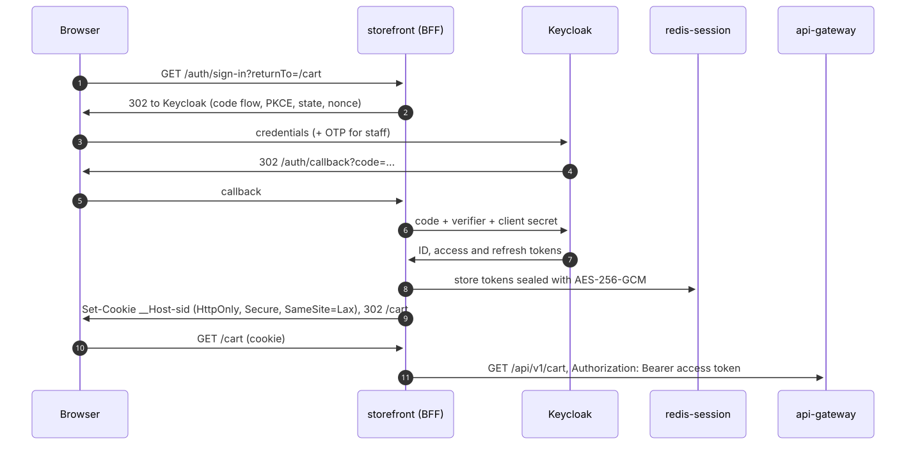

# 12. Security design

How the platform protects customers, money and data: the trust boundaries, the threats at each (STRIDE), sign-in and
authorisation, secrets, data protection, and the supply chain. The storefront's own controls are detailed in
[16 Storefront UI §16.5–16.6](16-storefront-ui.md#165-sign-in-sessions-and-tokens-bff); requirements are in
[SPEC §8.1](SPEC.md#81-security). Section 12.8 lists what is designed but not yet built.

## 12.1 Trust boundaries

<picture>
  <source media="(prefers-color-scheme: dark)" srcset="diagrams/security-design--trust-boundaries.dark.svg">
  
</picture>

| Boundary | What crosses it | Trust decision |
|---|---|---|
| B1 Internet → edge | everything | TLS 1.2+, HSTS preload; per-address rate limits; only the edge has a `LoadBalancer` |
| B2 Edge → storefront / Keycloak | page requests, sign-in | storefront trusts nothing from the browser but its sealed session cookie |
| B3 → api-gateway | API calls with a bearer token | signature, expiry, issuer and audience checked; roles for staff routes; `/internal/**` denied |
| B4 Gateway → services | routed calls with the token | each service validates the JWT again and checks ownership (`order.customerId == sub`) |
| B5 Service → service (`/internal`) | checkout saga calls, price lookups | network policy: only the named caller may reach the port (e.g. only order-service → payment-service) |
| B6 Services → platform stores | queries, events | one database and user per service; network policy per namespace |
| B7 Platform → payment provider | authorise, capture, void, refund | egress gateway with an FQDN allow-list; card data never enters the platform (PCI DSS SAQ A) |

## 12.2 Threats per boundary (STRIDE)

| # | Threat | Where | Control |
|---|---|---|---|
| S | Spoofing a user | B1–B3 | OIDC with Keycloak; JWTs (5 min) validated at the gateway and again in each service; staff need a second factor; brute-force lockout |
| S | Spoofing a service | B5 | network policies admit only the named caller; mTLS planned (12.8) |
| T | Tampering with prices or totals | B3–B5 | the client sends SKUs and quantities only; cart-service prices from catalog; order-service totals from the cart snapshot, not the request |
| T | Tampering with events | Kafka | only the owning service writes its topic (outbox); consumers validate the envelope and park unreadable events in `<topic>.dlq` |
| R | Repudiation of orders or refunds | order, payment | the order, its saga step and cancel reason are persisted with timestamps; the customer id comes from the token; request id and trace id on every request |
| I | Token theft through XSS | storefront | no tokens in the browser; strict CSP with nonces; React escaping |
| I | Data leaks in logs and URLs | all | no personal data in URLs; emails masked in logs; problem responses carry codes, never stack traces |
| I | Reading another customer's order | B4 | ownership check in the application layer; a foreign order is `404`, not `403`, so ids cannot be probed |
| D | Floods, scraping, credential stuffing | B1, B3 | edge limits per address; gateway token buckets per user and per address; sign-in limits; admission control per hot SKU |
| D | One slow dependency stalls checkout | B5 | timeouts, retries and a circuit breaker per downstream (Resilience4j `ResilientCall`) |
| E | Customer calls staff endpoints | B3–B4 | `hasRole("staff")` at the gateway and in catalog; staff role only from Keycloak |
| E | Reaching `/internal` from outside | B3 | gateway `denyAll` on `/internal/**`; the edge routes only `/api`, pages and `/auth` |
| E | Compromised pod moves sideways | B5–B6 | non-root, read-only root filesystem, all capabilities dropped, `RuntimeDefault` seccomp; default-deny network policies; per-service database users |

## 12.3 Authentication and sessions

<picture>
  <source media="(prefers-color-scheme: dark)" srcset="diagrams/security-design--authentication-and-sessions.dark.svg">
  
</picture>

* The storefront is a confidential client; the browser never holds a token. A guest cart uses a random `__Host-guest`
  cookie, merged into the account at sign-in.
* Access tokens live 5 minutes; the BFF refreshes them 60 s before expiry; refresh tokens rotate. Sessions end after 30
  minutes idle or 12 hours. Sign-out ends the Keycloak session too.
* The API (`shop-web`, public client with the password grant) is enabled only in dev, for tests and API exploration.

## 12.4 Authorisation

| Rule | Enforced in |
|---|---|
| Public: browse, search, product, reviews (read), recommendations | gateway and services `permitAll` |
| Signed in (`customer`): cart merge, checkout, orders, cancel, write a review | gateway `authenticated`; services check the token |
| Own data only: orders, cancellation, reviews of bought products | application layer (`isOwnedBy`, review eligibility from `order.events`) |
| Staff: products, categories, images, stock | gateway and catalog `hasRole("staff")`; staff can act on any order |
| Internal: saga calls, prices | not routed by the gateway; network policy per callee |

Roles come only from Keycloak's realm roles in the token. Nothing in the request body or headers can grant one.

## 12.5 Secrets

| Secret | Held in | Reaches the pod as |
|---|---|---|
| Database, RabbitMQ and Redis passwords | the environment's vault | External Secrets → Kubernetes Secret → env (staging, prod); `dev-secrets` in Git for dev only |
| Storefront client secret and session key | vault | External Secret; the session key has a key id so it can rotate |
| Payment provider key | vault | External Secret, payment-service only |
| TLS certificates | cert-manager | Secret mounted by the edge |

Nothing secret is in the repository except the dev overlay's fixed passwords, which only work on a local cluster. Images
contain no secrets; configuration comes from ConfigMaps and Secrets at run time.

## 12.6 Data protection

| Data | Where | Protection |
|---|---|---|
| Card numbers | never in the platform | tokenised in the browser by the provider; the platform sees a token and the last four digits |
| Customer identity (name, email) | Keycloak; the email is stored with the order (`orders.customer_email`) and carried in `order.events` for receipts | TLS outside the cluster; the storefront masks it in logs; storage encryption is the cluster's (12.8) |
| Orders and payments | PostgreSQL `orders`, `payments` | per-service database user; three replicas across zones in prod; backups not yet configured (12.8) |
| Sessions and tokens | `redis-session` | AES-256-GCM sealed; no persistence beyond the session lifetime |
| Traces and logs | Tempo, Loki | request ids, not personal data; query strings dropped from span names and URLs; retention 24–72 h locally, set per environment |

Retention and deletion follow [04 Database design](04-database-design.md) (retention section).

## 12.7 Supply chain and builds

* Pinned versions everywhere: Gradle version catalogs (`gradle/libs.versions.toml`) in every Java service,
  `package-lock.json` with integrity hashes, Go modules, `pyproject.toml`; image tags pinned in compose and Kubernetes.
* CI per service: tests and image build; the storefront adds `npm audit`, a CycloneDX SBOM and a bundle budget.
* Base images: distroless or slim, non-root. Nightly ZAP baseline scan against the storefront through the edge.

## 12.8 Gaps (designed, not yet built)

| Gap | Risk today | Plan |
|---|---|---|
| mTLS between services (SPEC §8.1) | B5 relies on network policies only; a pod that can reach a port can call `/internal` without credentials | a mesh with mTLS and per-service identities, or client-credential tokens for internal calls |
| WAF and bot detection | only rate limits and lockout stop automated abuse | WAF at the CDN in front of the edge |
| Image signing and admission policy | an unsigned image could be deployed | cosign signatures with provenance; an admission policy that requires them |
| Trusted Types enforcement | report-only | enforce once reports are clean ([16 §16.6](16-storefront-ui.md#166-security-design)) |
| Automated dependency updates | versions go stale unless someone bumps them | Renovate (or Dependabot) across Gradle, npm, Go and Python |
| SBOMs for the backend services | only the storefront produces one | CycloneDX Gradle, Go and Python plugins in each service's CI |
| Database backups and volume encryption | a lost cluster loses orders; disks rely on the provider's defaults | CloudNativePG backups to object storage with point-in-time recovery; an encrypted storage class |
| payment-service ingress | also admits any pod in `e-commerce-platform` on 8086 | narrow it to the monitoring scrape port once metrics move to a separate port |
