# 13. Observability and SLOs

What the platform measures, what it promises, and how a person gets from an alert to the cause. The decision is
[ADR 0013](adr/0013-observability-with-opentelemetry-alloy-and-slos-at-the-gateway.md); the implementation, how to run it
and how to check it are in [`deploy/observability`](../deploy/observability/README.md); what to do when an alert fires is
in [15 Runbooks](15-runbooks.md).

## 13.1 Signals and pipeline

<picture>
  <source media="(prefers-color-scheme: dark)" srcset="diagrams/observability-and-slos--signals-and-pipeline.dark.svg">
  
</picture>

| Signal | Produced by | Conventions |
|---|---|---|
| Traces | edge: NGINX's OpenTelemetry module (the trace starts where the request enters); Java: Micrometer Tracing bridged to OpenTelemetry; storefront: OTel Node SDK with HTTP and undici instrumentation; notification-service: OTel Go SDK (a span per Kafka record and per email attempt, the context carried in RabbitMQ headers through the retry queues); recommendation-service: OTel Python SDK (FastAPI and a span per Kafka record) | W3C `traceparent` everywhere, including Kafka record headers and the outbox row; health checks, metrics scrapes and the relay's polling are not traced; query strings are dropped from span names and URLs |
| Metrics | Micrometer at `/actuator/prometheus` (payment-service on its own management port in Kubernetes); `/metrics` in Go and Python; Strimzi's Kafka exporter; CloudNativePG instances (WAL archiving, backups) | Prometheus naming; histograms for `http.server.requests` (5 ms – 5 s) with exemplars (`trace_id`) that Grafana's latency panels show and link to Tempo; the gateway's per-route histogram with buckets at each SLO threshold |
| Logs | stdout, one JSON object per line | Java: ECS (`LOGGING_STRUCTURED_FORMAT_CONSOLE=ecs`) with `traceId` and `spanId`; storefront, notification and recommendation: the same fields; the edge: its access log with the request id, and the firewall's audit records; labels in Loki are only `service` and `level`, the trace id is structured metadata |

## 13.2 One trace from click to consumers

The outbox writer stores the request's `traceparent` with each event; the relay sends the event inside that context, so the
asynchronous half of a request belongs to the same trace. Verified on the local stack with a real checkout:

```
api-gateway        http post /api/v1/orders                        request.id = 4525fb06-…
order-service        http post /api/v1/orders
cart-service           http get /internal/carts/{customerId}/checkout-snapshot
inventory-service      http post /internal/reservations
payment-service        http post /internal/payments/authorize
order-service          order.events send          (outbox relay, after commit)
cart-service             order.events process     (cart cleared)
inventory-service        order.events process
```

Problem responses return the request id as `traceId`. Support can paste it into Tempo
(`{ span.request.id = "<id>" }`) and land on the trace, then jump to that trace's log lines in Loki.

## 13.3 SLIs and SLOs

Measured at the API gateway per route, so failures between the gateway and a service count against the service. Objectives
are over 30 days and come from SPEC §2.2.

| Journey | SLI | Objective | Error budget (30 days) |
|---|---|---|---|
| Browse (catalog, search, reviews, recommendations, order reads) | non-5xx responses / all | 99.95 % | 21.6 min |
| Cart | non-5xx / all on cart routes | 99.95 % | 21.6 min |
| Checkout | non-5xx / all on `POST /orders` | 99.9 % | 43.2 min |
| Product page latency | GET catalog under 150 ms | 99 % | 1 % of requests |
| Search latency | GET search under 300 ms | 99 % | 1 % |
| Add-to-cart latency | PUT/POST cart items under 100 ms | 99 % | 1 % |
| Checkout latency | `POST /orders` under 1.5 s | 99 % | 1 % |

A declined payment or an out-of-stock answer is a correct `4xx`/`409` outcome, not an error. Checkout outcomes are counted
separately (`checkout_outcomes_total{outcome}`) so the business can see declines without them burning the budget.

The table lives in one place, `deploy/observability/generate.py`, which writes the recording rules, the alerts, the
Kubernetes PrometheusRules and the SLO dashboard; CI fails when the generated files are stale.

## 13.4 Alerts

Burn-rate alerts follow the SRE workbook's multi-window pattern: both a long and a short window must burn, so an alert
starts fast and stops soon after the problem does.

| Alert | Windows | Burn rate | Budget gone in | Severity |
|---|---|---|---|---|
| `ErrorBudgetBurnFast` | 1 h and 5 min | 14.4 | ~2 days | page |
| `ErrorBudgetBurnFast` | 6 h and 30 min | 6 | 5 days | page |
| `ErrorBudgetBurnSlow` | 1 day and 2 h | 3 | 10 days | ticket |
| `ErrorBudgetBurnSlow` | 3 days and 6 h | 1 | 30 days | ticket |

Cause-based alerts cover what SLOs see late or not at all:

| Alert | Fires when | Severity |
|---|---|---|
| `OutboxBacklogStale` | the oldest unpublished event of a service is older than 30 s | page |
| `TopicGrowingFasterThanItsEvents` | a topic grows more than ten times faster than its outbox publishes (a producer re-sending) | page |
| `ServiceDown` | Prometheus cannot scrape a service for 2 min | page |
| `DeadLetterQueueNotEmpty` | any `<topic>.dlq` has messages | ticket |
| `ConsumerLagGrowing` | a consumer group is more than 1,000 events behind and still falling behind, for 10 min | ticket |
| `PaymentOutcomeUnknown` | more than 5 checkouts ended in a payment timeout within 15 min | ticket |
| `PaymentDeclineRateHigh` | more than 30 % of checkouts declined for 15 min | ticket |
| `RateLimiterDegraded` | the gateway cannot reach Redis and limits per instance | ticket |

Every alert has a runbook section ([15](15-runbooks.md) and `deploy/observability/RUNBOOK.md`) and unit tests run by
`promtool` in CI.

## 13.5 Dashboards

| Dashboard | Shows |
|---|---|
| Services: rate, errors, duration | RED per service and route, p50/p95/p99 from histograms |
| SLOs and error budgets | each SLO's 30-day compliance, budget left, burn rates per window |
| Checkout, events and Kafka | checkout outcomes, outbox backlog and age, events published per type, messages produced per topic, consumer lag, DLQ depth |
| Analytics (ClickHouse) | business views: orders, revenue, top products ([analytics](../services/analytics/README.md)) |

## 13.6 Sampling, retention and cost

| Environment | Traces | Logs | Metrics |
|---|---|---|---|
| Local (compose) | 100 %, 24 h | 72 h | 15 d |
| Kubernetes | tail sampling: every error, every trace over 1 s, 10 % of the rest | per environment | per environment |

Tail sampling needs all spans of a trace on one collector: an Alloy DaemonSet receives spans and routes them by trace id to
an `alloy-sampler` StatefulSet, which decides once the trace is complete.

## 13.7 Known gaps

* The storefront's Node metrics carry no exemplars (prom-client attaches them only to histograms given a trace id by
  hand); its traces are linked from the gateway's and the edge's instead.
* Locally, the core stack plus this profile needs about 5 GB of Docker memory under load.
