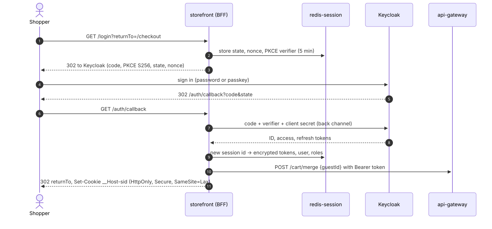

# 16. Storefront UI

The storefront: the web app shoppers and staff use. It is designed to production grade and secure, not as a throwaway
demo. This document shows what the industry uses, ranks the options against this project's needs, gives the reason for
every decision, and designs the app. Milestone **UI** in the [implementation plan](IMPLEMENTATION-PLAN.md); decision record
[ADR 0012](adr/0012-storefront-server-rendered-with-react-router-and-a-backend-for-frontend.md).

## 16.1 Requirements

| Requirement | What it means for the UI |
|---|---|
| **Production grade** | Public product and search pages are fast on a mid-range phone (LCP < 2.5 s, INP < 200 ms, CLS < 0.1) and indexable by search engines; zero-downtime releases; observable (logs, metrics, traces); runs in every environment of [03 Deployment](03-deployment.md) |
| **Secure** | No access or refresh token ever reaches the browser; protection against XSS, CSRF, clickjacking, session theft and supply-chain attacks; least privilege on the network; follows the OWASP ASVS 5.0 level 2 controls for web front ends |
| **Correct** | Every API outcome has a screen, including every checkout outcome of the saga; no double orders |
| **Accessible** | WCAG 2.2 AA, checked automatically on every page |
| **Maintainable** | Mainstream technology, typed against the services' OpenAPI contracts, tested at every level |

In scope: browse, search with facets, product page with reviews and recommendations, guest cart, sign-in and registration
(Keycloak), cart merge, checkout, orders, cancellation, reviews, and staff pages for products, images, categories and stock.
Out of scope: real payments (payment-service simulates the provider), multiple languages and currencies, native apps, a CMS.

## 16.2 What the industry uses

Measured on 2026-11-19 from the public npm registry (downloads in the last week), GitHub, and the frameworks' published
security advisories. Downloads overstate packages that other tools pull in and include CI installs, so they show relative
use, not head counts. Developer surveys of recent years (Stack Overflow, State of JS) give the same order for the big
three: React well ahead, then Angular and Vue, then Svelte.

### UI libraries

| Rank | Library | npm downloads / week | GitHub stars | Where it is used in practice |
|---|---|---|---|---|
| 1 | React | 268.6 M | 252.7 k | The default for new web apps; most jobs, libraries and examples; most commerce front ends (Shopify Hydrogen, many headless shops) |
| 2 | Vue | 25.9 M | 55.0 k | Strong in Asia and with PHP/Laravel teams; Nuxt for server rendering |
| 3 | Angular | 8.3 M | 101.4 k | Large enterprises and internal apps; everything built in |
| 4 | Svelte | 10.2 M | 89.7 k | Loved by developers, small bundles, smaller job market |
| — | Solid, Preact, Qwik | — | — | Niche, or pulled in by other tools |

### Application frameworks (routing, server rendering, server code)

| Rank | Framework | Built on | npm downloads / week | Advisories in 2026 (critical / high) | Typical use |
|---|---|---|---|---|---|
| 1 | Next.js 16 | React | 97.7 M | 5 / 7 | Public React sites; the most common React framework |
| 2 | React Router 8 framework mode (formerly Remix) | React, Vite | 78.9 M (library + framework) | 1 / 12 | Apps that grew from React Router; Shopify Hydrogen |
| 3 | TanStack Start | React, Vite | 13.7 M | — (young) | Newer full-stack React with typed routing |
| 4 | Astro 7 | any (islands) | 12.3 M | — | Content sites with little interactivity |
| 5 | SvelteKit 3 | Svelte, Vite | 5.5 M | — | Svelte apps with server rendering |
| 6 | Nuxt 4 | Vue, Vite | 3.5 M | — | Vue apps with server rendering |

Advisory counts are from each project's GitHub security advisories. Both leading frameworks ship fixes often; React
Router's latest batch (2026-11-18) is fixed in 8.5.1, and the storefront starts on 8.5.2. The lesson for a secure design is
not "pick the one with no advisories" but "use few framework features, and patch within days" (§16.11).

### The rest of the stack

| Concern | Most used today | Runner-up | Note |
|---|---|---|---|
| Build tool | **Vite** (284 M) | webpack (75 M, mostly legacy) | Every framework above except Next.js builds with Vite |
| Server-side OIDC | **openid-client** (Node) | Auth.js (Next.js-centred) | openid-client is a certified OpenID relying party library |
| Server data in the browser | **TanStack Query** (89.6 M) | Redux Toolkit (51.3 M) | Mostly replaced by framework loaders when the server renders |
| Styling | **Tailwind CSS** (187.5 M) | styled-components, MUI (14 M each) | CSS-in-JS declined with server rendering |
| Accessible primitives | Radix (99.5 M) | React Aria Components (9.8 M) | Unstyled, accessible building blocks |
| Unit tests | **Vitest** (190 M) | Jest (61 M) | |
| Browser tests | **Playwright** (136.4 M) | Cypress (7.3 M) | |

**Practical reading:** in 2026 a team building a public, production web shop most often picks React + TypeScript with a
server-rendering framework, Next.js first and React Router second. Plain single-page apps built with Vite remain the
common choice for internal tools and apps behind a login.

## 16.3 Choosing the stack

### Why the requirements rule out a plain single-page app

An earlier plan for this milestone was a React + Vite single-page app with tokens in the browser, because it needed no
server. The production-grade and secure requirements change that:

1. **Tokens must stay off the browser.** The IETF guidance *OAuth 2.0 for Browser-Based Applications* ranks a
   backend-for-frontend (BFF) as the most secure pattern: a server keeps the tokens and the browser holds only an
   `HttpOnly` session cookie. With tokens in the browser, any XSS bug can use them; with a BFF, it cannot steal them.
2. **Public pages must render on the server.** Search engines and first-load speed on phones need HTML with the product
   in it, not an empty page that fills in after JavaScript runs.

Both need a server. Once there is a server, the best choice is a framework that renders React on the server and is the
BFF, in one process.

### Criteria

| Criterion | What it asks | Weight |
|---|---|---|
| Production storefront fit | Server rendering, streaming, caching of public pages, SEO, Core Web Vitals | 25 % |
| Security model | Server-side sessions and tokens (BFF) without custom glue; CSRF protection; size of the attack surface; patch record | 20 % |
| Ecosystem and hiring | Libraries, examples, people who know it (§16.2) | 20 % |
| Simplicity | Concepts to learn and get right: rendering modes, caches, server/client boundaries | 15 % |
| OIDC fit | Standard Keycloak sign-in with a confidential client | 10 % |
| Testing and tooling | Unit, component, browser tests; type safety; dev speed | 10 % |

### Ranking

Scores 1–5 per criterion; total out of 100.

| Rank | Option | Storefront | Security | Ecosystem | Simple | OIDC | Tooling | **Total** |
|---|---|---|---|---|---|---|---|---|
| **1** | **React Router 8 framework mode (React 19, Vite, server rendering + BFF)** | 5 | 5 | 4 | 4 | 5 | 4 | **91** |
| 2 | Next.js 16 (App Router) | 5 | 4 | 5 | 2 | 4 | 4 | 83 |
| 3 | SvelteKit 3 | 5 | 5 | 2 | 4 | 4 | 4 | 81 |
| 4 | Nuxt 4 | 5 | 4 | 3 | 3 | 4 | 4 | 78 |
| 5 | Angular 22 with SSR | 4 | 4 | 4 | 2 | 4 | 5 | 76 |
| 6 | Astro 7 with React islands | 4 | 4 | 3 | 4 | 3 | 4 | 74 |
| 7 | React + Vite single-page app + separate BFF | 2 | 4 | 5 | 2 | 4 | 5 | 69 |
| 8 | TanStack Start | 4 | 3 | 2 | 3 | 3 | 3 | 61 |
| 9 | Vue + Vite single-page app | 2 | 3 | 3 | 3 | 4 | 4 | 59 |

How the security scores were set: 5 = server sessions are the framework's normal way of working, the request model is plain
HTTP (forms, loaders, actions) that is easy to reason about, and the features we would use have a short advisory list;
4 = a BFF works but needs more care (more server features with their own advisories, or a separate process); 3 = tokens
would sit in the browser, or the project is too young to judge.

### The decision

**React Router 8 in framework mode: React 19 + TypeScript, rendered on the server by a Node 26 LTS process that is also the
backend-for-frontend.**

Why, point by point:

1. **Secure by construction.** The server holds the Keycloak tokens in a server-side session; the browser gets one
   `__Host-` session cookie (`HttpOnly`, `Secure`, `SameSite=Lax`). Every API call goes browser → storefront server →
   gateway, and the server adds the access token. An XSS bug can no longer read or exfiltrate a token.
2. **Plain web model.** Data loads in route `loader`s and changes go through route `action`s, which are ordinary HTTP GET and
   POST handlers. Auth checks are explicit code at the top of each loader and action, so they are easy to review and test.
   No hidden layers decide what runs where.
3. **Small attack surface by choice.** We use server rendering, loaders, actions and nothing more: no React Server
   Components, no framework image optimisation, no edge middleware. Most 2026 advisories in both leading frameworks are in
   exactly those features.
4. **Production storefront fit.** Product, category and search pages render on the server with streaming, so a phone gets
   readable HTML at once; they are cacheable at the edge for signed-out visitors. Shopify's own React storefront framework
   (Hydrogen) is built on this same framework, which is evidence that it suits commerce.
5. **Mainstream React.** The components, hooks and libraries are ordinary React; the build is Vite. Anyone who knows React
   can work on it, and nothing locks the project to a hosting vendor.

**Why not Next.js, the most used option?** It is a sound choice and scores second. It loses here on simplicity and attack
surface: server components, server actions, several caching layers and middleware are more concepts to get right, and
those features carried five critical advisories this year. Its strengths (image optimisation, edge runtime, a hosting
platform) are not needed with our NGINX edge and CDN. A team already fluent in Next.js could pick it and follow the
same design (§16.5–16.11 apply unchanged).

**Why not SvelteKit?** Technically as strong and as secure, but a much smaller ecosystem and hiring pool.

**Why not keep the single-page app?** It would need a separate BFF anyway, and still could not serve indexable public pages.

### How the decision was reached

| Date | Question | Answer and reason |
|---|---|---|
| 2026-11-19 | Should the platform have a UI at all? | Yes: a storefront milestone after the end-to-end tests (P3). Every API it needs already exists, and a real UI makes the walkthroughs and videos far clearer than API calls |
| 2026-11-19 | React with Vite, or Next.js, for a simple demo? | React + Vite single-page app: simplest to run (static files on the existing edge), most common skills, and a demo behind sign-in needs no server rendering |
| 2026-11-19 | Requirement added: **the UI must be production grade and secure** | The single-page app no longer qualifies: tokens would sit in the browser and public pages would not be server-rendered. Both needs call for a server, so the criteria gained *security model* and *production storefront fit*, and the stacks were re-ranked (above) |
| 2026-11-19 | Final choice | **React Router 8 framework mode (rank 1, 91/100)**, confirmed by the project owner; Next.js (83) stays the documented alternative |

## 16.4 Architecture

<picture>
  <source media="(prefers-color-scheme: dark)" srcset="diagrams/storefront-ui--architecture.dark.svg">
  
</picture>

* **One public origin** (`shop.example`). The edge sends `/` and every page route to the storefront, and `/assets/*` comes
  from the CDN (origin: the storefront). The pages never call `/api/*` from the browser: they call the storefront, which
  calls the gateway with the token. `/api/*` stays public for clients that hold their own bearer tokens (the end-to-end
  tests, the smoke test, future mobile apps); the gateway accepts only `Authorization: Bearer`, never the session cookie,
  so a stolen cookie is useless against the API.
* **Same image everywhere.** Settings that differ per environment (issuer URL, client id, CDN host) come from environment
  variables and the `deploy/k8s` hosts component, never from the build.
* **Stateless pods.** Sessions live in `redis-session`, so any pod serves any request and pods can roll or scale freely.

**Why a separate `redis-session`?** Sessions must never be evicted by cache pressure or flushed with a cache: the same
reason notification's sent log has its own instance. It uses an append-only file and `noeviction`.

## 16.5 Sign-in, sessions and tokens (BFF)

<picture>
  <source media="(prefers-color-scheme: dark)" srcset="diagrams/storefront-ui--sign-in-sessions-and-tokens-bff.dark.svg">
  
</picture>

| Decision | Why |
|---|---|
| Confidential client `shop-storefront` (client secret from the vault) with PKCE and `nonce` | A server can keep a secret, so Keycloak authenticates the client too; PKCE and nonce still protect the code and the ID token |
| Tokens only in `redis-session`, encrypted with AES-256-GCM (key from the vault, rotated with a key id) | A Redis dump or backup does not expose usable tokens |
| Cookie `__Host-sid`: random 256-bit id, `HttpOnly`, `Secure`, `SameSite=Lax`, `Path=/`, no `Domain` | The `__Host-` prefix forbids sub-domain cookies; scripts cannot read it; it is not sent on cross-site POSTs |
| New session id at sign-in and on role change | Prevents session fixation |
| Idle timeout 30 min, absolute 12 h; access token refreshed by the server 60 s before expiry; refresh tokens rotate | Short-lived credentials without bothering the shopper |
| Sign-out ends the Keycloak session (RP-initiated logout) and deletes the Redis session; Keycloak back-channel logout also deletes it | Signing out anywhere signs out everywhere |
| `returnTo` must be a relative path on our origin | Prevents open redirects |
| Staff accounts need a second factor (Keycloak OTP or passkey) | Staff can change prices and stock |
| Guest cart: random `__Host-guest` cookie (`HttpOnly`), sent by the BFF as `X-Guest-Id`; merged and cleared at sign-in | Guests shop without an account; the id never appears in scripts or URLs |

Realm changes this needs: client `shop-storefront` (confidential, standard flow only, redirect URI
`https://<shop host>/auth/callback`, back-channel logout URL); `shop-web` (public) is kept only for local API exploration in
dev; brute-force detection on; password policy (length ≥ 12, breached-password check).

## 16.6 Security design

### Threats and controls

| Threat | Control |
|---|---|
| XSS steals tokens | No tokens in the browser (§16.5). |
| XSS runs actions as the user | Strict CSP with a per-request nonce, no inline scripts or `eval`, no third-party scripts; React escapes output; `dangerouslySetInnerHTML` banned by lint; review bodies are plain text; Trusted Types first in report-only mode, enforced once reports are clean |
| CSRF | `SameSite=Lax` cookie, every state-changing request is POST/PUT/DELETE, plus a check of `Origin` (must equal the shop origin) and a per-session CSRF token on every form and fetch; actions reject anything else |
| Clickjacking | `frame-ancestors 'none'` and `X-Frame-Options: DENY` |
| Session theft or fixation | `__Host-` cookie, rotation at sign-in, idle and absolute timeouts, sessions revocable server-side |
| Open redirect | `returnTo` limited to relative paths |
| Broken access control | Every loader and action checks the session and roles before calling the API; the gateway and services enforce the same rules again (the UI is never the only check) |
| Injection into API calls | Inputs validated with Zod schemas generated from the OpenAPI contracts; path parameters encoded; the BFF forwards only a fixed list of API routes, never a caller-supplied URL (no server-side request forgery) |
| Abuse (credential stuffing, scraping, cart spam) | Edge rate limits per IP on `/login`, `/auth/*` and search; Keycloak brute-force lockout; gateway token buckets per user |
| Sensitive data exposure | HTTPS only with HSTS preload; no personal data in URLs or logs (emails and names masked); `Cache-Control: private, no-store` on every signed-in page; the edge caches only anonymous public pages |
| Supply chain | Lockfile with integrity hashes, `npm ci --ignore-scripts`, dependency review and `npm audit` in CI, Renovate for updates, SBOM (CycloneDX) and signed image with provenance; framework advisories patched within 72 h (critical) or 7 days (high) |
| Compromised pod | Distroless Node image, non-root, read-only root filesystem, all capabilities dropped, seccomp `RuntimeDefault`; egress only to the gateway, Keycloak and `redis-session` |

### Response headers (set by the storefront, enforced by the edge)

| Header | Value |
|---|---|
| `Content-Security-Policy` | `default-src 'self'; script-src 'nonce-…' 'strict-dynamic'; style-src 'self' 'nonce-…'; style-src-attr 'unsafe-inline'; img-src 'self' <cdn> data:; connect-src 'self'; font-src 'self'; frame-ancestors 'none'; form-action 'self' <id host>; base-uri 'none'; object-src 'none'; upgrade-insecure-requests` (inline `style` attributes are allowed because accessible components position popovers with them; they cannot run script) |
| `Strict-Transport-Security` | `max-age=63072000; includeSubDomains; preload` |
| `Cross-Origin-Opener-Policy` / `Cross-Origin-Resource-Policy` | `same-origin` / `same-site` |
| `Referrer-Policy` | `strict-origin-when-cross-origin` |
| `Permissions-Policy` | camera, microphone, geolocation, payment and USB disabled |
| `X-Content-Type-Options` | `nosniff` |

## 16.7 Pages and routes

<picture>
  <source media="(prefers-color-scheme: dark)" srcset="diagrams/storefront-ui--pages-and-routes.dark.svg">
  
</picture>

| Route | Rendering and caching | Data (API catalogue) |
|---|---|---|
| `/`, `/c/:slug`, `/p/:id`, `/search` | Server-rendered and streamed. HTML is never shared (it carries a one-time CSP nonce); for signed-out visitors the edge caches the loader data behind client-side navigation (`.data`, 30 s). Any cookie bypasses the cache | `GET /categories`, `/search`, `/products/{id}`, `/products/{sku}/reviews`, `/recommendations`; reviews and recommendations stream in and fail independently |
| `/cart` | Server-rendered, `private, no-store`; quantity changes are form actions with optimistic UI | `GET /cart`, `PUT /cart/items/{sku}`, `DELETE /cart`; "pricing pending" banner in degraded mode |
| `/checkout`, `/orders*`, `/p/:id/review` | Sign-in required; `private, no-store` | `POST /orders` (+ `Idempotency-Key`), `GET /orders`, `POST /orders/{id}/cancel`, `POST /reviews` |
| `/staff/*` | `staff` role and recent second factor required; never cached; code split so shoppers never download it | `/admin/products`, `/admin/categories`, image upload and confirm, inventory admin; edits send `If-Match`, a `412` shows "changed by someone else" |
| `/login`, `/logout` (POST), `/auth/callback`, `/auth/backchannel-logout` | BFF endpoints; per-address rate limit at the edge | Keycloak |
| `/healthz`, `/readyz`, `/metrics` | Not routed by the edge | |

All pages work without JavaScript for the core path (browse, search, add to cart, check out) because loaders and actions are
plain GET and POST; JavaScript improves them (instant navigation, optimistic updates). This is progressive enhancement, and it
also makes the app more robust on poor networks.

## 16.8 Checkout

<picture>
  <source media="(prefers-color-scheme: dark)" srcset="diagrams/storefront-ui--checkout.dark.svg">
  
</picture>

* **The server owns the idempotency key.** When the checkout page renders, the BFF creates a key and stores it in the
  session next to a hash of the cart. "Place order" posts to the action, which sends that key. A double click, reload or
  retry after a timeout reuses it, and order-service returns the first result: never two orders. A changed cart gets a new
  key.
* **Every outcome has a screen**, matching the saga in [05 Sequence diagrams](05-sequence-diagrams.md): out of stock marks the
  lines; declined keeps the cart; an unknown payment result shows "confirming your payment" and polls.
* **Card data never touches our servers.** In production the payment provider's hosted fields (in an isolated iframe on the
  provider's origin, allowed by `frame-src` for that origin only) produce the `paymentToken`; the demo provider issues test
  tokens. This keeps the storefront out of PCI DSS card-data scope.

## 16.9 Errors, loading and empty states

| Situation | What the user sees |
|---|---|
| `problem+json` with a known `code` | A specific message from one mapping table, tested against the API catalogue's error list |
| `400 VALIDATION_FAILED` | Messages next to the fields in `errors[]` |
| Session expired | Silent refresh by the server; if that fails, sign in and return to the same page (form input kept) |
| `403` | "You do not have access" |
| `429` | "Too many requests, try again in N seconds" (`Retry-After`) |
| `503 SEARCH_UNAVAILABLE` / `DEPENDENCY_UNAVAILABLE` | That section shows "temporarily unavailable"; the rest of the page works |
| Anything else | "Something went wrong" with a reference (`traceId`); details only in server logs |

Error pages never show stack traces or upstream messages. Loading states are skeletons shaped like the content.

## 16.10 Accessibility and performance

* **WCAG 2.2 AA:** semantic HTML first; React Aria Components for combobox, dialog, menu and toast; full keyboard use; visible
  focus; contrast checked in light and dark themes; focus moves to the page heading on navigation; axe runs in every browser
  test and fails the build on any violation.
* **Budgets (checked in CI on every change):** LCP < 2.5 s and INP < 200 ms on a throttled mid-range phone for home, search
  and product pages; JavaScript per route ≤ 150 kB compressed; no layout shift from images (width and height always set).
* **Images:** responsive sizes from the CDN (`srcset`), modern formats, lazy below the fold.

## 16.11 Technology inside the app

| Concern | Choice | Why |
|---|---|---|
| Framework | React Router 8.5 (framework mode), React 19, Vite 8 | §16.3 |
| Language | TypeScript 5.9, strict, erasable syntax only (Node runs `server.ts` directly) | Contract mismatches fail the build; TypeScript 7 waits for `openapi-typescript` and `typescript-eslint` to support it |
| Runtime | Node 26 LTS (supported to April 2029) on a distroless image | Current LTS line, small image without a shell |
| OIDC | `openid-client` 6 | Certified OpenID relying-party library; standards only, not tied to Keycloak |
| Sessions | Own small session store over `redis` 6 with AES-256-GCM | A few dozen lines we fully understand, instead of a generic session framework |
| API client and types | `openapi-typescript` + `openapi-fetch` from each service's `contracts/openapi.yaml`; Zod for runtime checks | The services are contract-first; a breaking API change fails the UI build |
| Browser data | Route loaders and actions; order status polling with React Router's `useRevalidator` | The server already loads data; no client store or query library needed |
| Styling | Tailwind CSS 4 with design tokens as CSS variables (light and dark) | Most used approach, no runtime cost, works with a strict CSP (styles from files, no CSS-in-JS) |
| Logging, metrics, tracing | `pino` (JSON, tokens and cookies redacted); `@prometheus-io/client` (the maintained successor of `prom-client`) on `/metrics`; `X-Request-Id` forwarded to the gateway; OpenTelemetry arrives with P5 | One trace from click to database |
| Tests | Vitest 5 + Testing Library + MSW 3; Playwright 1.65 + axe-core; OWASP ZAP baseline scan | §16.13 |

**Patch policy:** Renovate opens updates daily; framework and runtime security fixes ship within 72 hours (critical) or 7
days (high); CI blocks a release that has a known critical or high advisory.

## 16.12 Deployment

| Item | Value |
|---|---|
| Project | `web/storefront` (not under `services/`: it owns no business data and publishes no API, but it is an independent project with its own build, tests, CI and README) |
| Image | Multi-stage: `npm ci --ignore-scripts` → build → distroless Node 26, non-root, read-only root, port 8090 |
| Kubernetes | Deployment (3 replicas, spread across zones), HPA on CPU, PDB `minAvailable: 50%`, probes on `/readyz` and `/healthz`, graceful shutdown that drains in-flight requests; network policy: ingress from the edge only, egress to api-gateway, Keycloak and `redis-session` |
| Edge | `/` and page routes → storefront; `/assets/*` → storefront with `immutable` caching (CDN in front); `/api/*` → gateway as today (bearer-token clients); `/docs/*` unchanged; per-IP rate limits on `/login` and `/auth/*` |
| Secrets | `STOREFRONT_CLIENT_SECRET`, `SESSION_ENCRYPTION_KEYS` from the vault through External Secrets (generated values in dev) |
| Local | `npm run dev` with the compose stack; compose service `storefront` behind the edge at `https://localhost:8443/` |
| Releases | Rolling update with `maxUnavailable: 0`; old and new pods share sessions (session format versioned); assets kept for one release so open pages keep working |

## 16.13 Testing

| Level | Tool | Covers |
|---|---|---|
| Types | `tsc` strict, generated API types | Every API call matches its contract |
| Unit | Vitest | Session encryption and rotation, CSRF and `Origin` checks, `returnTo` validation, problem-code mapping, money formatting (string amounts, never floats), idempotency-key lifecycle |
| Component | Vitest + Testing Library + MSW | Each page with success, empty, error and slow responses |
| BFF integration | Vitest + Testcontainers (Redis, Keycloak) | Sign-in, refresh, sign-out, back-channel logout, expired and tampered cookies, role changes |
| End to end | Playwright + axe against the compose stack | Browse → search → cart → sign in (merge) → checkout → email in Mailpit; out of stock; declined; cancel; review; staff product with image and stock; every page accessible |
| Security | OWASP ZAP baseline in CI; header and cookie assertions in Playwright; dependency audit | No missing headers, no token in any response body or storage, CSRF rejected without a token |
| Performance | Lighthouse CI on home, search and product pages | Budgets of §16.10 |

## 16.14 Delivery steps

| Step | Result |
|---|---|
| U1 | Project scaffold, server rendering, design tokens and layout, generated API client, CI with audits, image and k8s base |
| U2 | BFF: OIDC sign-in and sign-out, encrypted sessions in `redis-session`, CSRF, security headers, guest cookie; realm client |
| U3 | Catalogue, search with facets, product page with reviews and recommendations; edge caching for anonymous pages |
| U4 | Cart, merge, checkout with every outcome, orders, cancellation, reviews |
| U5 | Staff pages with second factor: products, images, categories, stock |
| U6 | Edge routing, compose and k8s wiring, Playwright + axe + ZAP + Lighthouse in CI, README and walkthrough |

## 16.15 As built

The storefront is in [`web/storefront`](../web/storefront/README.md). Where the build differs from the design above, and why:

| Design | As built | Why |
|---|---|---|
| Edge caches anonymous HTML for 30 s | Edge caches only `.data` loader responses and assets | Every HTML page carries a fresh CSP nonce; a shared copy would give every visitor the same nonce, which defeats it |
| Product URLs by SKU | `/p/:id`; the cart, which knows SKUs, uses `GET /products/by-sku` (added to catalog-service) to show names and links | Product ids are stable; SKUs can change |
| Browser uploads images straight to object storage | Staff upload through the storefront, which forwards the file to the pre-signed URL | No object-storage origin in `connect-src`; the 5 MB limit and content type are checked on our side first |
| React Aria Components | Native HTML form elements (inputs, selects, radio groups) | No page needs a combobox or menu yet; axe finds no violation |
| Component tests with MSW; BFF tests with Testcontainers | Unit tests (27) for crypto, sessions, CSRF, `returnTo`, problems and money; the BFF is exercised end to end by Playwright against real Keycloak and Redis | The browser journeys cover the same paths with fewer moving parts; component tests come when pages gain client logic |
| `ApiError` thrown from a loader | Shaped as a React Router error response | The page answers with the upstream status (404, 429, 503) and the reference id, not a generic 500 |

**Measured** (compose stack, Apple silicon, 4 GB Docker VM):

| Check | Result |
|---|---|
| Client JavaScript, all routes together | 132 kB gzip (budget 150 kB per route; `npm run budget` fails above it) |
| Lighthouse, mobile emulation, home and search (3 runs each) | LCP 0.8–1.0 s, CLS 0, TBT 0–209 ms, accessibility 100, best practices 96 |
| OWASP ZAP baseline | 0 failures. Warnings reviewed: no `Cross-Origin-Embedder-Policy` (would block CDN images without CORP; accepted), `private, no-cache` on HTML (intended), "timestamps" are product SKUs. Duplicate HSTS on assets and a 500 for `/sitemap.xml` were fixed |
| Browser journeys (Playwright + axe) | 5 storefront journeys plus 14 API journeys, 19 of 19 passing |
| Image | 248 MB, distroless Node 26, non-root, read-only root |

The edge limits sign-in to 10 requests a minute per address (`SIGN_IN_RATE`); the local stack raises it to 300 because the
journeys sign in many times from one address.
