# 3. Deployment design

## 3.1 Production topology (one region, three availability zones)

<picture>
  <source media="(prefers-color-scheme: dark)" srcset="../diagrams/deployment--production-topology-one-region-three-availabilit.dark.svg">
  
</picture>

Stateful systems run either as managed services or through Kubernetes operators:
* PostgreSQL: CloudNativePG or Patroni.
* Kafka: Strimzi.
* Redis: Redis operator.
* OpenSearch: OpenSearch operator.
* Cassandra: K8ssandra.
* MinIO: MinIO operator.
* RabbitMQ: RabbitMQ Cluster Operator.
* ClickHouse: Altinity ClickHouse operator.

## 3.2 Node pools and placement

<picture>
  <source media="(prefers-color-scheme: dark)" srcset="../diagrams/deployment--node-pools-and-placement.dark.svg">
  
</picture>

* **Spread:** `topologySpreadConstraints` with `maxSkew: 1` across zones and hosts for every Deployment and StatefulSet.
* **Isolation:** stateful pods use dedicated node pools (taints and tolerations) with local NVMe or provisioned-IOPS volumes.
* **Disruption budgets:** `PodDisruptionBudget` `minAvailable: 50%` for services; `maxUnavailable: 1` for data clusters.

## 3.3 Kubernetes objects per service

<picture>
  <source media="(prefers-color-scheme: dark)" srcset="../diagrams/deployment--kubernetes-objects-per-service.dark.svg">
  
</picture>

**Network policies** (default deny, then allow):

| From | To |
|---|---|
| ingress controller | api-gateway |
| api-gateway | catalog, search, cart, order, review, recommendation |
| cart | catalog |
| order | cart, inventory, payment |
| all services | their own data stores, Kafka, OTel collector |
| payment | payment provider egress (FQDN allow-list) |
| notification | RabbitMQ, Redis, SMTP egress |
| recommendation | Kafka, Redis |

## 3.4 CI/CD pipeline

<picture>
  <source media="(prefers-color-scheme: dark)" srcset="../diagrams/deployment--ci-cd-pipeline.dark.svg">
  
</picture>

* **Migrations:** database migrations run as a Kubernetes `Job` before the rollout. They are always backward compatible (expand → migrate → contract), so old and new pods work against the same schema.
* **Event contracts:** these are checked in CI. A change that is not backward compatible fails the build unless it introduces a new event version.

## 3.5 Environments

| Environment | Purpose | Infrastructure | Data |
|---|---|---|---|
| local | Development | Docker Compose (`deploy/compose`) | Seed data |
| dev | Integration of merged changes | Kubernetes, single-replica data stores | Synthetic |
| staging | Release candidate, load tests | Production-like, smaller | Anonymised copy |
| production | Customers | As in §3.1 | Live |

## 3.6 Local stack (Docker Compose)

<picture>
  <source media="(prefers-color-scheme: dark)" srcset="../diagrams/deployment--local-stack-docker-compose.dark.svg">
  
</picture>

| Component | Local port |
|---|---|
| api-gateway | 8080 |
| services | 8081 – 8089 |
| RabbitMQ management | 15672 |
| ClickHouse HTTP | 8123 |
| Keycloak | 8180 |
| Mailpit UI | 8025 |
| Grafana | 3000 |
| MinIO console | 9001 |

## 3.7 Disaster recovery

| Store | Backup | RPO | RTO |
|---|---|---|---|
| PostgreSQL | Continuous WAL archiving + daily base backup to object storage; point-in-time recovery | ≈ 0 (sync standby) / 5 min (region) | 15 min |
| Kafka | Replication factor 3 across zones; topics can be rebuilt from outbox tables for 7 days | 0 within region | Minutes |
| Cassandra | Nightly snapshots + incremental backups (Medusa) | 24 h worst case; RF 3 normally | 1 h |
| OpenSearch | Snapshots; can always be rebuilt from catalog | n/a (derived) | Reindex time |
| Redis | AOF every second; carts are cheap to lose | ≤ 1 s | Minutes |
| MinIO | Erasure coding + bucket replication | 0 within cluster | Minutes |
| RabbitMQ | Quorum queues (Raft) across 3 nodes; jobs are rebuildable from Kafka | 0 within cluster | Minutes |
| ClickHouse | Replicated tables + backups; can be rebuilt by replaying Kafka | n/a (derived) | Replay time |
