# 5. Sequence diagrams

Timeouts on every arrow follow [SPEC §8.3](../SPEC.md#83-resilience). "GW" is the API gateway.

## 5.1 Sign-in and an authenticated request

<picture>
  <source media="(prefers-color-scheme: dark)" srcset="../diagrams/sequence-diagrams--sign-in-and-an-authenticated-request.dark.svg">
  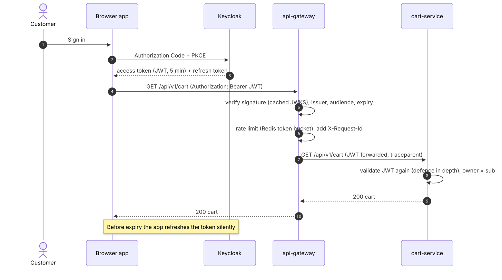
</picture>

## 5.2 Browse a product (cache-aside)

<picture>
  <source media="(prefers-color-scheme: dark)" srcset="../diagrams/sequence-diagrams--browse-a-product-cache-aside.dark.svg">
  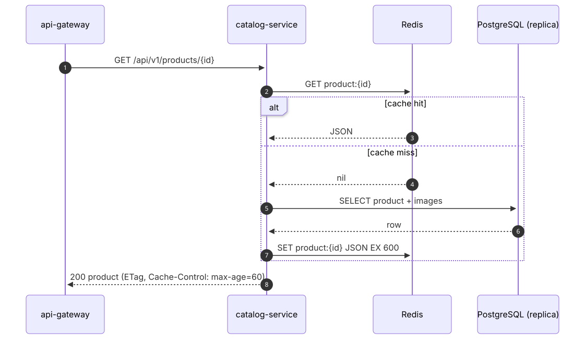
</picture>

## 5.3 Search

<picture>
  <source media="(prefers-color-scheme: dark)" srcset="../diagrams/sequence-diagrams--search.dark.svg">
  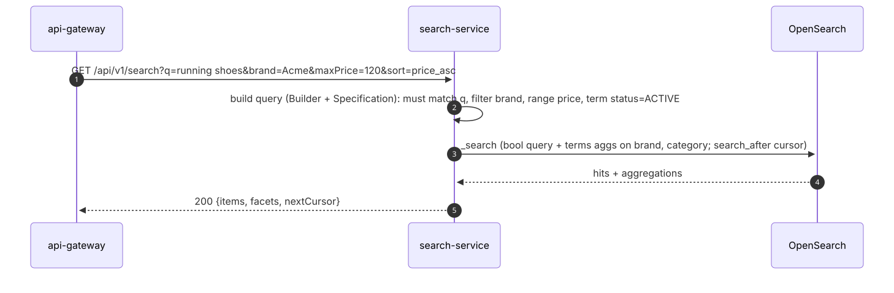
</picture>

## 5.4 Add to cart

<picture>
  <source media="(prefers-color-scheme: dark)" srcset="../diagrams/sequence-diagrams--add-to-cart.dark.svg">
  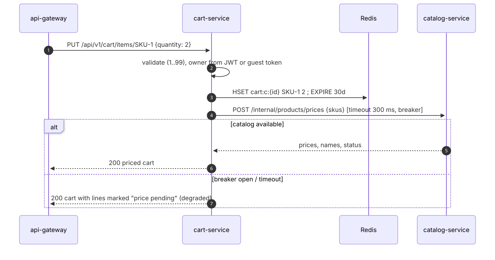
</picture>

## 5.5 Checkout: happy path

<picture>
  <source media="(prefers-color-scheme: dark)" srcset="../diagrams/sequence-diagrams--checkout-happy-path.dark.svg">
  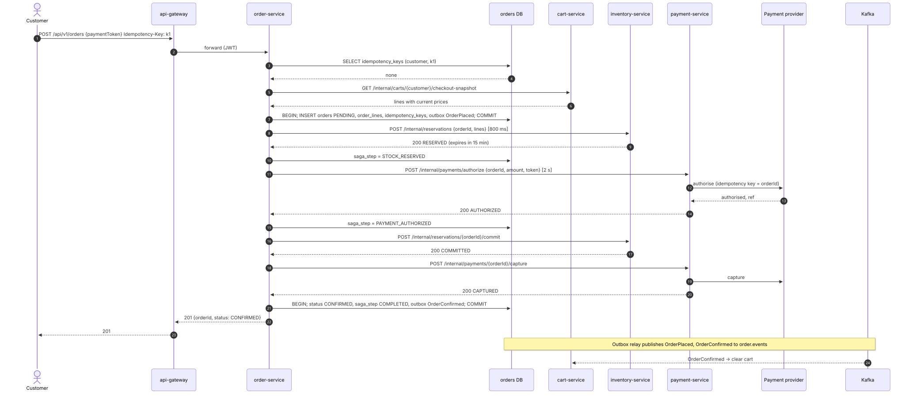
</picture>

## 5.6 Checkout: out of stock

<picture>
  <source media="(prefers-color-scheme: dark)" srcset="../diagrams/sequence-diagrams--checkout-out-of-stock.dark.svg">
  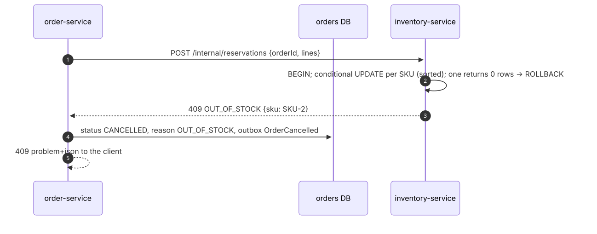
</picture>

Nothing was reserved, because the whole reservation is one transaction, so no compensation is needed.

## 5.7 Checkout: payment declined

<picture>
  <source media="(prefers-color-scheme: dark)" srcset="../diagrams/sequence-diagrams--checkout-payment-declined.dark.svg">
  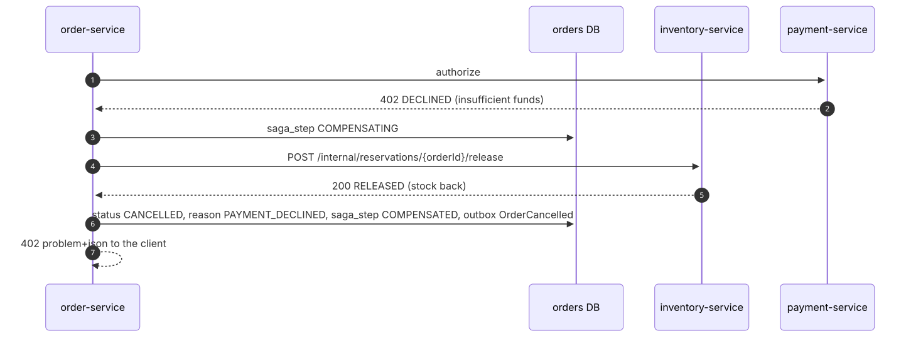
</picture>

## 5.8 Checkout: payment outcome unknown (timeout)

<picture>
  <source media="(prefers-color-scheme: dark)" srcset="../diagrams/sequence-diagrams--checkout-payment-outcome-unknown-timeout.dark.svg">
  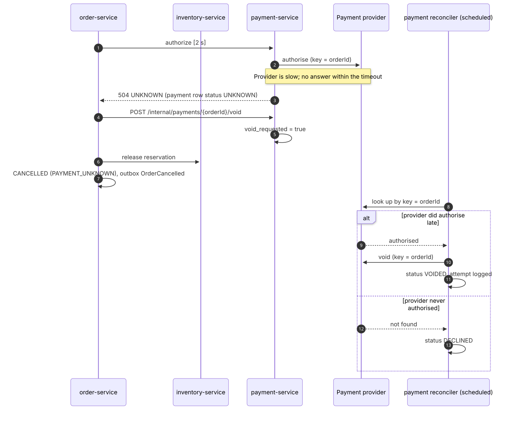
</picture>

The customer is never charged for a cancelled order, even if the provider answered after the timeout.

## 5.9 Cancellation and refund

<picture>
  <source media="(prefers-color-scheme: dark)" srcset="../diagrams/sequence-diagrams--cancellation-and-refund.dark.svg">
  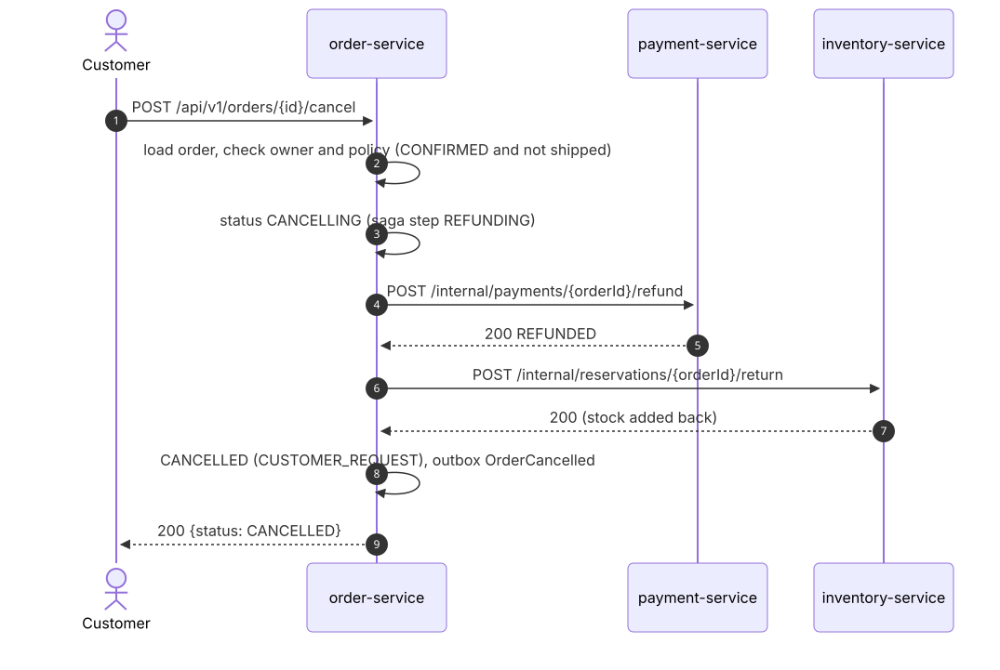
</picture>

If order-service stops between steps, the saga recovery job resumes the order from its recorded step (§6.2 in the flow diagrams).

## 5.10 Transactional outbox relay

<picture>
  <source media="(prefers-color-scheme: dark)" srcset="../diagrams/sequence-diagrams--transactional-outbox-relay.dark.svg">
  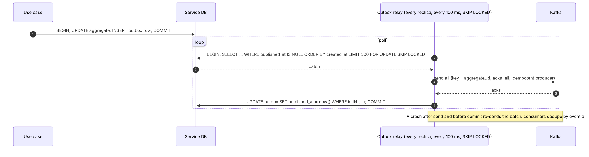
</picture>

## 5.11 Idempotent consumer

<picture>
  <source media="(prefers-color-scheme: dark)" srcset="../diagrams/sequence-diagrams--idempotent-consumer.dark.svg">
  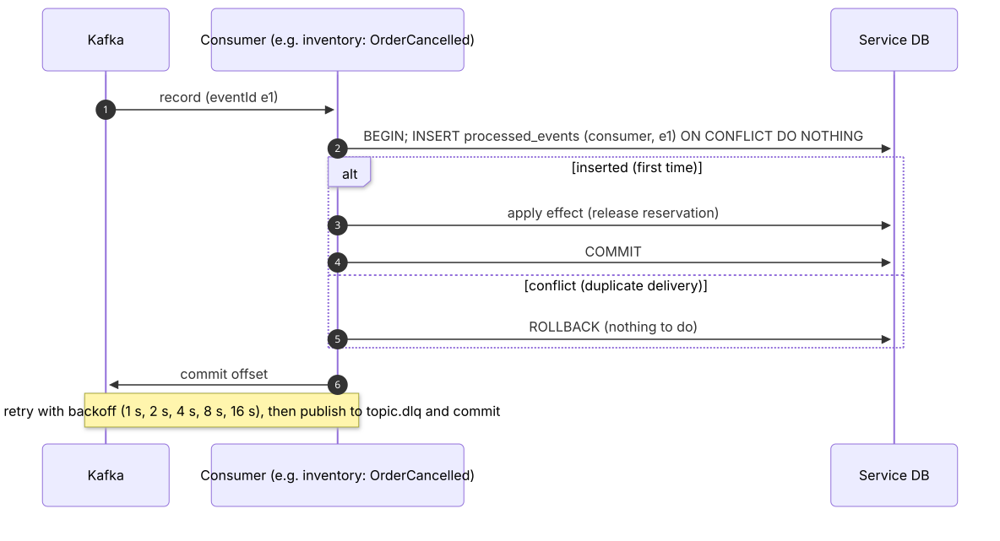
</picture>

## 5.12 Catalogue change to search index

<picture>
  <source media="(prefers-color-scheme: dark)" srcset="../diagrams/sequence-diagrams--catalogue-change-to-search-index.dark.svg">
  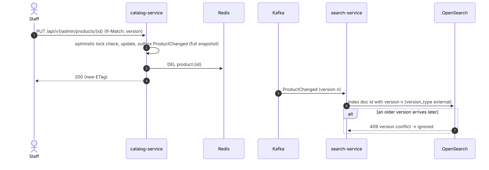
</picture>

## 5.13 Presigned image upload (Valet Key)

<picture>
  <source media="(prefers-color-scheme: dark)" srcset="../diagrams/sequence-diagrams--presigned-image-upload-valet-key.dark.svg">
  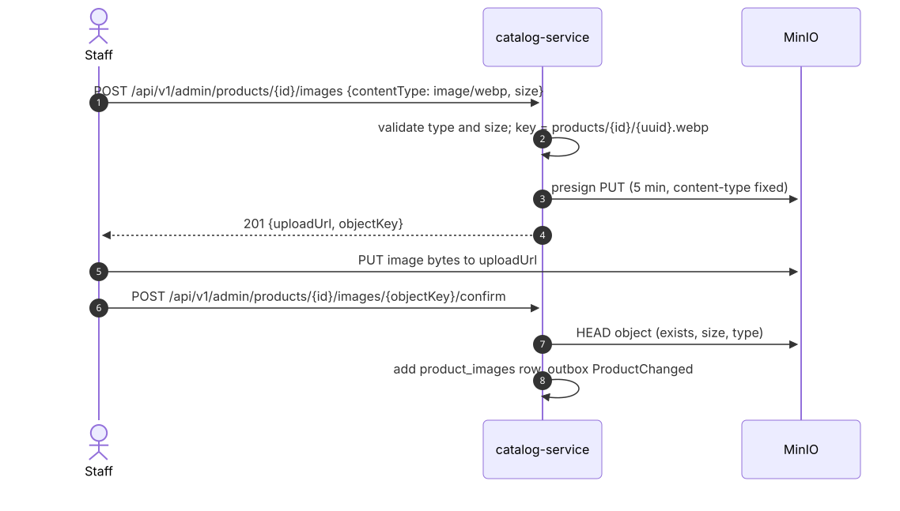
</picture>

## 5.14 Posting a review

<picture>
  <source media="(prefers-color-scheme: dark)" srcset="../diagrams/sequence-diagrams--posting-a-review.dark.svg">
  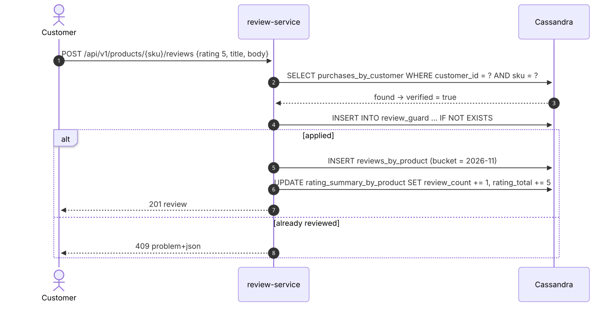
</picture>

## 5.15 Order email (Kafka → RabbitMQ → SMTP)

<picture>
  <source media="(prefers-color-scheme: dark)" srcset="../diagrams/sequence-diagrams--order-email-kafka-rabbitmq-smtp.dark.svg">
  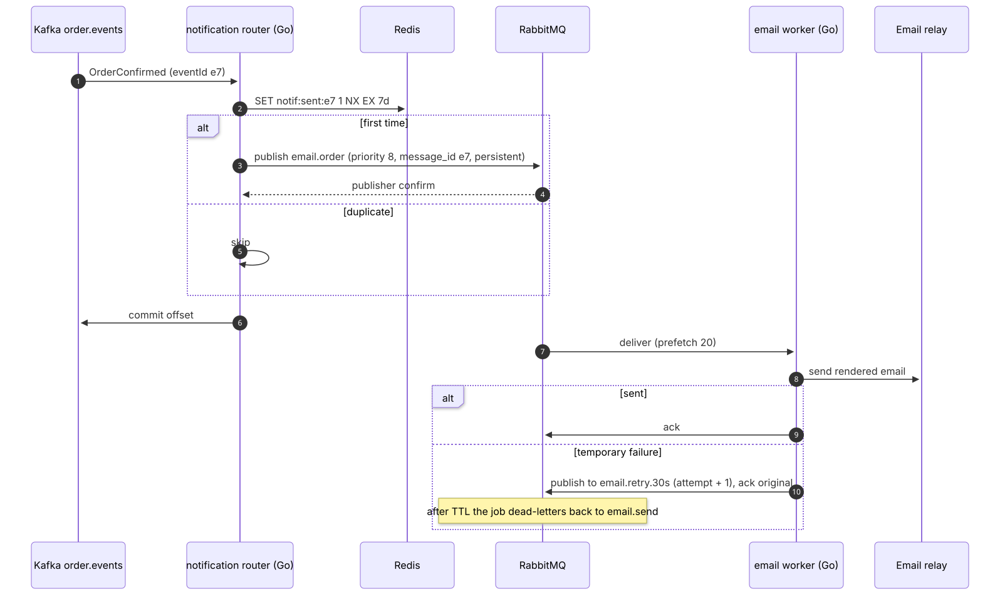
</picture>

## 5.16 Recommendations

<picture>
  <source media="(prefers-color-scheme: dark)" srcset="../diagrams/sequence-diagrams--recommendations.dark.svg">
  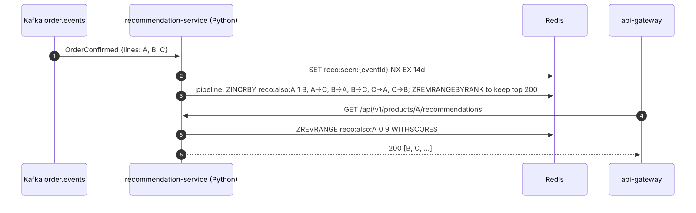
</picture>
