# 6. Flow diagrams

## 6.1 Checkout decision flow (order-service)

<picture>
  <source media="(prefers-color-scheme: dark)" srcset="../diagrams/flow-diagrams--checkout-decision-flow-order-service.dark.svg">
  
</picture>

## 6.2 Saga recovery job (every 15 s, one runner via ShedLock)

<picture>
  <source media="(prefers-color-scheme: dark)" srcset="../diagrams/flow-diagrams--saga-recovery-job-every-15-s-one-runner-via-shed.dark.svg">
  
</picture>

* **Moving forward or back:** once money has been authorised, the saga moves **forward**, because the customer intended to buy and stock is held. Before that point it moves **back**.
* **Safe to repeat:** every step is idempotent on the remote side, so running recovery twice is harmless.

## 6.3 Reservation expiry job (inventory-service, every 30 s)

<picture>
  <source media="(prefers-color-scheme: dark)" srcset="../diagrams/flow-diagrams--reservation-expiry-job-inventory-service-every-3.dark.svg">
  
</picture>

## 6.4 Gateway request pipeline (Chain of Responsibility)

<picture>
  <source media="(prefers-color-scheme: dark)" srcset="../diagrams/flow-diagrams--gateway-request-pipeline-chain-of-responsibility.dark.svg">
  
</picture>

## 6.5 Token bucket rate limiting

<picture>
  <source media="(prefers-color-scheme: dark)" srcset="../diagrams/flow-diagrams--token-bucket-rate-limiting.dark.svg">
  
</picture>

Default limits:

| Route | Rate |
|---|---|
| Read | 50 req/s burst 100 per user |
| Checkout | 2 req/s burst 5 per user |
| Hot SKU checkout | Per-SKU bucket set by staff during sales |

## 6.6 Kafka consumer retry and dead letters

<picture>
  <source media="(prefers-color-scheme: dark)" srcset="../diagrams/flow-diagrams--kafka-consumer-retry-and-dead-letters.dark.svg">
  
</picture>

DLQ records are replayed with `tools/dlq-replay` after the cause is fixed. Alerts fire when DLQ depth is above 0.

## 6.7 Cache-aside read and invalidation

<picture>
  <source media="(prefers-color-scheme: dark)" srcset="../diagrams/flow-diagrams--cache-aside-read-and-invalidation.dark.svg">
  
</picture>

Deleting the key after the commit, not before it, avoids a race: if the key were deleted first, a concurrent read could put the old value back.

## 6.8 Flash-sale admission

<picture>
  <source media="(prefers-color-scheme: dark)" srcset="../diagrams/flow-diagrams--flash-sale-admission.dark.svg">
  
</picture>

## 6.9 Recommendation update

<picture>
  <source media="(prefers-color-scheme: dark)" srcset="../diagrams/flow-diagrams--recommendation-update.dark.svg">
  
</picture>
