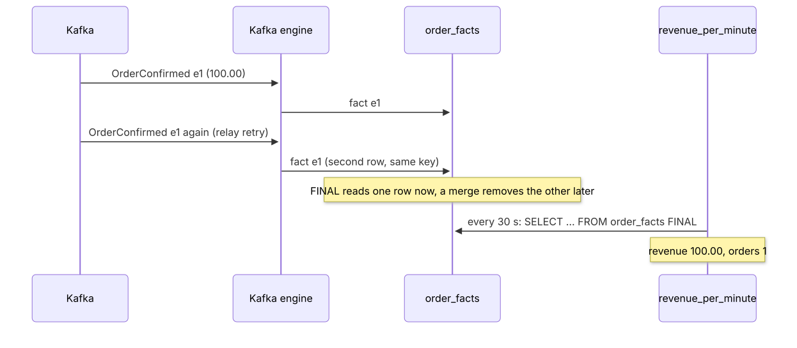

# analytics: low-level design

Part of the [e-commerce system design](../../../design/README.md). Animated version: [walkthrough](walkthrough/index.html).

## 1. Responsibilities

| Does | Does not |
|---|---|
| Keep every order event as a fact for 25 months | Serve the shop: nothing on the request path reads ClickHouse |
| Show revenue per minute within a minute of an order | Replace the order database as the record of truth |
| Daily revenue, orders, cancellations, average order, distinct customers | Store personal data (customer ids are hashed) |
| Keep unreadable messages for inspection | Stop ingesting because of one bad message |

## 2. Guarantees

| Guarantee | How |
|---|---|
| **Exact numbers despite duplicate deliveries** | Facts share an `event_id` in the sorting key; `ReplacingMergeTree` collapses duplicates and `FINAL` reads are exact before the merge happens. Rollups are *refreshable* views computed from `order_facts FINAL`, so they never add a duplicate twice |
| **Fresh** | Kafka engine flushes every second; `revenue_per_minute` refreshes every 30 s over the last two days |
| **One bad message never blocks** | `kafka_handle_error_mode = 'stream'` turns unparseable messages into rows with `_error`; non-throwing `…OrZero/OrNull` parsing; anything incomplete goes to `order_event_errors` |
| **Read-only dashboards** | Grafana connects as `grafana`, which has `SELECT` on `analytics.*`, a read-only profile, 30 s and 2 GB limits |
| **Rebuildable** | All state derives from Kafka (7 days) and, beyond that, from the order database export |

Why not the insert-triggered `SummingMergeTree` rollup: a materialised view fires on every insert, so a re-delivered event would
add its revenue twice; the duplicate fact disappears only later, at merge time, and the rollup never learns about it.

## 3. Module diagram

<picture>
  <source media="(prefers-color-scheme: dark)" srcset="diagrams/analytics--module-diagram.dark.svg">
  
</picture>

## 4. Interaction diagram

<picture>
  <source media="(prefers-color-scheme: dark)" srcset="diagrams/analytics--interaction-diagram.dark.svg">
  
</picture>

## 5. Sequences

### A duplicate delivery

<picture>
  <source media="(prefers-color-scheme: dark)" srcset="diagrams/analytics--a-duplicate-delivery.dark.svg">
  
</picture>

## 6. Data model

Schema: [001_order_events.sql](../sql/001_order_events.sql), [002_rollups.sql](../sql/002_rollups.sql).

| Table | Engine | Key | Notes |
|---|---|---|---|
| `order_facts` | ReplacingMergeTree | `(event_type, occurred_at, event_id)`, monthly partitions | 25-month TTL; `customer_key` = `cityHash64(customerId)` |
| `order_event_errors` | MergeTree | `received_at` | 30-day TTL; the raw message and the reason |
| `revenue_per_minute` | MergeTree, replaced every 30 s | `(minute, currency)` | Last two days of confirmed orders |
| `orders_per_day` | MergeTree, replaced every hour | `(day, currency)` | Placed, confirmed, cancelled, revenue, average order, customers |

## 7. Scaling and performance

* **Volume:** at 100 orders a second (a sale peak), about 300 events a second: trivial for one ClickHouse node.
* **Rollup cost:** `revenue_per_minute` scans two days of confirmed facts (a few million rows at peak) every 30 s; `FINAL` is
  parallel across partitions. `orders_per_day` scans all history hourly; past ~1 billion facts it should switch to an
  `APPEND` refresh of the last two days only.
* **Growth:** add a replica (ReplicatedReplacingMergeTree + Keeper) for availability, then shards keyed by `event_id` if needed.

## 8. Failure handling

| Failure | Behaviour |
|---|---|
| Kafka down | Ingestion pauses; dashboards show the last data; consumption resumes from the committed offset |
| ClickHouse down | No effect on the shop; Kafka keeps 7 days; on restart the engine catches up |
| Bad message | Row in `order_event_errors`; ingestion continues |
| Refresh fails | The previous rollup stays; `system.view_refreshes` shows the exception; the next refresh retries |

## 9. Tests

| Test | Kind | Proves |
|---|---|---|
| `tests/test_analytics.py` | The image + Kafka on a Docker network | Schema applies on first start; placed, confirmed (twice, same id), confirmed, cancelled and two bad messages → 4 exact facts and 2 error rows with reasons; no personal columns; revenue per minute 179.90 from 2 orders (duplicate counted once); daily row 1 placed / 2 confirmed / 1 cancelled / 2 customers; every dashboard query runs |
| Manual check (README) | Grafana 13.2 + plugin | Datasource healthy with the read-only user; dashboard provisioned into the E-commerce folder; the read-only user cannot drop tables |
