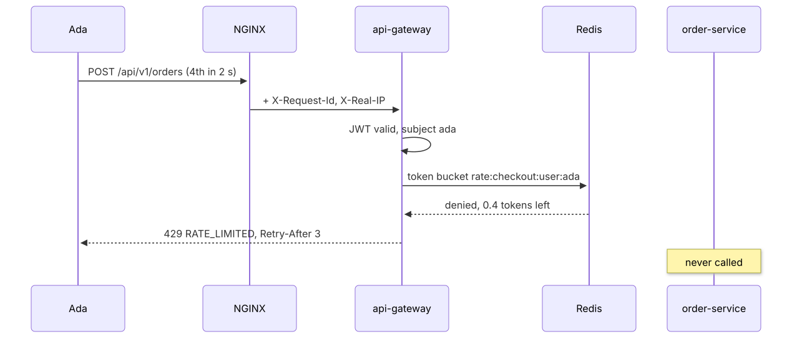
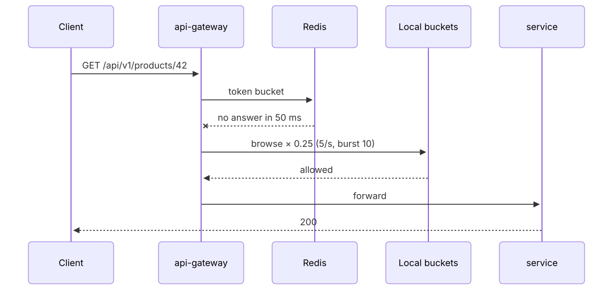
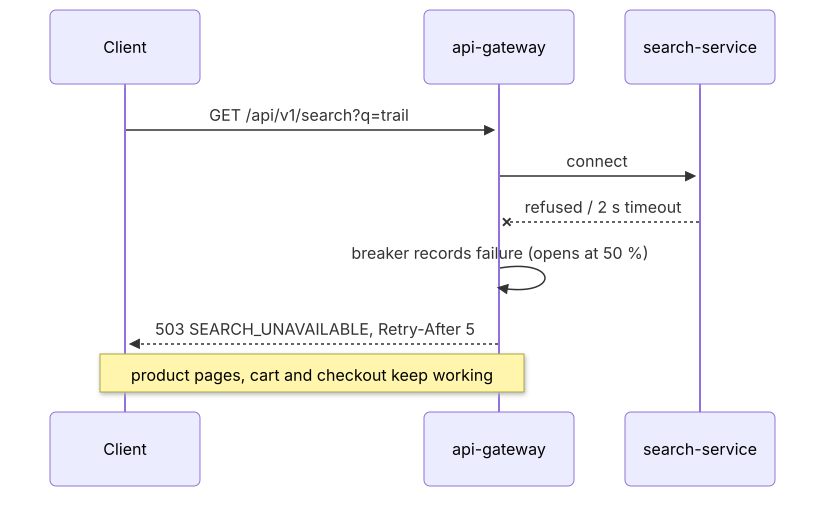

# api-gateway and NGINX edge: low-level design

Part of the [e-commerce system design](../../../design/README.md). Animated version: [walkthrough](walkthrough/index.html).

## 1. Responsibilities

| Does | Does not |
|---|---|
| Terminate TLS and HTTP/2; compress; redirect plain HTTP (edge) | Hold any business data |
| Micro-cache anonymous product, category and search reads for 5 s (edge) | Cache anything for signed-in customers |
| Route each public path to one service; rewrite the staff stock path | Aggregate several services into one response |
| Validate tokens (signature, expiry, issuer, audience) and coarse roles | Replace the services' own checks: each service validates again |
| Rate-limit per user, per address and per hot SKU | Decide whether a product can be sold (inventory-service does) |
| Give each request an id that every hop logs | |
| Answer 503 quickly when a service is down or slow | Retry non-idempotent requests |

## 2. Guarantees

| Guarantee | How |
|---|---|
| **Limits hold across replicas** | Buckets live in Redis; refill and take are one Lua script using Redis's clock, so two replicas can never both spend the last token |
| **Redis down is neither an outage nor a free-for-all** | Each call to Redis has a 50 ms timeout; on any error the request is decided by an in-process bucket with a quarter of the policy (per replica). Counted in `gateway.ratelimit.degraded` |
| **A slow service cannot exhaust the gateway** | Per-route TimeLimiter (2 s; 12 s for checkout) and circuit breaker (opens at 50 % failures over 20 calls, 10 s open); the fallback answers 503 + `Retry-After: 5` immediately |
| **Internal APIs are never public** | `/internal/**` is denied by the gateway's rules and answered 404 by NGINX before it reaches the gateway |
| **A spike on a popular page reaches the services once per 5 s** | NGINX `proxy_cache_lock` lets one request fill a missing entry while the rest wait; `use_stale updating` serves the old copy during refresh |
| **Every request is traceable** | NGINX keeps a well-formed `X-Request-Id` or generates one; the gateway checks it again, forwards it and returns it |

## 3. Module diagram

<picture>
  <source media="(prefers-color-scheme: dark)" srcset="diagrams/api-gateway--module-diagram.dark.svg">
  
</picture>

## 4. Interaction diagram

<picture>
  <source media="(prefers-color-scheme: dark)" srcset="diagrams/api-gateway--interaction-diagram.dark.svg">
  
</picture>

## 5. Sequences

### Checkout limited per customer

<picture>
  <source media="(prefers-color-scheme: dark)" srcset="diagrams/api-gateway--checkout-limited-per-customer.dark.svg">
  
</picture>

### Redis down

<picture>
  <source media="(prefers-color-scheme: dark)" srcset="diagrams/api-gateway--redis-down.dark.svg">
  
</picture>

### Search down

<picture>
  <source media="(prefers-color-scheme: dark)" srcset="diagrams/api-gateway--search-down.dark.svg">
  
</picture>

## 6. Token bucket

A bucket holds at most `burst` tokens and gains `rate` tokens per second. A request takes one token or is refused.
`Retry-After` is the time until one whole token is back: `ceil((1 − tokens) / rate)`.

| Store | Key | Fields | Expiry |
|---|---|---|---|
| Redis hash | `rate:<policy>:<key>` | `tokens` (fractional), `at` (Redis time, seconds) | `burst / rate × 2 + 1` s, so idle buckets disappear |
| Local LRU map | `<policy>-local:<key>` | tokens, nanoTime | at most 100 000 keys; least recently used dropped |

## 7. Scaling and performance

* **Pods:** stateless, 3–20 replicas on CPU. Non-blocking (Netty), so a slow service ties up no threads.
* **Per request:** one Redis round trip per limit that applies (one, or two on cart item and checkout routes); a cached JWKS check.
* **Redis:** a dedicated instance (`redis-ratelimit`) so a cache flood cannot slow admission; about 100 bytes per active key.
* **Edge:** NGINX absorbs read spikes with the micro-cache; at 5 s per URL, 10 000 identical requests per second become 0.2.

## 8. Failure handling

| Failure | Behaviour |
|---|---|
| Redis down or slow | Local buckets at 25 %; health stays UP (the Redis health check is off on purpose) |
| A service down | Its route answers 503 within the time limit, then immediately while the breaker is open; other routes unaffected |
| Keycloak down | Tokens keep validating with cached keys; new signing keys cannot be fetched until it returns |
| Gateway pod lost | NGINX keep-alive pool retries the next pod; the PDB keeps half available during upgrades |
| Edge pod lost | The load balancer drops it; each pod has its own 512 MB cache, refilled within seconds |

## 9. Tests

| Test | Kind | Proves |
|---|---|---|
| `LocalTokenBucketsTest` | domain | Burst then refill at the rate; correct `Retry-After`; keys independent; map bounded; scaled policy stricter |
| `RedisTokenBucketsFallbackTest` | adapter | With Redis unreachable, exactly 10 of 15 requests pass (40 × 0.25) and every one is counted as degraded |
| `ArchitectureTest` | ArchUnit | Pure domain; adapters independent |
| `GatewayContainersIT` | Redis + stub services | Routes and the reviews-before-catalogue order; stock path rewrite; request id kept or replaced; 401 / 403 / `/internal` denied; guest cart; checkout limited per customer with `Retry-After` while another customer passes; a hot SKU limited across shoppers; down search answers 503 `SEARCH_UNAVAILABLE` |
| `EdgeContainersIT` | NGINX image + stub gateway | HTTP/2 over TLS; MISS then HIT with one upstream call; signed-in requests bypass the cache; HSTS; request id generated or kept and forwarded with the client address; `/internal` 404 without reaching upstream; HTTP redirects to HTTPS |
