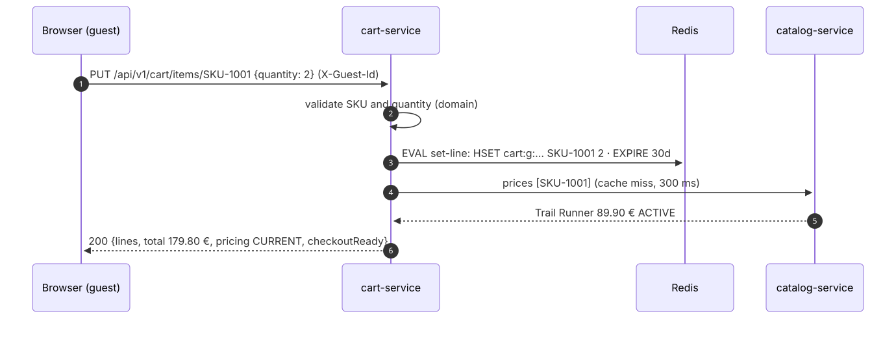
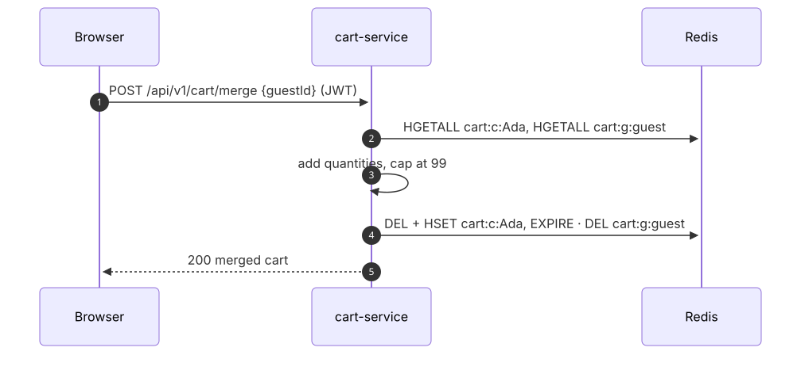

# cart-service: low-level design

Part of the [e-commerce system design](../../../design/README.md). Animated version: [walkthrough](walkthrough/index.html).

## 1. Responsibilities

| Does | Does not |
|---|---|
| Keep carts for guests and customers | Hold stock (only checkout reserves) |
| Price lines from the catalogue on every read | Store prices: they would go stale |
| Merge a guest cart on sign-in | Create orders |
| Hand order-service a priced snapshot; empty the cart after the order | |

## 2. Guarantees

| Guarantee | How |
|---|---|
| **Prices are current at checkout** | The snapshot is priced on the spot; if the catalogue cannot confirm prices it answers 503 instead of guessing |
| **The cart stays usable when the catalogue is down** | Reads fall back to `pricing: PENDING`: lines are shown and editable, totals are hidden, and checkout is blocked |
| **No orphan keys** | Each line write and its 30-day expiry happen in one Lua script |
| **The cart is emptied exactly once per order** | `SET NX` dedupe on the event id |
| **Bounded carts** | 1–99 per line, at most 100 lines |

## 3. Module diagram

<picture>
  <source media="(prefers-color-scheme: dark)" srcset="diagrams/cart-service--module-diagram.dark.svg">
  
</picture>

## 4. Interaction diagram

<picture>
  <source media="(prefers-color-scheme: dark)" srcset="diagrams/cart-service--interaction-diagram.dark.svg">
  
</picture>

## 5. Sequences

### Add to cart and read it back

<picture>
  <source media="(prefers-color-scheme: dark)" srcset="diagrams/cart-service--add-to-cart-and-read-it-back.dark.svg">
  
</picture>

### Sign in: merge the guest cart

<picture>
  <source media="(prefers-color-scheme: dark)" srcset="diagrams/cart-service--sign-in-merge-the-guest-cart.dark.svg">
  
</picture>

## 6. Data model (Redis)

| Key | Type | Value | Expiry |
|---|---|---|---|
| `cart:c:<customerId>` | hash | SKU → quantity | 30 days after the last change |
| `cart:g:<guestId>` | hash | SKU → quantity | 30 days after the last change |
| `cart:seen:<eventId>` | string | `1` | 14 days |

Prices live only in the in-process Caffeine cache (30 s, at most 100 000 SKUs), never in Redis.

## 7. Scaling and performance

* **Pods:** stateless, 2–10 replicas.
* **Redis:** a cart read is one `HGETALL` and a write is one script call, both well under a millisecond. Redis Cluster shards
  carts by key hash.
* **Catalogue calls:** pricing fetches only the SKUs missing from the cache, in one request. At steady state most reads never
  call the catalogue.

## 8. Failure handling

| Failure | Behaviour |
|---|---|
| catalog-service down or slow | Breaker opens; carts shown with `pricing: PENDING`; snapshot answers 503 `PRICING_UNAVAILABLE`, so order-service answers 503 |
| Redis down | Cart requests fail fast (200 ms command timeout) with 503; nothing else is affected |
| Duplicate `OrderConfirmed` | Dedupe key exists → skipped (a new cart started after the order is kept) |

## 9. Tests

| Test | Kind | Proves |
|---|---|---|
| `CartTest` | domain | Set and remove lines, validation, merge with cap, owner keys |
| `CartServiceTest` | application | Pricing, inactive products block checkout, degraded pricing, guest merge, clear-once |
| `HexagonalArchitectureTest` | ArchUnit | Layering |
| `CartContainersIT` | Redis + Kafka + fake catalog over HTTP | Guest cart priced and stored with expiry, merge on sign-in, snapshot; catalogue outage → PENDING and 503 snapshot; `OrderConfirmed` empties the cart; validation and auth |
