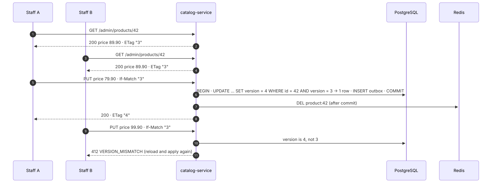
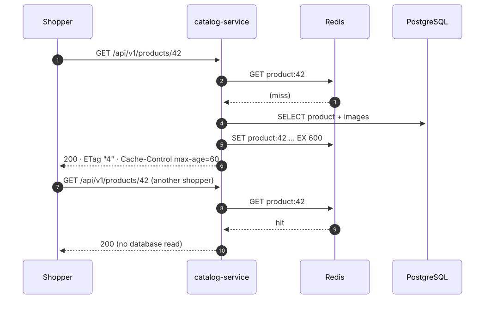
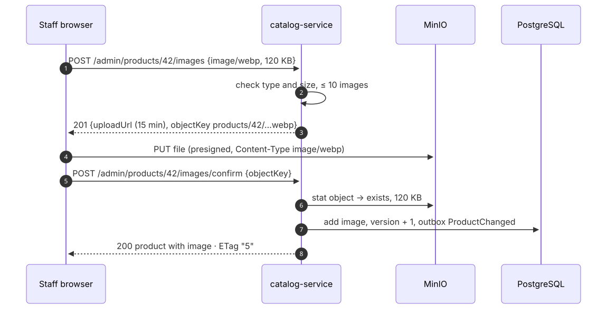

# catalog-service: low-level design

Part of the [e-commerce system design](../../../design/README.md). Animated version: [walkthrough](walkthrough/index.html).

## 1. Responsibilities

| Does | Does not |
|---|---|
| Own products, categories, prices, attributes and image references | Search or filter across products (search-service does) |
| Let staff edit products without overwriting each other's changes | Hold stock (inventory-service does) |
| Sign short-lived upload URLs; record images once they exist | Receive image bytes: they go straight to object storage |
| Publish every change as `catalog.ProductChanged` | Call any other service |
| Answer price lookups for carts | |

## 2. Guarantees

| Guarantee | How |
|---|---|
| **No lost updates** | Every product has a `version`. Reads return it as a strong ETag; `PUT` requires `If-Match` (428 without it) and runs `UPDATE … WHERE id = ? AND version = ?`. Zero rows updated → 412 |
| **A change and its event are never separated** | The product row and the outbox row are written in one transaction; the relay publishes afterwards (at least once) |
| **Consumers can order events** | `ProductChanged` carries the whole product and its `catalogVersion`; search keeps only the highest version |
| **The cache never outlives a committed change by more than an instant** | Cache-aside: entries are evicted **after** the transaction commits, a read that overlapped the commit does not write its old copy back, and entries expire after 10 minutes ± 10 % in any case |
| **Redis is optional** | Any cache error is logged and read as a miss; reads fall through to PostgreSQL |
| **Only real uploads are attached** | Confirm checks the object exists in storage (422 `IMAGE_MISSING` otherwise), its key belongs to the product, and its size is at most 5 MB |
| **Shoppers see only ACTIVE products** | The public API answers 404 for drafts and archived products |

## 3. Module diagram

<picture>
  <source media="(prefers-color-scheme: dark)" srcset="diagrams/catalog-service--module-diagram.dark.svg">
  
</picture>

## 4. Interaction diagram

<picture>
  <source media="(prefers-color-scheme: dark)" srcset="diagrams/catalog-service--interaction-diagram.dark.svg">
  
</picture>

## 5. Sequences

### Edit a product without overwriting a colleague

<picture>
  <source media="(prefers-color-scheme: dark)" srcset="diagrams/catalog-service--edit-a-product-without-overwriting-a-colleague.dark.svg">
  
</picture>

### Read a product (cache-aside)

<picture>
  <source media="(prefers-color-scheme: dark)" srcset="diagrams/catalog-service--read-a-product-cache-aside.dark.svg">
  
</picture>

### Upload an image

<picture>
  <source media="(prefers-color-scheme: dark)" srcset="diagrams/catalog-service--upload-an-image.dark.svg">
  
</picture>

## 6. State diagram

<picture>
  <source media="(prefers-color-scheme: dark)" srcset="diagrams/catalog-service--state-diagram.dark.svg">
  
</picture>

## 7. Data model (PostgreSQL)

Schema: [V1__catalog_schema.sql](../src/main/resources/db/migration/V1__catalog_schema.sql).

| Table | Key | Notes |
|---|---|---|
| `categories` | `id` | `parent_id` forms the tree; `slug` unique |
| `products` | `id` | `sku` unique; `attributes` JSONB with a GIN index (`jsonb_path_ops`); partial index on `category_id` for ACTIVE products; `version` for optimistic locking |
| `product_images` | `(product_id, position)` | Object keys in MinIO; deleted with the product |
| `outbox` | `id` (UUIDv7, the event id) | Partial index on unpublished rows; published rows purged after 7 days |
| `shedlock` | `name` | One replica runs the purge job |

## 8. Scaling and performance

* **Pods:** stateless, 2–10 replicas. Reads dominate (product pages); writes are staff edits, a few per second at most.
* **Reads:** a cache hit is one Redis `GET`; the 60-second `Cache-Control` lets the edge cache popular products too. A miss is two
  indexed queries (product, images); concurrent misses for one product in a pod share one load (`SingleFlight`), and the
  expiry is spread by ± 10 % so entries cached together do not expire together.
* **Connections:** through `pgbouncer-catalog` in transaction mode; 10 pods × 20 client connections share 30 server connections.
* **Price lookups:** cart-service batches up to 100 SKUs into one `sku IN (…)` query and caches the answers for 30 s itself.
* **Outbox relay:** every replica polls every 100 ms; `FOR UPDATE SKIP LOCKED` gives each a separate batch of up to 500 rows.
* **Images:** bytes never pass through the service, so uploads do not consume its threads or memory.

## 9. Failure handling

| Failure | Behaviour |
|---|---|
| Redis down | Cache reads and evictions log a warning; reads go to PostgreSQL. Stale entries left by a failed eviction expire within 10 minutes |
| Kafka down | Writes still succeed; outbox rows wait and are published when Kafka returns (search is behind, not wrong) |
| MinIO down | Upload start and confirm fail with 500; products and reads are unaffected |
| Upload never happens | Nothing is recorded; the signed URL expires after 15 minutes |
| Two editors at once | One gets 200, the other 412 and must reload |
| Crash after publish, before marking | The relay re-sends the batch; consumers ignore duplicates by event id and older versions by `catalogVersion` |

## 10. Tests

| Test | Kind | Proves |
|---|---|---|
| `ProductTest` | domain | Versions go up by one per change; lifecycle transitions; price rules; SKU and slug formats; images ordered, idempotent, limited to 10 |
| `CatalogServiceTest` | application | Create writes product and event in one transaction; cache hits avoid the database; drafts hidden from shoppers; eviction happens after commit; a read that overlaps a committed edit does not re-cache the old version; a stale version is rejected with no event; a write that commits between the check and the update is still caught; upload confirmed only when the object exists |
| `SingleFlightTest` | application | 50 concurrent misses for one key load once; every waiter gets the loader's exception and the next miss loads again |
| `RedisProductCacheExpiryTest` | adapter | Expiry stays within ± 10 % of the base and differs between entries written together |
| `HexagonalArchitectureTest` | ArchUnit | Layering |
| `CatalogContainersIT` | PostgreSQL + Redis + Kafka + S3 (RustFS) | 428 without If-Match, 200 with the current ETag, 412 with a stale one; cache entry evicted; events with versions 1 and 2 on Kafka; real presigned upload to MinIO then confirm; price lookup; 401 and 403 for non-staff; SKU uniqueness |
