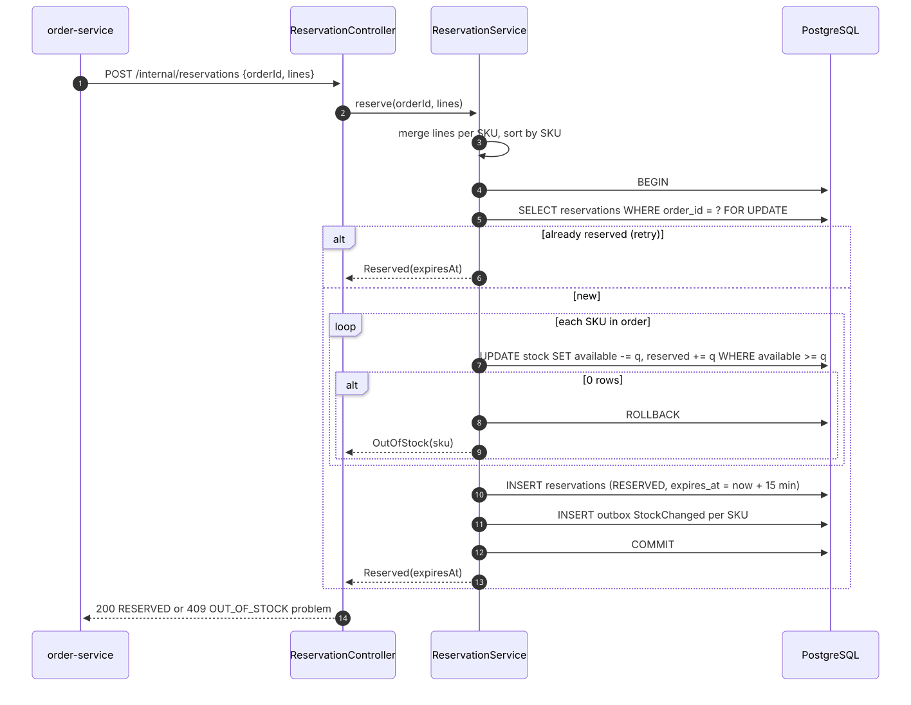

# inventory-service: low-level design

Part of the [e-commerce system design](../../../design/README.md). Animated version: [walkthrough](walkthrough/index.html).

## 1. Responsibilities

| Does | Does not |
|---|---|
| Keep available and reserved units per SKU | Know prices or product details (catalog-service) |
| Reserve all lines of an order atomically, or none | Decide whether checkout continues (order-service) |
| Commit, release, return and expire reservations | Talk to customers directly (not routed by the gateway) |
| Publish `StockChanged` so search and carts show availability | Hold stock for carts; only checkout reserves |

## 2. Guarantees

| Guarantee | How |
|---|---|
| **No overselling** | One conditional statement per SKU: `UPDATE … SET available = available - q WHERE available >= q`. No read-then-write; plus `CHECK (available >= 0)` |
| **All or nothing per order** | All lines in one transaction; any short line throws and rolls back the whole reservation |
| **No deadlocks** | Lines are merged per SKU and locked in SKU order |
| **Idempotent commands** | Reservations are keyed by `(order_id, sku)`; repeating reserve, commit, release or return returns the current result |
| **Stock is never stuck** | Every reservation expires after 15 minutes; a ShedLock job returns expired stock |
| **Events are never lost** | Transactional outbox in the same transaction; relay with `SKIP LOCKED`; consumers deduplicate |

## 3. Components

<picture>
  <source media="(prefers-color-scheme: dark)" srcset="diagrams/inventory-service--components.dark.svg">
  
</picture>

## 4. Class diagram

<picture>
  <source media="(prefers-color-scheme: dark)" srcset="diagrams/inventory-service--class-diagram.dark.svg">
  
</picture>

## 5. Reserve: sequence

<picture>
  <source media="(prefers-color-scheme: dark)" srcset="diagrams/inventory-service--reserve-sequence.dark.svg">
  
</picture>

## 6. Reservation state machine

<picture>
  <source media="(prefers-color-scheme: dark)" srcset="diagrams/inventory-service--reservation-state-machine.dark.svg">
  
</picture>

| Command | Stock movement |
|---|---|
| reserve | available → reserved |
| commit | reserved → sold (leaves the counters) |
| release / expire | reserved → available |
| return | sold → available |

## 7. Data model

<picture>
  <source media="(prefers-color-scheme: dark)" srcset="diagrams/inventory-service--data-model.dark.svg">
  
</picture>

Full DDL: [`V1__inventory_schema.sql`](../src/main/resources/db/migration/V1__inventory_schema.sql).

## 8. Background work

| Job | Runs | Interval | What it does |
|---|---|---|---|
| Outbox relay | every replica (`SKIP LOCKED`) | 100 ms, drains backlog | Publishes unpublished outbox rows to Kafka, then marks them |
| Reservation expiry | one replica (ShedLock) | 30 s | Expires due reservations in batches of 500 and returns their stock |
| Outbox purge | one replica (ShedLock) | daily 03:17 | Deletes published outbox rows older than 7 days |

## 9. Scaling and performance

* **Stateless pods** behind an HPA (3–20 replicas on CPU). Each pod holds 20 pooled connections; PgBouncer keeps the database's
  connection count bounded at any pod count.
* **Short hot path:** a reservation of *n* SKUs costs one `SELECT … FOR UPDATE` plus *n* conditional updates, one insert and *n*
  outbox inserts, all in one round-trip-light transaction. No locks are held across network calls.
* **Hot SKUs (flash sales):** row-level contention on one SKU serialises updates for that row only. If one row becomes the
  bottleneck, its stock can be split into several bucket rows (`warehouse` = `MAIN#1..N`) and reservations pick a random bucket.
* **Virtual threads** let a pod serve thousands of concurrent blocking requests without a large thread pool.

## 10. Failure handling

| Failure | Behaviour |
|---|---|
| Database unavailable | Requests fail fast (2 s connection timeout) → order-service's circuit breaker opens → checkout returns 503 |
| Kafka unavailable | Outbox rows accumulate; relay retries every 100 ms; nothing is lost |
| Duplicate `OrderCancelled` | `processed_events` insert conflicts → skipped |
| order-service crashes after reserving | The reservation expires after 15 minutes, or saga recovery releases it earlier |
| Commit after expiry | 409 `RESERVATION_EXPIRED` → order-service compensates (voids payment, cancels order) |

## 11. Tests

| Test | Kind | Proves |
|---|---|---|
| `ReservationTest` | domain unit | State rules, idempotent transitions, value validation |
| `ReservationServiceTest` | application, in-memory test doubles | All-or-nothing, merging, idempotency, expiry, commit-after-expiry |
| `HexagonalArchitectureTest` | ArchUnit | Domain is pure Java; application depends only on domain; adapters independent |
| `InventoryContainersIT` | PostgreSQL + Kafka containers | 50 concurrent orders for 10 units → exactly 10 reserved; REST contract and problem details; outbox → Kafka; `OrderCancelled` releases stock, duplicates ignored |
