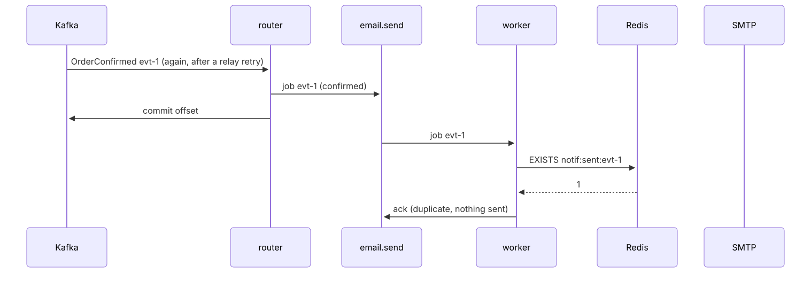
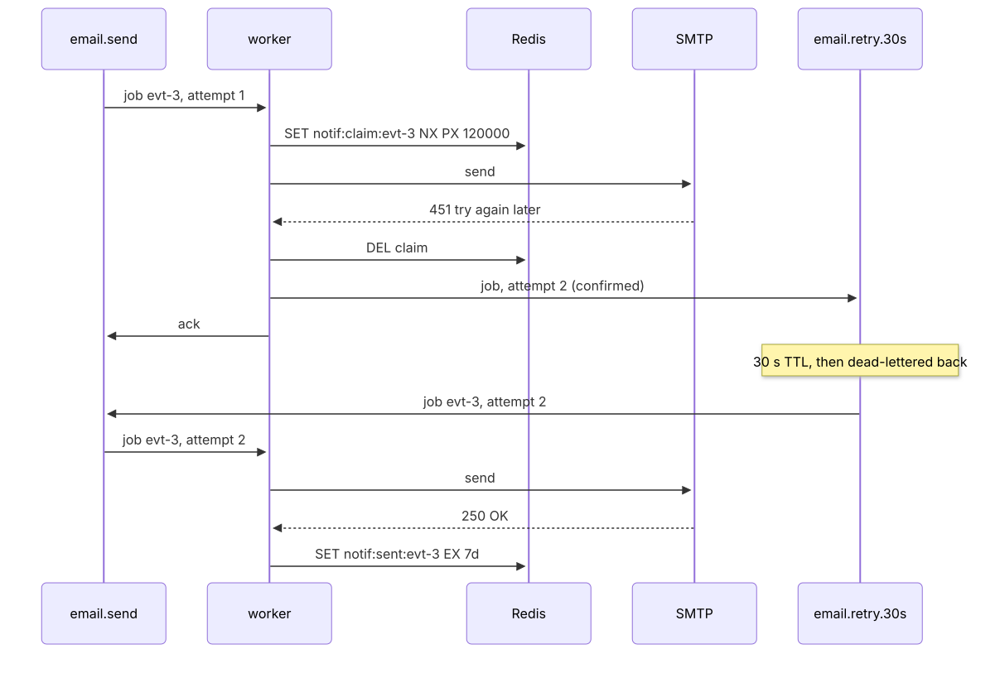

# notification-service: low-level design

Part of the [e-commerce system design](../../../design/README.md). Animated version: [walkthrough](walkthrough/index.html).

## 1. Responsibilities

| Does | Does not |
|---|---|
| Turn `OrderConfirmed` and `OrderCancelled` into emails | Decide anything about orders |
| Send transactional email before bulk email | Store emails (the provider and Mailpit do) |
| Retry temporary failures with growing delays; set aside the rest | Retry forever: 5 attempts, then `email.dead` |
| Send each event's email once, even when the event arrives several times | Promise exactly once: see §2 |

Email jobs are **tasks**, not facts. A work queue with acknowledgements, priorities and delayed retries fits better than a Kafka
topic, where one slow email would hold up a whole partition.

## 2. Guarantees

| Guarantee | How |
|---|---|
| **No event is lost** | The router commits a Kafka offset only after RabbitMQ confirms the job (persistent, quorum queue). If RabbitMQ is down the router retries with back-off and the offset waits |
| **One email per event, in practice** | Before sending, the worker checks `notif:sent:<eventId>`, then takes a 2-minute claim `notif:claim:<eventId>` with `SET NX PX`, sends, and records `notif:sent` for 7 days (Kafka's retention). Duplicates find the sent key; concurrent duplicates lose the claim and are retried later |
| **Never zero emails** | A failed send releases the claim. A crash after sending but before recording can send a second email (SMTP has no idempotency key): at least once, with a very small duplicate window |
| **Redis down never causes duplicates** | Without the sent log the worker cannot tell a duplicate apart, so it parks the job in the first delay queue rather than send |
| **Order emails first** | Quorum queues (RabbitMQ 4) deliver priority ≥ 5 before the rest; order emails are priority 8, bulk mail 1 |
| **Poison never blocks** | Unreadable events → `order.events.dlq`; permanent SMTP rejections (5xx) and jobs failing 5 times → `email.dead`; unreadable jobs → `email.dead` as they are |

## 3. Module diagram

<picture>
  <source media="(prefers-color-scheme: dark)" srcset="diagrams/notification-service--module-diagram.dark.svg">
  
</picture>

## 4. Interaction diagram

<picture>
  <source media="(prefers-color-scheme: dark)" srcset="diagrams/notification-service--interaction-diagram.dark.svg">
  
</picture>

## 5. Sequences

### Duplicate event

<picture>
  <source media="(prefers-color-scheme: dark)" srcset="diagrams/notification-service--duplicate-event.dark.svg">
  
</picture>

### Temporary failure, then success

<picture>
  <source media="(prefers-color-scheme: dark)" srcset="diagrams/notification-service--temporary-failure-then-success.dark.svg">
  
</picture>

## 6. Retry ladder

| Attempt fails | Next | Waits |
|---|---|---|
| 1 | attempt 2 | `email.retry.30s` |
| 2 | attempt 3 | `email.retry.2m0s` |
| 3 | attempt 4 | `email.retry.10m0s` |
| 4 | attempt 5 | `email.retry.10m0s` |
| 5, or any 5xx | — | `email.dead` |

Delay queues have no consumer: a message waits out the queue's `x-message-ttl`, then RabbitMQ dead-letters it back to the `email`
exchange (`at-least-once` dead-lettering, so it cannot be dropped on the way). No scheduler, no polling.

## 7. Scaling and performance

* **Router:** cheap; bounded by the 12 partitions of `order.events`, so 2 replicas are plenty.
* **Worker:** bounded by SMTP latency. 20 jobs in flight per pod (prefetch 20, 20 goroutines); KEDA adds pods when `email.send`
  holds more than 200 jobs per pod. About 30 MB of memory per pod; starts in milliseconds.
* **Redis:** two small keys per email; 7-day expiry keeps the set bounded by a week of orders.

## 8. Failure handling

| Failure | Behaviour |
|---|---|
| RabbitMQ down | Router retries the record with back-off (offset not committed); the process exits on a lost connection and Kubernetes restarts it |
| Redis down | Jobs wait in the first delay queue; no emails sent, none duplicated |
| SMTP down or 4xx | Retry ladder; after 5 attempts `email.dead` |
| SMTP 5xx (bad address) | `email.dead` at once |
| Worker crash mid-send | Unacknowledged job is redelivered; the claim expires within 2 minutes; at worst one duplicate email |
| Unreadable event | `order.events.dlq` with an `x-reason` header; the partition moves on |

## 9. Tests

| Test | Kind | Proves |
|---|---|---|
| `domain_test.go` | domain | Event to email (lines, totals, reason text); other events ignored; broken events and header-injection addresses rejected; retry ladder then dead |
| `app_test.go` | use cases with fakes | Same event twice sends once; 20 concurrent duplicates send once; temporary failures climb the ladder with attempts incremented and claims released; 5xx dead at once; Redis down means wait, not send |
| `mailer_test.go` | adapter | 5xx permanent, 4xx and network temporary; headers and CRLF line endings |
| `test/containers_test.go` | Kafka + RabbitMQ + Redis + Mailpit | Three copies of one event → exactly one email; cancellation email; a recipient failing twice delivered after two delayed retries (3 attempts); a 5xx tried once and a never-working address tried 5 times, both in `email.dead`; an unreadable event on `order.events.dlq` with its reason; the spans of two events continue their checkouts' traces, one routing span each and one span per send attempt, also after the delay queues |
| `telemetry_test.go` | adapter | Trace context read from a Kafka record and written to RabbitMQ headers unchanged; log lines carry the trace and span ids; nothing exported without an endpoint |
