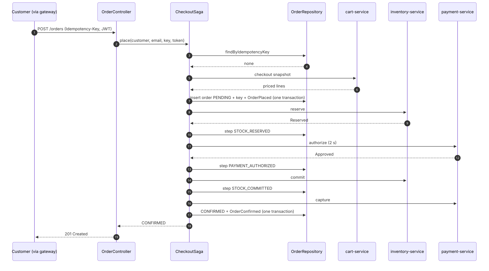

# order-service: low-level design

Part of the [e-commerce system design](../../../design/README.md). Animated version: [walkthrough](walkthrough/index.html).

## 1. Responsibilities

| Does | Does not |
|---|---|
| Turn a priced cart into an order and run the checkout saga | Price products (catalog) or keep carts (cart) |
| Guarantee one order per idempotency key | Hold stock (inventory) or talk to the payment provider (payment) |
| Compensate every failure: release, void, return, refund | Send emails (notification reacts to its events) |
| Cancel confirmed orders on request | Ship orders (future fulfilment service) |
| Finish interrupted sagas | |
| Serve order history | |

## 2. Guarantees

| Guarantee | How |
|---|---|
| **One order per request** | `idempotency_keys (customer_id, key)` primary key; a repeat returns the stored order with no downstream calls |
| **No charge without an order, no order without a charge** | Saga with explicit compensations; payment is captured only after stock is committed |
| **No lost progress** | Each step is persisted (`saga_step`) before the next call; the recovery job resumes from it |
| **Never charged for a cancelled order** | An unknown payment outcome is voided, and payment-service voids a late authorisation |
| **Events if and only if the change commits** | Events go into the outbox in the same transaction as the order |
| **No lost updates** | Optimistic locking on `version` |
| **Fast lookups at any size** | Monthly partitions; the order id (UUIDv7) gives the partition directly |

## 3. Module diagram

<picture>
  <source media="(prefers-color-scheme: dark)" srcset="diagrams/order-service--module-diagram.dark.svg">
  
</picture>

Dependencies point inwards. `domain` uses only `java.*`; `application` uses only `domain`; adapters never depend on each other.
`HexagonalArchitectureTest` enforces all three rules.

## 4. Interaction diagram

<picture>
  <source media="(prefers-color-scheme: dark)" srcset="diagrams/order-service--interaction-diagram.dark.svg">
  
</picture>

## 5. Class diagram

<picture>
  <source media="(prefers-color-scheme: dark)" srcset="diagrams/order-service--class-diagram.dark.svg">
  
</picture>

The results are **sealed** types, so every `switch` in the saga is exhaustive: adding an outcome without handling it fails to compile.

## 6. Checkout: sequence

<picture>
  <source media="(prefers-color-scheme: dark)" srcset="diagrams/order-service--checkout-sequence.dark.svg">
  
</picture>

The failure paths are drawn in the system [sequence diagrams](../../../design/05-sequence-diagrams.md) (§5.6 to §5.9).

| Outcome | HTTP | What was undone |
|---|---|---|
| CONFIRMED | 201 (200 on replay) | — |
| IN_PROGRESS | 202 + `Location` | Nothing: money is authorised, recovery finishes the order |
| OUT_OF_STOCK | 409 | Nothing was reserved |
| PAYMENT_DECLINED | 402 | Stock released |
| PAYMENT_UNKNOWN | 504 | Payment voided, stock released |
| DEPENDENCY_UNAVAILABLE | 503 + `Retry-After` | Stock released (best effort) |
| FAILED | 502 | Payment voided, stock returned |

## 7. State diagrams

<picture>
  <source media="(prefers-color-scheme: dark)" srcset="diagrams/order-service--state-diagrams.dark.svg">
  
</picture>

Saga steps: `STARTED → STOCK_RESERVED → PAYMENT_AUTHORIZED → STOCK_COMMITTED → PAYMENT_CAPTURED → COMPLETED`, with
`COMPENSATING → COMPENSATED` on failure and `REFUNDING` while cancelling.

| Recovery from step | Action |
|---|---|
| STARTED, STOCK_RESERVED, COMPENSATING | Void any authorisation, release stock, cancel (`CHECKOUT_ABANDONED`) |
| PAYMENT_AUTHORIZED, STOCK_COMMITTED, PAYMENT_CAPTURED | Continue forward: commit, capture, confirm |
| REFUNDING | Refund, return stock, cancel |

## 8. Data model

<picture>
  <source media="(prefers-color-scheme: dark)" srcset="diagrams/order-service--data-model.dark.svg">
  
</picture>

The DDL, including `ensure_order_partitions(months_ahead)`, is in
[`V1__order_schema.sql`](../src/main/resources/db/migration/V1__order_schema.sql).

Indexes:
* `(customer_id, created_at desc, id desc)` for keyset-paginated history.
* A partial index on `updated_at` for in-flight orders, used by recovery.
* A partial index on unpublished outbox rows.

## 9. Background work

| Job | Runs | Interval | What it does |
|---|---|---|---|
| Outbox relay | every replica (`SKIP LOCKED`) | 100 ms | Publishes order events to `order.events`, keyed by order id |
| Saga recovery | one replica (ShedLock) | 15 s | Resumes orders `PENDING` or `CANCELLING` for more than 30 s |
| Partition maintenance | one replica (ShedLock), and at start-up | daily 02:07 | Creates monthly partitions three months ahead |
| Outbox purge | one replica | daily | Deletes published rows older than 7 days |

## 10. Scaling and performance

* **Pods:** stateless, 3–20 replicas on CPU. Each has 30 pooled connections behind PgBouncer.
* **Virtual threads:** a checkout spends most of its time waiting on three downstream calls, so a pod handles thousands of
  concurrent checkouts.
* **Writes per checkout:** about 7 short transactions (insert, 4 step updates, confirm, outbox), each a few milliseconds. No
  transaction spans a network call.
* **Partitioning:** keeps indexes small and makes archiving a cheap `DETACH PARTITION`. Beyond one primary, Citus can shard
  orders by `customer_id` (SPEC §13.1).

## 11. Failure handling

| Failure | Behaviour |
|---|---|
| cart-service down | 503 `DEPENDENCY_UNAVAILABLE`; no order created |
| inventory-service down at reserve | Release attempted, order cancelled, 503 |
| payment-service slow (> 2 s) | Treated as unknown: void requested, stock released, 504, customer not charged |
| inventory or payment down after authorisation | Order stays `PENDING`, 202 returned; recovery completes it within about 30 s once the dependency is back |
| Crash at any step | Recovery resumes from the recorded step |
| Two requests with the same key | The second sees the key (or loses the insert race) and returns the first order |

## 12. Tests

| Test | Kind | Proves |
|---|---|---|
| `OrderTest` | domain | Totals, events, idempotent cancel, cancellation rules, money rules |
| `CheckoutSagaTest` | application with test doubles | Happy path, idempotent replay, out of stock, declined, unknown, outages before and after authorisation, expired reservation, failed capture, recovery, customer cancellation, ownership, millisecond ids |
| `UuidV7Test` | adapter unit | Version, variant, embedded time, ordering |
| `HexagonalArchitectureTest` | ArchUnit | Layering and adapter independence |
| `OrderContainersIT` | PostgreSQL + Kafka + real HTTP | End-to-end checkout, monthly partition used, replay, 402 and 409 mappings, events on Kafka, private paginated history, cancellation, validation |
