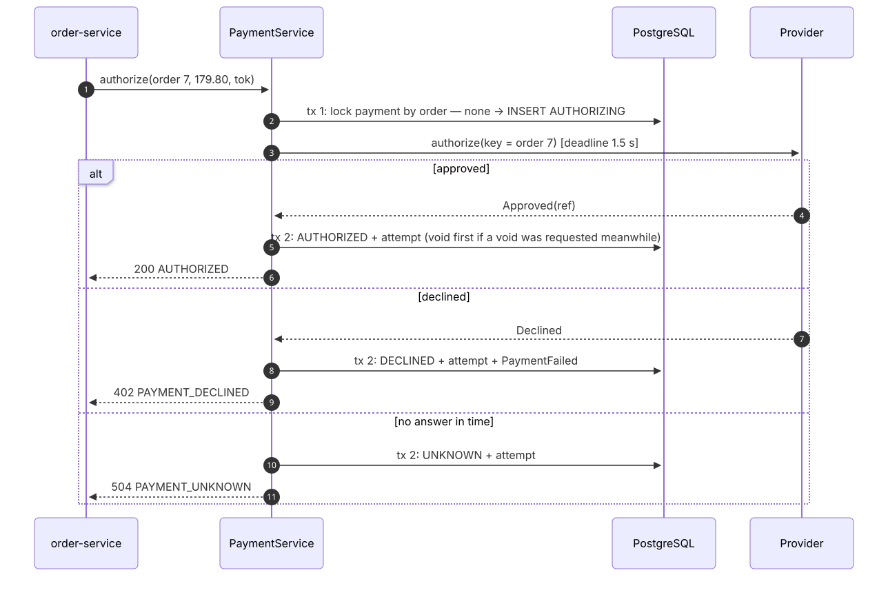
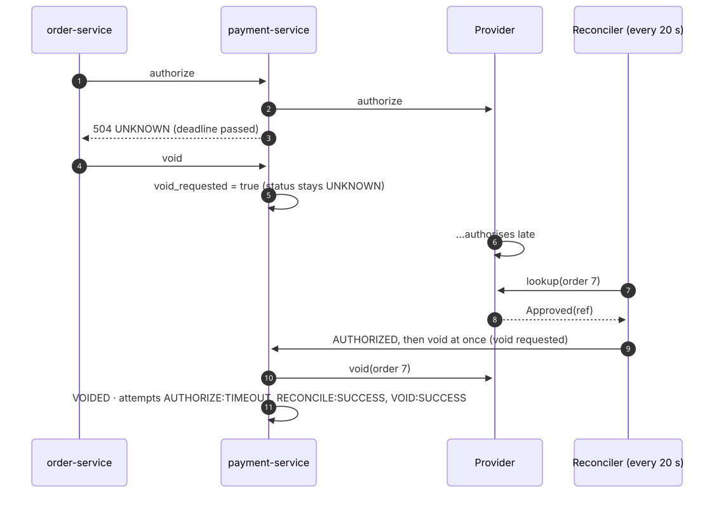

# payment-service: low-level design

Part of the [e-commerce system design](../../../design/README.md). Animated version: [walkthrough](walkthrough/index.html).

## 1. Responsibilities

| Does | Does not |
|---|---|
| Authorise, capture, void and refund through the provider | Decide whether an order proceeds (order-service) |
| Keep exactly one payment per order | See card numbers: the browser tokenises them with the provider (PCI DSS SAQ A) |
| Settle unknown outcomes and void late successes | Talk to customers |
| Keep an append-only audit trail | |

## 2. Guarantees

| Guarantee | How |
|---|---|
| **One payment per order** | `payments.order_id UNIQUE`; a repeated authorise returns the existing payment |
| **No double charge** | Every provider call carries the order id as idempotency key |
| **No charge for a cancelled order** | A void request is stored even before or during authorisation. A late success is voided at once, or by the reconciler. A payment with a void request can never be captured |
| **Nothing settled in the dark** | The intent (`AUTHORIZING`) is committed before calling the provider, so a crash leaves a row for the reconciler |
| **Full audit** | Every provider interaction is a row in `payment_attempts`; rows are never updated |
| **Events if and only if committed** | Outbox in the same transaction |

## 3. Module diagram

<picture>
  <source media="(prefers-color-scheme: dark)" srcset="diagrams/payment-service--module-diagram.dark.svg">
  
</picture>

## 4. Interaction diagram

<picture>
  <source media="(prefers-color-scheme: dark)" srcset="diagrams/payment-service--interaction-diagram.dark.svg">
  
</picture>

## 5. Class diagram

<picture>
  <source media="(prefers-color-scheme: dark)" srcset="diagrams/payment-service--class-diagram.dark.svg">
  
</picture>

## 6. Sequences

### Authorise (with the provider outside the transaction)

<picture>
  <source media="(prefers-color-scheme: dark)" srcset="diagrams/payment-service--authorise-with-the-provider-outside-the-transact.dark.svg">
  
</picture>

### Late success after a timeout

<picture>
  <source media="(prefers-color-scheme: dark)" srcset="diagrams/payment-service--late-success-after-a-timeout.dark.svg">
  
</picture>

## 7. State diagram

<picture>
  <source media="(prefers-color-scheme: dark)" srcset="diagrams/payment-service--state-diagram.dark.svg">
  
</picture>

## 8. Data model

<picture>
  <source media="(prefers-color-scheme: dark)" srcset="diagrams/payment-service--data-model.dark.svg">
  
</picture>

DDL: [`V1__payment_schema.sql`](../src/main/resources/db/migration/V1__payment_schema.sql). A check constraint allows empty
amount, currency and token only for a void recorded before any authorisation.

## 9. Background work

| Job | Runs | Interval | What it does |
|---|---|---|---|
| Reconciler | one replica (ShedLock) | 20 s | Settles `AUTHORIZING` / `UNKNOWN` payments older than 30 s by asking the provider; voids late successes; retries failed voids |
| Outbox relay | every replica | 100 ms | Publishes `payment.events` |

## 10. Scaling and performance

* **Provider-bound:** a call waits up to 1.5 s, but no database connection or transaction is held meanwhile. Virtual threads make
  waiting cheap, so 2–10 replicas cover the 500 checkouts/s peak.
* **Short transactions:** two per authorise and one per capture, void or refund.
* **Partial index:** unsettled payments are indexed separately, so the reconciler stays cheap at any table size.

## 11. Failure handling

| Failure | Behaviour |
|---|---|
| Provider slow or down | 504 `PAYMENT_UNKNOWN` within 1.5 s; order-service voids; the reconciler settles later |
| Provider down during void | Void request kept, attempt logged; the reconciler retries until voided |
| Crash after inserting `AUTHORIZING` | The reconciler asks the provider: found → authorised (or voided); not found → declined |
| Duplicate authorise | Returns the stored payment; the provider is called once |
| Capture after a void request | Rejected (`VOID_REQUESTED`), never sent to the provider |

## 12. Tests

| Test | Kind | Proves |
|---|---|---|
| `PaymentTest` | domain | Lifecycle, void blocks capture, illegal transitions, input checks |
| `PaymentServiceTest` | application with the real simulated provider | Authorise, capture, refund; one charge on repeat; decline; **late success after timeout is voided**; void before authorise blocks it; never-seen authorisation declined; captured payments refunded, not voided |
| `HexagonalArchitectureTest` | ArchUnit | Layering and adapter independence |
| `PaymentContainersIT` | PostgreSQL + Kafka | HTTP status codes per outcome, validation, late success voided with full audit trail, capture and refund idempotent and published |
