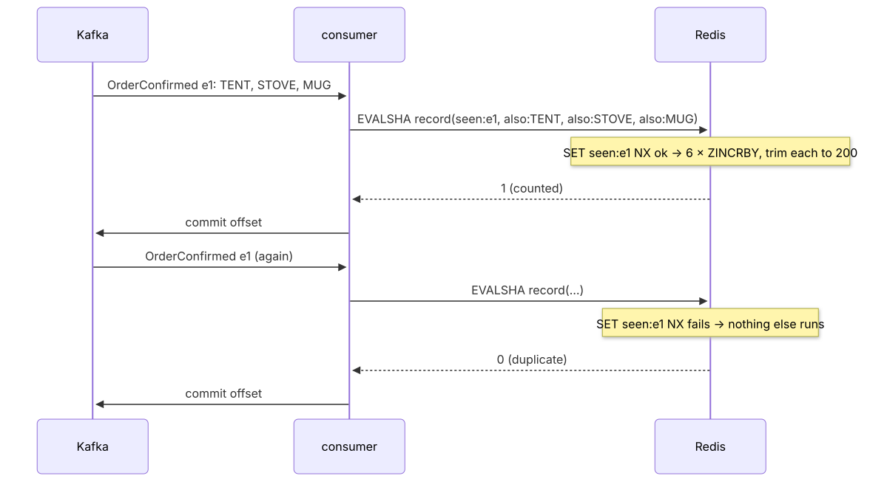
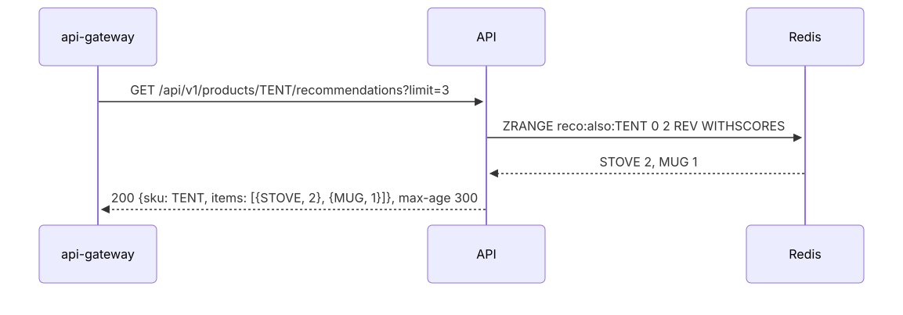

# recommendation-service: low-level design

Part of the [e-commerce system design](../../../design/README.md). Animated version: [walkthrough](walkthrough/index.html).

## 1. Responsibilities

| Does | Does not |
|---|---|
| Learn which products are bought together from confirmed orders | Personalise per customer (a later model can, from the same events) |
| Answer the top N partners of a product in one Redis read | Filter out-of-stock or archived products (the shop front hides them when it loads the products) |
| Count each order once, however often it is delivered | Store orders or customers |

## 2. Guarantees

| Guarantee | How |
|---|---|
| **Each order counts exactly once** | One Lua script: `SET reco:seen:<eventId> NX EX 14d`, and only if that succeeds, every `ZINCRBY`. Redis runs a script atomically, so a duplicate (or 20 concurrent ones) changes nothing and a crash cannot leave the order half counted or marked seen without being counted |
| **No order is skipped** | The Kafka offset is committed after the script returns. Redis down holds the partition and retries with back-off |
| **Bounded memory** | Each list keeps its 200 strongest partners (`ZREMRANGEBYRANK` in the same script); orders count at most 50 distinct products |
| **Fast reads** | `ZRANGE reco:also:<sku> 0 N-1 REV WITHSCORES`: O(log n + N); the response is cacheable for 5 minutes |
| **Optional by design** | Redis down → 503 in milliseconds; the gateway's breaker and the product page treat recommendations as optional |

The script touches one key per product in the order. On a single Redis primary (with a replica and Sentinel) that is fine. In
Redis Cluster the keys would need one hash tag, which puts the whole data set on one shard: at ~600 MB for 100 000 products that is
acceptable, and a sharded design would count per-product with idempotent increments instead.

## 3. Module diagram

<picture>
  <source media="(prefers-color-scheme: dark)" srcset="diagrams/recommendation-service--module-diagram.dark.svg">
  
</picture>

## 4. Interaction diagram

<picture>
  <source media="(prefers-color-scheme: dark)" srcset="diagrams/recommendation-service--interaction-diagram.dark.svg">
  
</picture>

## 5. Sequences

### Learn from an order (delivered twice)

<picture>
  <source media="(prefers-color-scheme: dark)" srcset="diagrams/recommendation-service--learn-from-an-order-delivered-twice.dark.svg">
  
</picture>

### Read

<picture>
  <source media="(prefers-color-scheme: dark)" srcset="diagrams/recommendation-service--read.dark.svg">
  
</picture>

## 6. Data model (Redis)

| Key | Type | Content | Expiry |
|---|---|---|---|
| `reco:also:<sku>` | Sorted set | member = other SKU, score = orders containing both | None; trimmed to the top 200 at each update |
| `reco:seen:<eventId>` | String | `1` | 14 days (twice Kafka's retention) |

Ties are returned in Redis order: equal scores by SKU, descending.

## 7. Scaling and performance

* **Writes:** an order with k distinct products costs k·(k−1) increments in one script; a typical order (k ≤ 5) is under 20
  operations, well under a millisecond.
* **Reads:** one Redis round trip; 2–6 pods behind the gateway, plus a 5-minute cache at the edge and in browsers.
* **Consumer:** one consumer per pod in group `recommendation-service`, up to the 12 partitions of `order.events`.

## 8. Failure handling

| Failure | Behaviour |
|---|---|
| Redis down | Reads: 503 at once. Learning: the event is retried with back-off up to 30 s; the offset waits |
| Kafka down | Reads unaffected; learning resumes from the committed offset |
| Crash mid-script | Impossible to observe half: Redis applies the whole script or none of it |
| Unreadable event | `order.events.dlq` with an `x-reason` header |

## 9. Tests

| Test | Kind | Proves |
|---|---|---|
| `test_domain.py` | domain | Distinct SKUs and all ordered pairs; single-product orders and other events teach nothing; broken events rejected; huge orders capped at 50 |
| `test_app.py` | use cases with fakes | Same event twice counts once; ranking by count; bad events dead-lettered; store errors propagate (so the offset is not committed); limit bounded |
| `test_http.py` | API | Shape and cache header; empty list for unknown products; 400 for bad SKU and limit; 503 problem with `Retry-After` when Redis is down |
| `test_architecture.py` | import boundaries | Domain and use cases import no framework or adapter; adapters independent |
| `test_containers.py` | Redis + Kafka | Three copies of one order count once; ranking; single-product order ignored; garbage on the DLQ with its reason; API reads the same sets; 20 concurrent duplicate scripts count once; seen key expires; lists trimmed |
