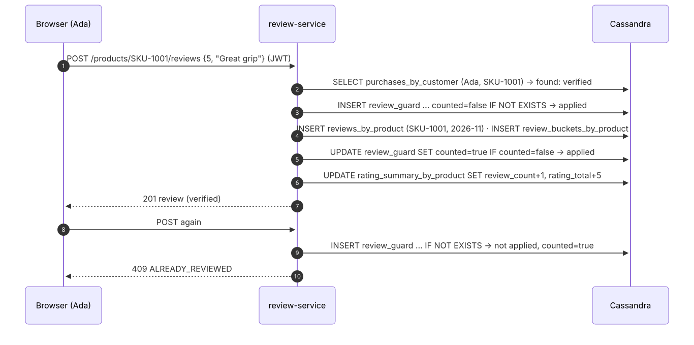
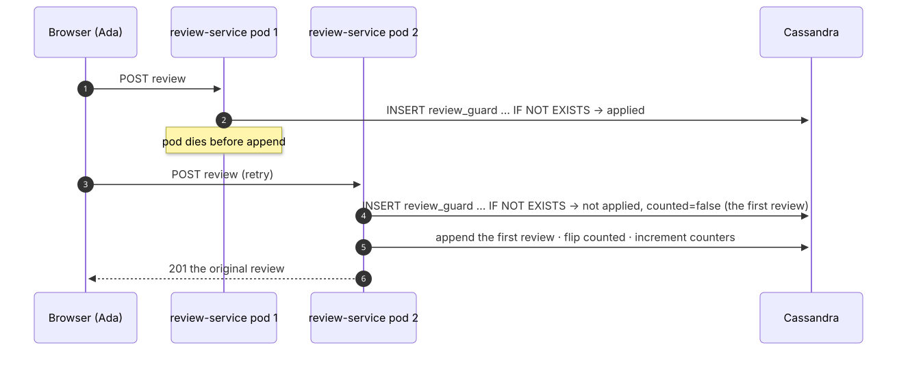

# review-service: low-level design

Part of the [e-commerce system design](../../../design/README.md). Animated version: [walkthrough](walkthrough/index.html).

## 1. Responsibilities

| Does | Does not |
|---|---|
| Store reviews and show them newest first, with a rating summary | Moderate text (a future moderation step would sit before `append`) |
| Allow one review per customer per product | Check that the SKU exists (the gateway only links reviews from product pages) |
| Mark reviews as verified purchases | Call order-service: purchases arrive as events |

## 2. Guarantees

| Guarantee | How |
|---|---|
| **One review per customer per product** | `INSERT INTO review_guard … IF NOT EXISTS`, a lightweight transaction (Paxos): of any number of concurrent attempts, one wins |
| **Counters never double-count** | Only the caller whose `UPDATE review_guard SET counted = true IF counted = false` succeeds increments the counters |
| **A crash half-way is not a dead end** | The guard row holds the whole review. A retry that finds an uncounted claim finishes it (append, count) and answers 201 with the original review |
| **Verified means bought before reviewing** | `purchases_by_customer` is filled from `OrderConfirmed`; the flag is set when the review is written |
| **Bounded partitions** | Reviews are partitioned by product **and month**; a bucket list per product lets paging continue into older months |
| **Duplicate purchase events are harmless** | Recording a purchase is an upsert |

The one failure that is not repaired: a crash after the flag flips and before the counter update leaves the summary one review
short. That is deliberate: of the two possible errors (one too few, one too many), one too few is the safer, and it is rare.

## 3. Module diagram

<picture>
  <source media="(prefers-color-scheme: dark)" srcset="diagrams/review-service--module-diagram.dark.svg">
  
</picture>

## 4. Interaction diagram

<picture>
  <source media="(prefers-color-scheme: dark)" srcset="diagrams/review-service--interaction-diagram.dark.svg">
  
</picture>

## 5. Sequences

### Post a review

<picture>
  <source media="(prefers-color-scheme: dark)" srcset="diagrams/review-service--post-a-review.dark.svg">
  
</picture>

### A retry after a crash

<picture>
  <source media="(prefers-color-scheme: dark)" srcset="diagrams/review-service--a-retry-after-a-crash.dark.svg">
  
</picture>

## 6. Data model (Cassandra)

Schema: [schema.cql](../src/main/resources/cassandra/schema.cql), applied at start-up (every statement `IF NOT EXISTS`).

| Table | Partition key | Clustering | Query |
|---|---|---|---|
| `reviews_by_product` | `(sku, bucket)` | `created_at DESC, review_id DESC` | Newest reviews of a product in one month; `(created_at, review_id) < (…)` continues a page |
| `review_buckets_by_product` | `sku` | `bucket DESC` | Which months hold reviews, newest first |
| `rating_summary_by_product` | `sku` | | `review_count`, `rating_total` counters; average = total ÷ count |
| `purchases_by_customer` | `customer_id` | `sku` | Has this customer bought this product? |
| `review_guard` | `(sku, customer_id)` | | The claim: the review, and `counted` |

Consistency: `LOCAL_QUORUM` for reads and writes, `LOCAL_SERIAL` for lightweight transactions.

## 7. Scaling and performance

* **Pods:** stateless, 2–10 replicas.
* **Reads:** a page is one or a few single-partition reads plus one counter read. Partitions stay small because of month buckets.
* **Writes:** two lightweight transactions per review (about four round trips each). Reviews are rare compared with reads, so this
  cost buys correctness cheaply.
* **Hot products:** a product with thousands of reviews a month still writes to one partition per month; a smaller bucket (week)
  is a schema change in one place (`Review.bucketOf`).

## 8. Failure handling

| Failure | Behaviour |
|---|---|
| Cassandra node down (of 3) | `LOCAL_QUORUM` still succeeds |
| Cassandra unavailable | Requests fail with 500; the `OrderConfirmed` consumer retries with back-off, without skipping |
| Pod dies while posting | The retry finishes the review (see 5) |
| Kafka down when publishing ReviewPosted | Logged; the review is stored and counted. Consumers can rebuild from `rating_summary_by_product` |
| Unreadable order event | Sent to `order.events.dlq` |

## 9. Tests

| Test | Kind | Proves |
|---|---|---|
| `ReviewTest` | domain | Rating, title and body rules; month buckets; average to one decimal |
| `ReviewServiceTest` | application | Second review rejected; verified only after a purchase; a crash before each step, then a retry: the review is finished once and counted at most once; paging across three month buckets, newest first |
| `HexagonalArchitectureTest` | ArchUnit | Layering |
| `ReviewContainersIT` | Cassandra + Kafka | `OrderConfirmed` → verified badge; 409 on the second review; summary and order; `ReviewPosted` on Kafka; **10 concurrent posts by one customer → exactly one review counted**; cursor paging; 401 and 400 |
