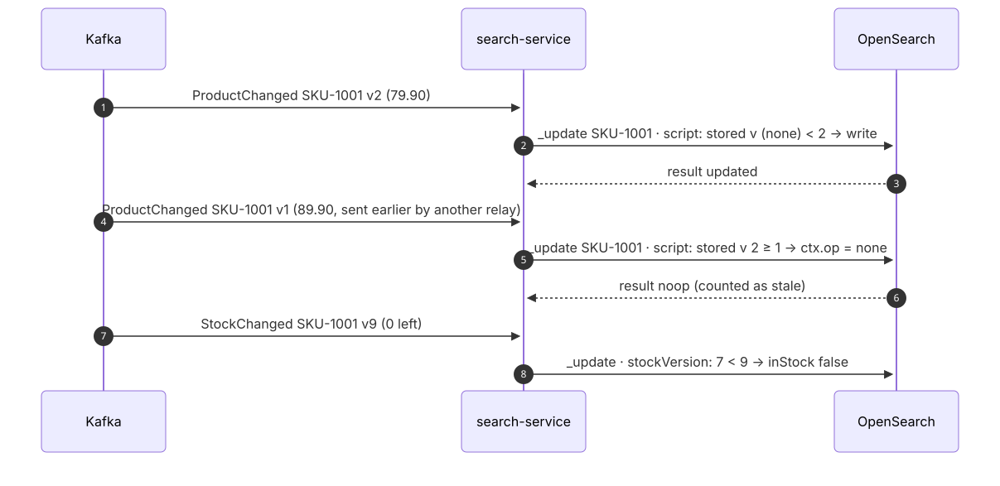
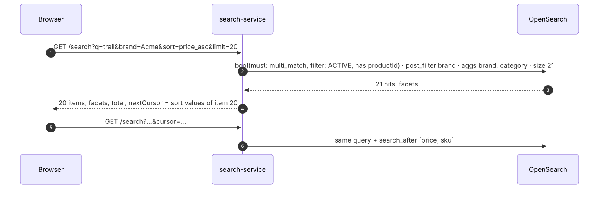

# search-service: low-level design

Part of the [e-commerce system design](../../../design/README.md). Animated version: [walkthrough](walkthrough/index.html).

## 1. Responsibilities

| Does | Does not |
|---|---|
| Keep a searchable copy of every product with its availability | Own product or stock data: the catalogue and inventory do |
| Answer full-text queries with filters, facets, sorting and cursor pages | Show drafts or archived products |
| Apply catalogue and stock events in any order, any number of times | Call other services: everything it needs arrives in events |

## 2. Guarantees

| Guarantee | How |
|---|---|
| **Out-of-order events never overwrite newer data** | Each document stores `catalogVersion` and `stockVersion`. A painless scripted upsert applies a write only if its version is higher, otherwise the result is `noop` |
| **No dedupe table needed** | A repeated event carries a version that is not higher, so it is a no-op |
| **Two sources, one document** | Product and stock events touch different fields of the same document (id = SKU), each guarded by its own version. Plain `version_type=external` cannot do this: it allows only one version per document |
| **A stock event before its product is not lost** | It creates the document with stock fields only; queries require `productId`, so it stays hidden until the product arrives |
| **No event skipped while OpenSearch is down** | The Kafka error handler retries the same record with back-off (up to 30 s apart) without limit; the partition waits |
| **Poison events do not block** | Unreadable events go straight to `<topic>.dlq` |
| **Stable pages** | `search_after` with a tie-breaker on SKU: deep pages cost the same as the first, and no item appears twice |

## 3. Module diagram

<picture>
  <source media="(prefers-color-scheme: dark)" srcset="diagrams/search-service--module-diagram.dark.svg">
  
</picture>

## 4. Interaction diagram

<picture>
  <source media="(prefers-color-scheme: dark)" srcset="diagrams/search-service--interaction-diagram.dark.svg">
  
</picture>

## 5. Sequences

### A late event arrives

<picture>
  <source media="(prefers-color-scheme: dark)" srcset="diagrams/search-service--a-late-event-arrives.dark.svg">
  
</picture>

### Search with facets and a cursor

<picture>
  <source media="(prefers-color-scheme: dark)" srcset="diagrams/search-service--search-with-facets-and-a-cursor.dark.svg">
  
</picture>

## 6. Index design

Mapping: [products-v1.json](../src/main/resources/opensearch/products-v1.json) (`dynamic: strict`).

| Field | Type | From |
|---|---|---|
| `productId`, `sku`, `category`, `brand`, `status`, `currency` | keyword | ProductChanged |
| `name` (+ `name.raw`), `description` | text, English analyser | ProductChanged |
| `price` | scaled_float × 100 | ProductChanged |
| `attributes` | flat_object | ProductChanged |
| `image` | keyword, not indexed | first image key |
| `updatedAt` | date | event `occurredAt` |
| `catalogVersion` | long | ProductChanged |
| `available`, `inStock`, `stockVersion` | integer, boolean, long | StockChanged |

**Mapping changes:** create `products-v2`, start a consumer group that replays both topics from the earliest offset into it, then
move the alias in one `_aliases` call. Readers and writers only ever use the alias.

## 7. Scaling and performance

* **Pods:** stateless, 2–10 replicas; listener concurrency 3 per pod, up to the 12 partitions of each topic.
* **Index:** 3 shards, 1 replica, 1 s refresh: a change is searchable about a second after it is indexed.
* **Queries:** filters run in filter context (cached, not scored); `track_total_hits` gives exact counts for the facet UI.
* **Writes:** one `_update` per event with `retry_on_conflict=5`, because product and stock writes for the same SKU can meet.

## 8. Failure handling

| Failure | Behaviour |
|---|---|
| OpenSearch down | Search answers 503 `SEARCH_UNAVAILABLE` with `Retry-After: 5`; product pages still work from the catalogue. Indexing pauses and resumes from the same offset |
| OpenSearch down at start-up | The service does not start (the index and alias must exist before any write, or OpenSearch would create an index with a guessed mapping) |
| Unreadable event | Sent to `<topic>.dlq` at once; the partition moves on |
| Duplicate or late event | `noop`, counted in `search_events_stale` |
| Index lost | Rebuilt by replaying `catalog.events` (and its compacted mirror) and `inventory.events` |

## 9. Tests

| Test | Kind | Proves |
|---|---|---|
| `SearchQueryTest` | domain | Defaults, limits, price range, sort parsing; no text means newest first |
| `EventParserTest` | adapter | Envelopes become documents and stock updates; other types skipped; malformed events marked for the DLQ |
| `IndexerTest` | application | Late and repeated events are dropped and counted |
| `HexagonalArchitectureTest` | ArchUnit | Layering |
| `SearchContainersIT` | OpenSearch + Kafka | Stock before product, product v2 before v1, stock 9 before 8: the newest data wins; brand facet still lists every brand while filtering; price range; five items in three cursor pages, sorted, no duplicates; invalid cursor 400; unreadable event on the DLQ |
